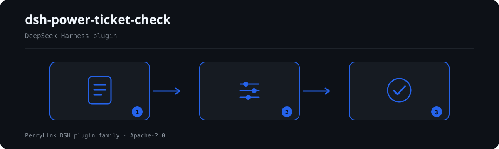

# dsh-power-ticket-check — Verificación de la completitud del permiso de trabajo eléctrico y del orden de emisión, autorización y cierre

[English](README.md) · [简体中文](README-zh.md) · [Español](README-es.md) · [Português](README-pt.md) · [हिन्दी](README-hi.md)

```sh
dsh plugin --profile <name> add dsh-power-ticket-check
```


[](https://dsh.market/)
[](https://dshfind.com/en/plugins/PerryLink/dsh-power-ticket-check?ref=badge)

`dsh-power-ticket-check` lee un **电力工作票** como un mapa plano de los nombres de columna del propio formulario a sus valores, junto con los roles que figuran en él, y comprueba lo que puede exigirse a un formulario: que estén rellenas todas las columnas de su `requiredFields` configurado, que el 工作票种类 figure entre los que declara su implantación, que 签发时间 → 许可时间 → 终结时间 formen una secuencia físicamente posible, que un 延期时间 desplace el final hacia adelante y no sea anterior a la autorización, que los roles configurados como exclusivos los desempeñen personas distintas, y que el texto de medidas de seguridad y de autorización contenga los cinco términos de 安全技术措施 y los tres de 许可手续 que el paquete busca. Las comprobaciones que no pudieron ejecutarse se listan en `skipped` con su motivo, en lugar de pasar en silencio.

## Install

```sh
dsh plugin --profile <name> add dsh-power-ticket-check
dsh --profile <name> --dump-config | grep 'dsh-power-ticket-check'
```

## Cómo se ve la salida



*Resumen del flujo: documento → reglas → hallazgos. Los ejemplos siguientes usan la superficie de comandos real.*


Salida real de este plugin sobre su propio fixture de prueba `PT-003` — no es un montaje. El paquete de reglas no inventa citas, así que cada hallazgo nombra la cláusula aplicada y advierte que su texto no se obtuvo.

## Qué responde

### Ejemplos

La tabla siguiente es el conjunto de ejemplos: la primera fila es el caso detallado y las demás son casos breves.


| Usted pregunta | Qué responde |
|---|---|
| Tal como viene, aprueba todos los permisos que le paso, ¿por qué? | Porque `PT-001` se declara a sí misma en `skipped`, no como aprobado. Su lista `requiredFields` viene vacía, así que la regla no puede ejecutarse; rellénela con las columnas que exige su propio formulario. Aun configurada, `PT-001` comprueba que la columna esté rellena, no que el valor sea correcto, y su nivel es `info`. |
| El permiso es un 电气第一种工作票 pero la 工作性质 menciona 带电作业, ¿se informa de esa contradicción? | No. `PT-002` informa solo de dos cosas: que falte el 工作票种类, o que no esté entre los tipos que declara su implantación. Su lista `ticketKinds` viene vacía y entonces la regla se declara en `skipped`, igual que `PT-005` cuando su lista `exclusiveRolePairs` está vacía; el plugin no decide qué tipo de permiso necesita un trabajo. Una vez rellene esas listas, configure `PT-005` con el par 工作许可人 y 工作负责人 para que se informe de la misma persona en ambas columnas. Ninguna de las dos reglas juzga la cualificación de nadie ni si se aprobó desempeñar dos roles. |
| El 许可时间 figura antes del 签发时间, y además una columna de tiempo no se puede analizar. | `PT-003` informa de ambas cosas: del 许可时间 anterior al 签发时间, del 终结时间 anterior al 许可时间, y de cualquier columna ilegible como 无法解析为日期时间, esperando una forma como `2026-03-15 08:30`. Ambos extremos se convierten a un recuento absoluto de minutos, así que un permiso que cruza la medianoche se compara bien. Si el 签发时间 o el 许可时间 no se pueden leer en absoluto, la regla se declara en `skipped`, porque la comprobación del orden no puede establecerse. Nunca comprueba si el trabajo siguió realmente el permiso, y el límite opcional de intervalo o de duración lo configura usted. |
| El 延期时间 es anterior al 计划结束时间, así que la prórroga acorta el trabajo en vez de alargarlo. | `PT-004` lo informa, y también informa de un 延期时间 anterior al 许可时间. La norma no fija ningún tope a cuánto ni a cuántas veces puede prorrogarse un permiso, así que la regla no lleva límite cuantitativo ni comprueba si se completaron los trámites de prórroga. |
| La columna 安全措施 está rellena, pero solo menciona 停电 y 验电. | `PT-006` informa de los tres términos que faltan, uno por uno. Es la única regla de nivel `error` aquí, porque su cláusula 6.1.1 está en el capítulo obligatorio, y comprueba que las cinco medidas estén escritas en el permiso, no que coincidan con el lugar ni que se hayan ejecutado. Si no encuentra ninguna columna de medidas legible, se declara en `skipped`. |
| Nada en el permiso muestra que el 工作许可人 volviera al lugar con el 工作负责人. | `PT-007` informa de cuáles de los tres términos de las formalidades de autorización faltan en el texto que lee, y ese texto son las `permitColumns` más los nombres de las columnas de rol. Solo lee la redacción: no puede saber si la revisión del lugar ocurrió de verdad, y una institución que quiera que esto bloquee puede subir el nivel de la regla en el paquete sin tocar el código. |

## Normas que sigue

| Documento | Número | Reglas que lo citan |
|---|---|---|
| 《电力安全工作规程 发电厂和变电站电气部分》 | GB 26860—2011 | PT-001, PT-002, PT-003, PT-004, PT-005, PT-006, PT-007 |

**Boundary:** this plugin checks one **电力工作票** for what a form can be held to — that the required
boxes are filled, that 签发 / 许可 / 终结 happened in an order that is physically possible, that 延期
moves the end forward, and that roles you require to be separate are held by different people. It does
**not** judge whether the safety measures written on the ticket were adequate, **does not** say which
kind of ticket a job needs, and **does not** verify that anyone's qualification is real.

> ### ⚠️ Three things this plugin refuses to do, and the effect tier that fixes its severities
>
> **1. It respects the standard's own effect tier.** GB 26860—2011's foreword says, verbatim,
> 「本标准的第5章和7.3.4为推荐性，其余为强制性」 — **the work-ticket regime sits in the *recommendatory*
> chapter 5.** So every rule resting on chapter 5 ships at `warn` or `info` and **nothing there can block a
> workflow**. `PT-006` (the five safety technical measures, clause 6.1.1) is the **only** `error`, because
> chapter 6 is mandatory. `PT-007` (the permit formalities, clause 5.5.1) is a `warn`; its note explains that
> an institution which wants those formalities to block can raise it by editing the rule pack, with no code
> change. A test asserts both directions: no chapter-5 rule is an `error`, and `PT-006` is the sole one.
>
> **2. It does not adopt three claims that have no basis in the standards.** After reading GB 26860—2011
> and GB 26859—2011 in full: there is **no** "第一种工作票应工作前一日送达" deadline anywhere; 5.3.12 and
> 5.4.10 say only 「延期应办理手续」 with **no ceiling on duration or count**; and the statutory name is
> **紧急抢修单** (5.2.4), not "事故应急抢修单". A test asserts the pack records all three.
>
> **3. It does not treat the ticket layout as mandatory.** 5.1.2 says the ticket "**可**包含" those items,
> and appendices A–D are marked **资料性附录** (informative) in the standard's contents. So `PT-001` ships
> with an **empty** field list for you to fill from your own form, and reports at `info`.
>
> Two more lists are yours: `PT-002`'s ticket kinds and `PT-005`'s exclusive role pairs. Both ship empty.
> The plugin never judges whether the safety measures written on a ticket were adequate, which ticket
> kind a job needs, or whether anyone's qualification is real — the standard sets out roles' **duties**
> (5.4.1–5.4.5) and **no qualification conditions**.

## Compatibility

| Superficie | Estado |
|---|---|
| Harness | Rango de peers `>=0.1.2-rc.1 <0.2.0 \|\| >=0.2.0-0 <0.3.0` — verificado para aceptar tanto `0.2.0-rc.2` como `0.2.1-rc.2`. **`engines.dsh` se declara como `>=0.2.1-0 <0.3.0`** y el host lo aplica desde 0.2.1 |
| Node | `^22.19.0 || >=24.0.0` |
| Plataformas | Todas (ESM puro; sin código nativo, sin red, sin llamada al modelo) |
| Modo de herramienta | Funciona en `native` y `ptc`; para un directorio completo use `ptc` |

## What it does

La tabla de reglas, los campos y el comportamiento detallado están en [README.md](README.md#what-it-does) (versión principal en inglés). El plugin sólo enumera divergencias literales frente a las cláusulas citadas e indica en `skipped` cada comprobación que no pudo ejecutarse.

## Configuration

Todos los parámetros ajustables viven en el esquema Schemastery de `src/config.ts`, por lo que se cambian desde `cordis.yml` sin tocar el código; los umbrales por regla están en el paquete de reglas bajo `rules/`.

| Clave | Tipo | Predeterminado | Descripción |
|---|---|---|---|
| `rulesFile` | string | `rules/power-ticket-check.yaml` | Ruta del paquete de reglas, relativa a la raíz del paquete |
| `disabledRules` | string[] | `[]` | Ids de reglas que se dejan de ejecutar; cada una aparece en `skipped` |
| `onlyRules` | string[] | `[]` | Ejecutar solo estas reglas; vacío ejecuta todas |
| `skipNotes` | string | `""` | Nota añadida a cada motivo de `skipped` |
| `timeoutMs` | number | `120000` | Presupuesto de tiempo de espera cooperativo de la herramienta |

## Material format

Acepta JSON o YAML. El ejemplo completo de campos está en [README.md](README.md#material-format) (versión principal en inglés). Los campos son opcionales en la capa de lectura y los valida el motor, de modo que una exportación parcial produce hallazgos sobre lo que falta en lugar de un fallo.

## Rule sources

Los datos de las reglas están separados del código: cada regla lleva documento, número, cláusula en la numeración propia de la fuente, extracto literal y URL de origen. El cargador impone que el extracto sea una cita real de al menos ocho caracteres y que una comprobación basada sólo en un principio general (`kind: derived-from-principle`, tope `warn`) o en una política local (`kind: institutional-configuration`, tope `info`) nunca se declare `error`.

Los límites verificados y las conclusiones deliberadamente **no** afirmadas están en [README.md](README.md#rule-sources) (versión principal en inglés) y en `rules/evidence/`.

## Troubleshooting

- **El plugin se instala pero la herramienta no aparece**: compruebe que `main` resuelve a `lib/index.mjs` y que `pnpm run build` lo generó.
- **`dsh plugin add` rechaza el paquete**: la faixa de peers cubre `0.1.x` y `0.2.x`; fuera de ella, conceda una exención explícita con `dsh plugin --profile <name> allow-version <pkg@ver> --dsh-version <runtime> --accept-risk`.
- **Una regla no se ejecutó**: lea el arreglo `skipped`.
- **`check` informa `manifest-peers` como fallo**: es un problema conocido de `dsh-plugin-dev`; el runtime aplica la compatibilidad al instalar.
- **Los horarios parecen desplazados**: toda la aritmética es de hora local sobre las cadenas entregadas.

## Development

```sh
pnpm install
pnpm run typecheck
pnpm test
pnpm run build
node ../scripts/sync-shared.mjs dsh-power-ticket-check
```

El último comando copia el kit compartido de `../_shared` a `src/shared/`; vuelva a ejecutarlo tras cada cambio compartido.

## PerryLink DSH Plugin Family

Este proyecto forma parte de la familia de plugins de DeepSeek Harness de [PerryLink](https://github.com/PerryLink). El registro permanece plegado abajo para que cada README conserve una primera pantalla corta; expándelo para ver cada fila y su estado.

<details>
<summary>Expandir todos los plugins</summary>

| Plugin | Estado |
|---|---|
| **[dsh-aqua-input-check](https://github.com/PerryLink/dsh-aqua-input-check)** |  |
| **[dsh-archive-check](https://github.com/PerryLink/dsh-archive-check)** |  |
| **[dsh-auto-review](https://github.com/PerryLink/dsh-auto-review)** |  |
| **[dsh-autotier](https://github.com/PerryLink/dsh-autotier)** |  |
| **[dsh-bid-ca-precheck](https://github.com/PerryLink/dsh-bid-ca-precheck)** |  |
| **[dsh-bid-qual-check](https://github.com/PerryLink/dsh-bid-qual-check)** |  |
| **[dsh-cert-mcp](https://github.com/PerryLink/dsh-cert-mcp)** |  |
| **[dsh-checkpoint-rewind](https://github.com/PerryLink/dsh-checkpoint-rewind)** |  |
| **[dsh-click](https://github.com/PerryLink/dsh-click)** |  |
| **[dsh-composer-history](https://github.com/PerryLink/dsh-composer-history)** |  |
| **[dsh-contract-stance](https://github.com/PerryLink/dsh-contract-stance)** |  |
| **[dsh-customs-doc-check](https://github.com/PerryLink/dsh-customs-doc-check)** |  |
| **[dsh-data-quality](https://github.com/PerryLink/dsh-data-quality)** |  |
| **[dsh-demurrage-ledger](https://github.com/PerryLink/dsh-demurrage-ledger)** |  |
| **[dsh-doublecheck](https://github.com/PerryLink/dsh-doublecheck)** |  |
| **[dsh-drill-script-check](https://github.com/PerryLink/dsh-drill-script-check)** |  |
| **[dsh-eia-guide-check](https://github.com/PerryLink/dsh-eia-guide-check)** |  |
| **[dsh-emergency-plan](https://github.com/PerryLink/dsh-emergency-plan)** |  |
| **[dsh-essay-rubric-check](https://github.com/PerryLink/dsh-essay-rubric-check)** |  |
| **[dsh-evidence-check](https://github.com/PerryLink/dsh-evidence-check)** |  |
| **[dsh-export-ctl-check](https://github.com/PerryLink/dsh-export-ctl-check)** |  |
| **[dsh-fast](https://github.com/PerryLink/dsh-fast)** |  |
| **[dsh-fmea-table-check](https://github.com/PerryLink/dsh-fmea-table-check)** |  |
| **[dsh-forecast-penalty](https://github.com/PerryLink/dsh-forecast-penalty)** |  |
| **[dsh-fund-research](https://github.com/PerryLink/dsh-fund-research)** |  |
| **[dsh-github](https://github.com/PerryLink/dsh-github)** |  |
| **[dsh-gongwen-flow-check](https://github.com/PerryLink/dsh-gongwen-flow-check)** |  |
| **[dsh-gongwen-word-check](https://github.com/PerryLink/dsh-gongwen-word-check)** |  |
| **[dsh-guard-plan-qc](https://github.com/PerryLink/dsh-guard-plan-qc)** |  |
| **[dsh-hazchem-check](https://github.com/PerryLink/dsh-hazchem-check)** |  |
| **[dsh-hazplan-check](https://github.com/PerryLink/dsh-hazplan-check)** |  |
| **[dsh-hidden-risk-map](https://github.com/PerryLink/dsh-hidden-risk-map)** |  |
| **[dsh-hs-classify](https://github.com/PerryLink/dsh-hs-classify)** |  |
| **[dsh-icd-rule-check](https://github.com/PerryLink/dsh-icd-rule-check)** |  |
| **[dsh-industry-research](https://github.com/PerryLink/dsh-industry-research)** |  |
| **[dsh-lawcite-adapter](https://github.com/PerryLink/dsh-lawcite-adapter)** |  |
| **[dsh-laya](https://github.com/PerryLink/dsh-laya)** |  |
| **[dsh-lc-doc-check](https://github.com/PerryLink/dsh-lc-doc-check)** |  |
| **[dsh-learning-gap-check](https://github.com/PerryLink/dsh-learning-gap-check)** |  |
| **[dsh-library](https://github.com/PerryLink/dsh-library)** |  |
| **[dsh-local-ai](https://github.com/PerryLink/dsh-local-ai)** |  |
| **[dsh-lsp-actions](https://github.com/PerryLink/dsh-lsp-actions)** |  |
| **[dsh-mask](https://github.com/PerryLink/dsh-mask)** |  |
| **[dsh-mcp-panel](https://github.com/PerryLink/dsh-mcp-panel)** |  |
| **[dsh-medrec-qc](https://github.com/PerryLink/dsh-medrec-qc)** |  |
| **[dsh-memento](https://github.com/PerryLink/dsh-memento)** |  |
| **[dsh-nsfc-form-check](https://github.com/PerryLink/dsh-nsfc-form-check)** |  |
| **[dsh-nurse-record-check](https://github.com/PerryLink/dsh-nurse-record-check)** |  |
| **[dsh-observe](https://github.com/PerryLink/dsh-observe)** |  |
| **[dsh-origin-rvc-check](https://github.com/PerryLink/dsh-origin-rvc-check)** |  |
| **[dsh-ota-review-check](https://github.com/PerryLink/dsh-ota-review-check)** |  |
| **[dsh-output-styles](https://github.com/PerryLink/dsh-output-styles)** |  |
| **[dsh-paper-doc-adapter](https://github.com/PerryLink/dsh-paper-doc-adapter)** |  |
| **[dsh-permission-rules](https://github.com/PerryLink/dsh-permission-rules)** |  |
| **[dsh-permit-report-check](https://github.com/PerryLink/dsh-permit-report-check)** |  |
| **[dsh-pipeline-check](https://github.com/PerryLink/dsh-pipeline-check)** |  |
| **[dsh-pleading-draft](https://github.com/PerryLink/dsh-pleading-draft)** |  |
| **[dsh-plugin-doctor](https://github.com/PerryLink/dsh-plugin-doctor)** |  |
| **[dsh-plugin-guide](https://github.com/PerryLink/dsh-plugin-guide)** |  |
| **[dsh-plugin-kit](https://github.com/PerryLink/dsh-plugin-kit)** |  |
| **[dsh-plugin-upgrade](https://github.com/PerryLink/dsh-plugin-upgrade)** |  |
| **[dsh-policy-brief-draft](https://github.com/PerryLink/dsh-policy-brief-draft)** |  |
| **[dsh-power-loss-split](https://github.com/PerryLink/dsh-power-loss-split)** |  |
| **[dsh-power-ticket-check](https://github.com/PerryLink/dsh-power-ticket-check)** |  |
| **[dsh-ppap-check](https://github.com/PerryLink/dsh-ppap-check)** |  |
| **[dsh-protest-deadline](https://github.com/PerryLink/dsh-protest-deadline)** |  |
| **[dsh-railway-window](https://github.com/PerryLink/dsh-railway-window)** |  |
| **[dsh-repair-order-qc](https://github.com/PerryLink/dsh-repair-order-qc)** |  |
| **[dsh-research-report](https://github.com/PerryLink/dsh-research-report)** |  |
| **[dsh-review-reply-check](https://github.com/PerryLink/dsh-review-reply-check)** |  |
| **[dsh-rulefile-check](https://github.com/PerryLink/dsh-rulefile-check)** |  |
| **[dsh-safety-brief-check](https://github.com/PerryLink/dsh-safety-brief-check)** |  |
| **[dsh-score](https://github.com/PerryLink/dsh-score)** |  |
| **[dsh-session-sync](https://github.com/PerryLink/dsh-session-sync)** |  |
| **[dsh-site-log-check](https://github.com/PerryLink/dsh-site-log-check)** |  |
| **[dsh-skill-pack-security](https://github.com/PerryLink/dsh-skill-pack-security)** |  |
| **[dsh-soe-decision-check](https://github.com/PerryLink/dsh-soe-decision-check)** |  |
| **[dsh-soilwater-check](https://github.com/PerryLink/dsh-soilwater-check)** |  |
| **[dsh-sop-sync-check](https://github.com/PerryLink/dsh-sop-sync-check)** |  |
| **[dsh-spc-gbt-adapter](https://github.com/PerryLink/dsh-spc-gbt-adapter)** |  |
| **[dsh-talk](https://github.com/PerryLink/dsh-talk)** |  |
| **[dsh-tender-extract](https://github.com/PerryLink/dsh-tender-extract)** |  |
| **[dsh-tender-matrix](https://github.com/PerryLink/dsh-tender-matrix)** |  |
| **[dsh-test-drive](https://github.com/PerryLink/dsh-test-drive)** |  |
| **[dsh-ticktick](https://github.com/PerryLink/dsh-ticktick)** |  |
| **[dsh-translate](https://github.com/PerryLink/dsh-translate)** |  |
| **[dsh-warranty-calc](https://github.com/PerryLink/dsh-warranty-calc)** |  |
| **[dsh-budget](https://github.com/PerryLink/dsh-budget)** | 🧊 CONGELADO — ver el README del repositorio |
| **[dsh-claude-move](https://github.com/PerryLink/dsh-claude-move)** | 🧊 CONGELADO — ver el README del repositorio |
| **[dsh-defend](https://github.com/PerryLink/dsh-defend)** | 🧊 CONGELADO — ver el README del repositorio |
| **[dsh-draw](https://github.com/PerryLink/dsh-draw)** | 🧊 CONGELADO — ver el README del repositorio |
| **[dsh-reach](https://github.com/PerryLink/dsh-reach)** | 🧊 CONGELADO — ver el README del repositorio |
| **[dsh-background-agents](https://github.com/PerryLink/dsh-background-agents)** | 🚫 RETIRADO — ver el README del repositorio |
| **[dsh-session-pin](https://github.com/PerryLink/dsh-session-pin)** | 🚫 RETIRADO — ver el README del repositorio |
| **[dsh-team-rooms](https://github.com/PerryLink/dsh-team-rooms)** | 🚫 RETIRADO — ver el README del repositorio |

</details>

## License

[Apache License 2.0](LICENSE) © 2026 dsh-power-ticket-check contributors.
