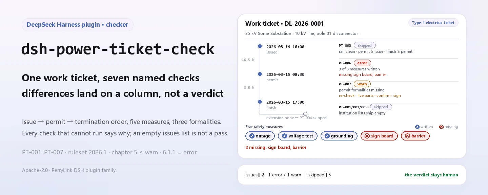
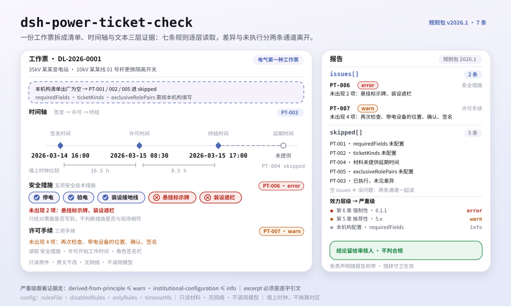

<div align="center">

<picture>
  <source media="(prefers-color-scheme: dark)" srcset="docs/assets/dsh-power-ticket-check-hero-en-dark.webp">
  
</picture>

# dsh-power-ticket-check

**Hand it one power work ticket and get back a list of which column is short, what is missing, and how to fix it — the compliance verdict stays with the reviewer.**

A data-only checker plugin for DeepSeek Harness: it reads one power work ticket (a flat mapping of the ticket's own column names to their values), applies the versioned rule pack it ships (PT-001..PT-007), and checks completeness plus the issue → permit → termination time order. It lists only the differences it can point to inside the material — never a compliance verdict, never a liability finding.

[Install](#three-step-setup) · [Configuration](#configuration) · [FAQ](#faq) · [简体中文](README.md) · [English](README.en.md) · [Español](README.es.md) · [Português](README.pt.md) · [हिन्दी](README.hi.md)

[](LICENSE)
[](#compatibility)
[](https://www.npmjs.com/package/dsh-power-ticket-check)
[](https://github.com/PerryLink/dsh-power-ticket-check/actions/workflows/ci.yml)
[](#compatibility)

[](https://github.com/PerryLink/dsh-power-ticket-check/stargazers)
[](https://www.npmjs.com/package/dsh-power-ticket-check)
[](https://dshfind.com/plugins/PerryLink/dsh-power-ticket-check?ref=badge)
[](https://securityscorecards.dev/viewer/?uri=github.com/PerryLink/dsh-power-ticket-check)
[](https://dsh.market/)
[](https://gitee.com/perrylink/dsh-power-ticket-check)

```sh
dsh plugin --profile <name> add dsh-power-ticket-check
```

</div>

<sub>Community plugin, not affiliated with DeepSeek. Canonical repository: <https://github.com/PerryLink/dsh-power-ticket-check> (Gitee is a mirror).</sub>

## What it is

`dsh-power-ticket-check` reads one **power work ticket** — a flat mapping of the ticket's own column names to their values, plus the personnel roles named on it — and checks it for what a form can be held to: that every column in your configured `requiredFields` is filled, that the ticket kind is one your deployment lists, that issue time → permit time → termination time form a sequence that is physically possible, that an extension moves the end forward and does not precede the permit, that roles you configured as exclusive are held by different people, and that the safety-measure and permit text carries the five safety-technical-measure terms and the three permit-formality terms the pack looks for.

Checks that could not run are listed in `skipped` with their reason rather than passing silently. It does not judge whether the work was compliant, does not find liability, and does not replace the reviewer; it lists only the differences it can point to inside the material.

- **Who it is for**: power operations staff, ticket issuers and permit holders; no command line required — hand the material over in chat.
- **What you give it**: the source material the check works on (a table, register or document); the original is never modified. Excel can be converted to JSON/YAML first, in chat if the platform supports it.
- **What you get back**: a list of "which column, what is missing, how to fix it"; every check that could not run is listed in `skipped` with its reason.

<picture>
  <source media="(prefers-color-scheme: dark)" srcset="docs/assets/dsh-power-ticket-check-flow-v5-dark.svg">
  
</picture>

## Three-step setup

1. **Install** (pick one channel):

   ```sh
   # git channel (latest main; equivalent to git+https://github.com/PerryLink/dsh-power-ticket-check.git)
   dsh plugin --profile <name> add github:PerryLink/dsh-power-ticket-check
   # npm channel (published releases; currently 0.2.10)
   dsh plugin --profile <name> add dsh-power-ticket-check
   # tarball channel: pnpm pack in this repo, then
   dsh plugin --profile <name> add ./dsh-power-ticket-check-<version>.tgz
   ```

2. **Minimal config** (sane defaults; without a `config` block on the bundle row everything runs on defaults and the rule pack resolves to the packaged `rules/power-ticket-check.yaml`):

   ```yaml
   - insert:
       - id: dsh-power-ticket-check
         name: dsh-power-ticket-check
   ```

3. **Verify it mounts**:

   ```sh
   dsh --profile <name> --dump-config | grep 'dsh-power-ticket-check'
   ```

   You can also run the bundled sample locally (build `lib/` first with `pnpm install && pnpm run build`):

   ```sh
   node samples/quickstart/run.mjs --json
   # => {"tool":"power_ticket_check","issueCount":2,"summary":{"error":1,"warn":1,"info":0},"skippedCount":5}
   ```

   The sample input lives in `samples/quickstart/input/`, the expected output in `samples/quickstart/expected/result.json`.

**Uninstall**: `dsh plugin --profile <name> remove dsh-power-ticket-check` (or remove the row from the profile patch).

<details>
<summary>Use it inside WorkBuddy / Coze</summary>

Search for the "Safety Compliance Suite" pack in WorkBuddy / Coze (this check is one item in it; availability follows the store) to call the same checking capability in chat, no command line needed.

</details>

## Core capabilities

`dsh-power-ticket-check` registers the `power_ticket_check` tool: it reads one ticket, applies a versioned rule pack, and returns a report.

- **Seven rules in one pack** — the rule pack is data, not code (`rules/power-ticket-check.yaml`, version `2026.1`); replacing the pack switches the whole rule set without touching a line of TypeScript.
- **Read-only on the material** — accepts JSON or YAML and never modifies the original; pure ESM, no network requests, no model calls.
- **No fabricated citations** — every rule carries `document` / `number` / `clause` / `excerpt` / `kind` / `source`, and `excerpt` must be a verbatim quotation. The clause text of DL/T 408—2023 could not be obtained this round, and the pack says so instead of paraphrasing it into a quotation.
- **Severity follows the evidence** — `derived-from-principle` is capped at `warn`, and institutional configuration (`institutional-configuration`) at `info`. GB 26860—2011's foreword marks chapter 5 (where the work-ticket regime lives) as recommendatory, so no chapter-5 rule reports `error`; the only `error` is `PT-006`, which rests on mandatory chapter 6.
- **An empty list is not a pass** — every check that could not run is reported in `skipped` with its reason; when `requiredFields`, `ticketKinds` or `exclusiveRolePairs` ship empty, the affected rule reports itself in `skipped` rather than passing silently.
- **No adjudicating wording** — the report lists differences only and never pronounces on compliance, liability or correctness; a wording guard enforces this and every report carries the disclaimer.

| Rule | What it checks | Severity | Basis kind |
|---|---|---|---|
| `PT-001` | every configured column is filled (off by default; layout is informative) | info | local |
| `PT-002` | the ticket kind is on your list and matches the work's nature | warn | direct |
| `PT-003` | issue → permit → termination is a possible order; optional interval and duration limits | warn | principle |
| `PT-004` | an extension moves the end forward and follows the permit | warn | direct |
| `PT-005` | roles you require to be separate are held by different people (off by default) | warn | direct |
| `PT-006` | the five safety technical measures are written on the ticket | error | direct |
| `PT-007` | the three permit formalities (site re-check, live parts pointed out, both signatures) | warn | direct |

### Examples

These are the plugin's real entry points; install once, then call one. The first block is the detailed walkthrough, the table after it holds the short cases.

**Detailed example** — tool `power_ticket_check`, input:

```json
{"工作票编号":"DL-2026-0001","工作票种类":"电气第一种工作票","安全措施":"应停电、验电、装设接地线。"}
```

Output:

```json
{
  "id": "dsh-power-ticket-check.PT-006.104aebcf",
  "ruleId": "PT-006",
  "severity": "error",
  "locator": {
    "column": "安全措施"
  },
  "found": "安全措施文本中未出现 2 项：悬挂标示牌、装设遮栏",
  "expected": "在电气设备上工作，应有停电、验电、装设接地线、悬挂标示牌和装设遮栏（围栏）等保证安全的技术措施",
  "fix": "核对票面是否写全五项；本条只核对是否写到，不判断措施内容是否与现场相符"
}
```

*Observed from `dsh-power-ticket-check/tests/fixtures/PT-006/PT-006-unsafe.json (cases.json expects 1×PT-006); executed parseMaterial+runCheck, checkedAt=2026-10-06T00:00:00.000Z`*

| You ask | What it answers |
|---|---|
| Out of the box it passes every ticket I run through it — why? | Because `PT-001` reports itself in `skipped`, not as a pass. Its `requiredFields` list ships empty, so the rule cannot run; fill it with the columns your own form requires. Even when configured, `PT-001` checks that a column is filled, not that the value in it is correct, and it sits at `info`. |
| The ticket is an electrical first-kind work ticket but the work nature mentions live-line work — is that a contradiction it reports? | No. `PT-002` reports only two things: that the ticket kind is missing, or that it is not among the kinds your deployment lists. Its `ticketKinds` list ships empty and the rule then reports itself in `skipped`, exactly as `PT-005` does when its `exclusiveRolePairs` list is empty; the plugin does not decide which kind of ticket a job needs. Once you fill those lists, configure `PT-005` with the pair of permit holder and work supervisor to have the same person in both columns reported. Neither rule judges anyone's qualification or whether holding two roles was approved. |
| The permit time is written earlier than the issue time, and one time column will not parse. | `PT-003` reports both: permit time earlier than issue time, termination time earlier than permit time, and any unreadable column as unparseable as a date-time, expecting a form such as `2026-03-15 08:30`. Both ends are converted to an absolute minute count, so a ticket spanning midnight compares correctly. If the issue time or the permit time cannot be read at all, the rule reports itself in `skipped`, because the order check cannot be established. It never checks whether the work actually followed the ticket, and an optional interval or duration limit is yours to configure. |
| The extension time is earlier than the planned end, so the extension shortens the job rather than lengthening it. | `PT-004` reports it, and also reports an extension time earlier than the permit time. The standard sets no ceiling on how long or how often a ticket may be extended, so the rule carries no quantitative limit and does not check whether the extension formalities were completed. |
| The safety-measure column is filled in but mentions only power-off and voltage testing. | `PT-006` reports the missing terms one by one. It is the only rule here at `error`, because its clause 6.1.1 sits in the mandatory chapter, and it checks that the five measures are written on the ticket, not that they match the site or were carried out. If no readable measure column is found it reports itself in `skipped`. |
| Nothing on the ticket shows that the permit holder went to the site again with the work supervisor. | `PT-007` reports which of the permit-formality keywords are absent from the text it reads, that text being the `permitColumns` plus the names in the role columns. It reads wording only: it cannot tell whether the site re-check really happened, and an institution that wants this to block can raise the rule's severity in the pack without a code change. |

## Configuration

All tunables are Schemastery `Config` fields in `src/config.ts` (changeable from cordis.yml); per-rule thresholds live in the rule pack under `rules/`. An id-targeted override replaces the whole row — restate every key you need.

| Key | Type | Default | Meaning |
|---|---|---|---|
| `rulesFile` | string | `rules/power-ticket-check.yaml` | Rule-pack path, relative to the package root |
| `disabledRules` | string[] | `[]` | Rule ids to stop running; each appears in `skipped` |
| `onlyRules` | string[] | `[]` | Run only these rule ids; empty runs every rule |
| `skipNotes` | string | `""` | Note appended to every `skipped` reason |
| `timeoutMs` | number | `120000` | Cooperative tool timeout budget |

Rule-level parameters worth knowing:

- `PT-001` `requiredFields` — the columns that must be filled, using the material's own column names; empty disables the check.
- `PT-002` `ticketKinds` — your ticket kinds, using the material's own names (the standard Chinese names are shown in the fenced example below); it can also be passed per call.
- `PT-003` `minMinutesBeforeWork` — the least interval you require between issue and permit; `0` disables the interval comparison.
- `PT-003` `maxDurationHours` — the longest a single ticket may run; `0` disables the duration check.
- `PT-005` `exclusiveRolePairs` — pairs that must not be the same person, written as the two material column names joined by `|` (see the fenced example below).
- `PT-006` `measureTerms` / `measureColumns` — the five measure keywords and the columns whose text is collected.
- `PT-007` `permitTerms` / `permitColumns` — the permit-formality keywords and the columns whose text is collected.

```yaml
PT-002.ticketKinds: [第一种工作票, 第二种工作票, 带电作业票]
PT-005.exclusiveRolePairs: ['工作票签发人|工作许可人']
```

Example override in your profile patch:

```yaml
- insert:
    - id: dsh-power-ticket-check
      name: dsh-power-ticket-check
      config:
        disabledRules: [PT-005]
        timeoutMs: 180000
```

## Material format

The tool accepts JSON or YAML. One ticket is one flat mapping:

```yaml
工作票编号: DL-2026-0001
工作票种类: 第一种工作票
工作地点: 35kV 某某变电站
工作任务: 10kV 某某线 01 号杆更换隔离开关
计划开始时间: 2026-03-15 08:00
计划结束时间: 2026-03-15 18:00
签发时间: 2026-03-14 16:00
许可时间: 2026-03-15 08:30
终结时间: 2026-03-15 17:00
工作票签发人: 张工
工作负责人: 李工
工作许可人: 王工
```

Times are accepted as `2026-03-15 08:30` or as a bare date, in which case midnight is assumed and the report says so when that matters. Role columns may carry a suffix — a work-supervisor signature column is recognised as the work-supervisor role — so a form exported with its signature boxes still maps cleanly.

The chronology check compares both ends on **one continuous timeline**, so a permit that falls on an earlier day is reported as an earlier instant, not as a small negative same-day interval. Fields are optional at the reader layer and validated by the check engine, so a partial export produces "missing item" differences instead of crashing.

## Standards it follows

| Document | Number | Cited by rules |
|---|---|---|
| Electric Safety Work Regulations: Power Plants and Substations | GB 26860—2011 | PT-001, PT-002, PT-003, PT-004, PT-005, PT-006, PT-007 |

**Boundary:** this plugin checks one **power work ticket** for what a form can be held to — that the required boxes are filled, that issue / permit / termination happened in an order that is physically possible, that an extension moves the end forward, and that roles you require to be separate are held by different people. It does **not** judge whether the safety measures written on the ticket were adequate, **does not** say which kind of ticket a job needs, and **does not** verify that anyone's qualification is real.

Rule data lives in `rules/power-ticket-check.yaml`, apart from the code. The loader enforces that every `excerpt` is a real quotation of at least eight characters, and that a check resting on a general principle or a local policy can never be declared `error`.

### ⚠️ Three things this plugin refuses to do, and the effect tier that fixes its severities

**1. It respects the standard's own effect tier.** GB 26860—2011's foreword says, verbatim:

```text
本标准的第5章和7.3.4为推荐性，其余为强制性
```

That is, **the work-ticket regime sits in the *recommendatory* chapter 5.** So every rule resting on chapter 5 ships at `warn` or `info` and **nothing there can block a workflow**. `PT-006` (the five safety technical measures, clause 6.1.1) is the **only** `error`, because chapter 6 is mandatory. `PT-007` (the permit formalities, clause 5.5.1) is a `warn`; its note explains that an institution which wants those formalities to block can raise it by editing the rule pack, with no code change. A test asserts both directions: no chapter-5 rule is an `error`, and `PT-006` is the sole one.

**2. It does not adopt three claims that have no basis in the standards.** After reading GB 26860—2011 and GB 26859—2011 in full: there is **no** "first-kind ticket must be delivered one working day before the work" deadline anywhere; clauses 5.3.12 and 5.4.10 say only:

```text
延期应办理手续
```

with **no ceiling on duration or count**; and the statutory name recorded in the pack is the short 5.2.4 term, not the longer variant:

```text
紧急抢修单 ≠ 事故应急抢修单
```

A test asserts the pack records all three.

**3. It does not treat the ticket layout as mandatory.** Clause 5.1.2 says the ticket may include those items, and appendices A–D are marked as informative in the standard's contents:

```text
5.1.2: 可包含
附录 A–D: 资料性附录
```

So `PT-001` ships with an **empty** field list for you to fill from your own form, and reports at `info`.

Two more lists are yours: `PT-002`'s ticket kinds and `PT-005`'s exclusive role pairs. Both ship empty. The plugin never judges whether the safety measures written on a ticket were adequate, which ticket kind a job needs, or whether anyone's qualification is real — the standard sets out roles' **duties** (5.4.1–5.4.5) and **no qualification conditions**.

The clauses quoted come from **GB 26860—2011** — 5.1.2, 5.2.1–5.2.4, 5.3.7, 5.3.12, 5.5.1, 5.7.5 and 6.1.1 — with the standard's foreword providing the effect tier that fixes each rule's severity. The clause text was obtained from a full-text scan transcription and cross-checked verbatim against a second independent site.

Current standards in this family, all verified against the standards platform:

| Standard | In force | Note |
|---|---|---|
| GB 26860—2011, power plants and substations | 2012-06-01 | mandatory, except chapters 5 and 7.3.4; a revision is "being approved" |
| GB 26859—2011, power lines | 2012-06-01 | the line-side counterpart |
| DL/T 408—2023, power plants and substations | 2024-06-28 | replaces **DL 408—1991**, runs **alongside** GB 26860 — not a replacement for it |
| DL/T 409—2023, power lines | 2024-06-28 | |
| DL/T 560—2022, high-voltage laboratories | 2022-11-13 | replaces DL 560—1995 |

**DL/T 408—2023's clause text could not be obtained, so this pack cites none of it.** Its identity and chapter structure were verified, and DL/T 408—2023 renames the emergency-repair form and adds the live-line ticket kind and dual issuance — which is why `PT-002` accepts both names rather than picking one:

```text
紧急抢修单 → 故障紧急抢修单 · + 带电作业票 · + 双签发
```

The full clause-verification report, including the sources that were checked and rejected, is in `rules/evidence/clause-verification.md`.

## FAQ

<details>
<summary>Is the material uploaded? Where does the data live?</summary>

No upload. This is a local, read-only checker: it reads only the material you hand the tool, makes no network requests, makes no model calls, and ships no telemetry; it writes no data beyond the tool result and the DSH host's own session/log storage. The host controls that storage and its retention; this package keeps no second copy. Removing the package removes its code, not the host session logs or documents you already created.

</details>

<details>
<summary>My tickets are Excel files — can I use them directly?</summary>

Yes: convert them to JSON or YAML first; in chat the platform can do the conversion when it supports it. The tool only reads the material and never modifies the original.

</details>

<details>
<summary>An empty `issues` list means the ticket is fine, right?</summary>

No. Every check that could not run is listed in `skipped` with its reason (for example `requiredFields` unset, issue time missing, no safety-measure column found). Read `issues` and `skipped` together. `PT-001`, `PT-002` and `PT-005` ship with empty lists, so by default they report themselves in `skipped`.

</details>

<details>
<summary>Why are almost all findings `warn` / `info`? Does it block a workflow?</summary>

Not by default. GB 26860—2011's foreword marks chapter 5 — where the work-ticket regime lives — as recommendatory, so chapter-5 rules top out at `warn`; the only `error` is `PT-006`, which rests on mandatory chapter 6. An institution that wants a class of findings to block can raise that rule's `severity` in the pack, with no code change.

</details>

<details>
<summary>How does it handle a month of tickets at once?</summary>

The tool runs in both `native` and `ptc`; for batch checking (for example a month of tickets) use `ptc`, so the schema cost is paid once. The check itself is local field matching and time arithmetic — no network requests, no model calls; `timeoutMs` (120 seconds by default) is the cooperative timeout budget.

</details>

## Troubleshooting

- **`PT-001`, `PT-002` or `PT-005` report themselves as skipped.** Their lists are empty. Fill in the ones your enterprise's rules require.
- **`PT-003` reports nothing about order.** Issue time and permit time are not both present; the rule says so in `skipped`. If a time is present but unreadable, the rule reports *that* instead of skipping, so an unparseable cell never hides the check.
- **`PT-003` fires on a duration that is normal for us.** `maxDurationHours` is `0` by default; if you set it, it applies to every ticket the tool sees. Leave it at `0` if your tickets legitimately run long.
- **`PT-005` misses a case I know about.** Add the role pair. The plugin compares only the pairs you list, because which roles must be separate depends on the ticket kind and your implementing rules.
- **The plugin installs but the tool never appears.** Check that `main` resolves to `lib/index.mjs` and that `pnpm run build` produced it; a wrong `main` makes the loader skip the entry silently.
- **`dsh plugin add` refuses the package as incompatible.** The peer range covers `0.1.x` and `0.2.x`; if your runtime sits outside it, grant an explicit exemption: `dsh plugin --profile <name> allow-version dsh-power-ticket-check@0.1.0 --dsh-version <runtime> --accept-risk`
- **`check` reports `manifest-peers` as failed.** The static checker compares against a hard-coded peer range that predates the 0.2 line. The runtime enforces peer compatibility at install time, so the declared range is the correct one; this is a known upstream issue in `dsh-plugin-dev`.
- **Times look shifted.** All arithmetic is wall-clock over the input strings; no timezone conversion is performed.

## Security boundaries & known limitations

- **Read-only, local, offline.** The tool reads only the material passed in and never modifies the original; it makes no network requests, no model calls, and ships no telemetry, writing nothing beyond the tool result and the host's own session storage.
- **No compliance verdict, no liability finding, no replacement for the reviewer.** The report lists only differences it can point to inside the material; a wording guard enforces this and every report carries the disclaimer.
- **It does not judge whether measures were adequate, which ticket kind a job needs, or whether a qualification is real.** The standard sets out roles' **duties** (5.4.1–5.4.5) and **no qualification conditions**; that is why `requiredFields`, `ticketKinds` and `exclusiveRolePairs` are left for the deployment to configure.
- **An empty list is not a pass.** Every check that could not run goes to `skipped`; when `requiredFields`, `ticketKinds` or `exclusiveRolePairs` are unset, the affected rule reports itself in `skipped`.
- **Single-ticket limitation.** Clause 5.3.7 says a work supervisor should not run two or more tickets at the same time; one ticket's material cannot show "at the same time", so in single-ticket mode the plugin only checks the configured role separation (`exclusiveRolePairs`). To check 5.3.7 itself, merge the tickets that share a time window and check them together.
- **Known gap in the rule pack.** DL/T 408—2023's clause text could not be obtained, so the pack cites none of it; its identity and chapter structure were verified, and `PT-002` accepts both names for the emergency-repair form (see the standards section). The full verification record is in `rules/evidence/clause-verification.md`.
- **Times are wall-clock.** All arithmetic is wall-clock over the input strings, with no timezone conversion; an unreadable time column is reported as unparseable as a date-time, and `PT-003` reports itself in `skipped` when neither issue time nor permit time can be read.
- **No blocking by default.** Chapter-5 rules top out at `warn`; an institution that needs blocking raises that entry's `severity` in the pack, with no code change.

## Compatibility

| Surface | Status |
|---|---|
| Harness | Peer range `>=0.1.2-rc.1 <0.2.0 \|\| >=0.2.0-0 <0.3.0` — verified to accept both `0.2.0-rc.2` and `0.2.1-rc.2`. `engines.dsh` is declared as `>=0.2.1-0 <0.3.0` and is enforced by the host since 0.2.1 |
| Node | `^22.19.0 \|\| >=24.0.0` |
| Platforms | All (plain ESM; no native code, no network, no model call) |
| Tool mode | Works in `native` and `ptc`; for a month of tickets use `ptc` |

## Ecosystem & quality

- [Gitee mirror](https://gitee.com/perrylink/dsh-power-ticket-check) (sync mirror; GitHub is canonical)
- [dshfind plugin page](https://dshfind.com/plugins/PerryLink/dsh-power-ticket-check) (installs and ranking)
- [OpenSSF Scorecard report](https://securityscorecards.dev/viewer/?uri=github.com/PerryLink/dsh-power-ticket-check) (driven by [.github/workflows/scorecard.yml](.github/workflows/scorecard.yml))
- [DSH Market](https://dsh.market/) (listed)
- [Ecosystem knowledge base](https://perrylink.github.io/dsh-plugin-guide/) — plugin development guide · plugin-selection data · maintenance criteria

## Development

```sh
pnpm install                                        # node ^22.19 || >=24
pnpm run typecheck                                  # tsc --noEmit
pnpm test                                           # vitest: shared table-plugin suite + paired fixtures
pnpm run build                                      # tsdown -> lib/index.mjs + lib/index.d.mts
pnpm run verify:self-contained                      # dependency specs resolve from the registry
pnpm run check:lockfile                             # lockfile drift check
pnpm run check:readmes                              # five-language README consistency
pnpm run check:citations                            # rule-pack citation baseline
node ../scripts/sync-shared.mjs dsh-power-ticket-check   # refresh src/shared from ../_shared
pnpm pack                                           # the published tarball
```

| Path | Role |
|---|---|
| `src/index.ts` | function-plugin contract; registers `power_ticket_check` and resolves the packaged rule pack |
| `src/config.ts` | Schemastery schema — every tunable lives here |
| `src/check.ts` | pure check core, `(input, ruleset, options) => Report`; no plugin context, no I/O, no clock, no model |
| `src/parse.ts` | JSON/YAML reader that normalizes the material into ticket fields and roles |
| `src/view.ts` | model-facing projection of a report |
| `src/shared/` | shared kit (ruleset loader, report shape, YAML subset, calendar arithmetic, wording guard, table helpers); copied in, not imported |
| `rules/power-ticket-check.yaml` | the rule pack (7 rules) |
| `rules/evidence/` | clause-verification record for every citation the pack makes |
| `tests/` | vitest; every rule has a paired compliant/violating fixture under `tests/fixtures/<RULE>/` |

The plugin is **data-shaped**: the rule pack declares every check, and the code only reads, executes and renders. Local sample run (build `lib/` first):

```sh
node samples/quickstart/run.mjs --json
# => {"tool":"power_ticket_check","issueCount":2,"summary":{"error":1,"warn":1,"info":0},"skippedCount":5}
```

The README images are generated programmatically by [`scripts/gen-readme-assets.py`](scripts/gen-readme-assets.py) (Pillow for the hero banner, hand-written SVG for the structure diagram) and are safe to re-run; the older single-skin flow and demo images stay in `docs/assets/` for external deep links, while the READMEs reference only the new hero and flow-v5 structure diagram, each in light and dark.

Topics: `deepseek-harness`, `dsh`, `dsh-plugin`, `cordis`, `power`, `ticket`

## Family & thanks

This project is part of the DeepSeek Harness plugin family from [PerryLink](https://github.com/PerryLink) (all Apache-2.0). Full family index: [choose a checker by material](https://perrylink.github.io/zh/checkers/choose/). If it is useful, **a star helps the next person find it** — nothing is gated behind it.

- [@PerryLink](https://github.com/PerryLink) — creator and maintainer: the data-shaped rule pack (PT-001..PT-007), the `power_ticket_check` tool, the clause-verification record and the five-language docs.

<details>
<summary>Expand all plugins</summary>

| Plugin | Status |
|---|---|
| **[dsh-aqua-input-check](https://github.com/PerryLink/dsh-aqua-input-check)** |  |
| **[dsh-archive-check](https://github.com/PerryLink/dsh-archive-check)** |  |
| **[dsh-auto-review](https://github.com/PerryLink/dsh-auto-review)** |  |
| **[dsh-autotier](https://github.com/PerryLink/dsh-autotier)** | 🧊 FROZEN — see the repo README |
| **[dsh-bid-ca-precheck](https://github.com/PerryLink/dsh-bid-ca-precheck)** |  |
| **[dsh-bid-qual-check](https://github.com/PerryLink/dsh-bid-qual-check)** |  |
| **[dsh-cert-mcp](https://github.com/PerryLink/dsh-cert-mcp)** | 🧊 FROZEN — see the repo README |
| **[dsh-checkpoint-rewind](https://github.com/PerryLink/dsh-checkpoint-rewind)** |  |
| **[dsh-click](https://github.com/PerryLink/dsh-click)** |  |
| **[dsh-composer-history](https://github.com/PerryLink/dsh-composer-history)** |  |
| **[dsh-contract-stance](https://github.com/PerryLink/dsh-contract-stance)** |  |
| **[dsh-customs-doc-check](https://github.com/PerryLink/dsh-customs-doc-check)** |  |
| **[dsh-data-quality](https://github.com/PerryLink/dsh-data-quality)** |  |
| **[dsh-demurrage-ledger](https://github.com/PerryLink/dsh-demurrage-ledger)** |  |
| **[dsh-doublecheck](https://github.com/PerryLink/dsh-doublecheck)** |  |
| **[dsh-drill-script-check](https://github.com/PerryLink/dsh-drill-script-check)** |  |
| **[dsh-eia-guide-check](https://github.com/PerryLink/dsh-eia-guide-check)** |  |
| **[dsh-emergency-plan](https://github.com/PerryLink/dsh-emergency-plan)** |  |
| **[dsh-essay-rubric-check](https://github.com/PerryLink/dsh-essay-rubric-check)** |  |
| **[dsh-evidence-check](https://github.com/PerryLink/dsh-evidence-check)** |  |
| **[dsh-export-ctl-check](https://github.com/PerryLink/dsh-export-ctl-check)** |  |
| **[dsh-fast](https://github.com/PerryLink/dsh-fast)** |  |
| **[dsh-fmea-table-check](https://github.com/PerryLink/dsh-fmea-table-check)** |  |
| **[dsh-forecast-penalty](https://github.com/PerryLink/dsh-forecast-penalty)** |  |
| **[dsh-fund-research](https://github.com/PerryLink/dsh-fund-research)** |  |
| **[dsh-github](https://github.com/PerryLink/dsh-github)** |  |
| **[dsh-gongwen-flow-check](https://github.com/PerryLink/dsh-gongwen-flow-check)** |  |
| **[dsh-gongwen-word-check](https://github.com/PerryLink/dsh-gongwen-word-check)** |  |
| **[dsh-guard-plan-qc](https://github.com/PerryLink/dsh-guard-plan-qc)** |  |
| **[dsh-hazchem-check](https://github.com/PerryLink/dsh-hazchem-check)** |  |
| **[dsh-hazplan-check](https://github.com/PerryLink/dsh-hazplan-check)** |  |
| **[dsh-hidden-risk-map](https://github.com/PerryLink/dsh-hidden-risk-map)** |  |
| **[dsh-hs-classify](https://github.com/PerryLink/dsh-hs-classify)** |  |
| **[dsh-icd-rule-check](https://github.com/PerryLink/dsh-icd-rule-check)** |  |
| **[dsh-industry-research](https://github.com/PerryLink/dsh-industry-research)** |  |
| **[dsh-lawcite-adapter](https://github.com/PerryLink/dsh-lawcite-adapter)** |  |
| **[dsh-laya](https://github.com/PerryLink/dsh-laya)** |  |
| **[dsh-lc-doc-check](https://github.com/PerryLink/dsh-lc-doc-check)** |  |
| **[dsh-learning-gap-check](https://github.com/PerryLink/dsh-learning-gap-check)** |  |
| **[dsh-library](https://github.com/PerryLink/dsh-library)** |  |
| **[dsh-local-ai](https://github.com/PerryLink/dsh-local-ai)** |  |
| **[dsh-lsp-actions](https://github.com/PerryLink/dsh-lsp-actions)** |  |
| **[dsh-mask](https://github.com/PerryLink/dsh-mask)** |  |
| **[dsh-mcp-panel](https://github.com/PerryLink/dsh-mcp-panel)** |  |
| **[dsh-medrec-qc](https://github.com/PerryLink/dsh-medrec-qc)** |  |
| **[dsh-memento](https://github.com/PerryLink/dsh-memento)** |  |
| **[dsh-nsfc-form-check](https://github.com/PerryLink/dsh-nsfc-form-check)** |  |
| **[dsh-nurse-record-check](https://github.com/PerryLink/dsh-nurse-record-check)** |  |
| **[dsh-observe](https://github.com/PerryLink/dsh-observe)** |  |
| **[dsh-origin-rvc-check](https://github.com/PerryLink/dsh-origin-rvc-check)** |  |
| **[dsh-ota-review-check](https://github.com/PerryLink/dsh-ota-review-check)** |  |
| **[dsh-output-styles](https://github.com/PerryLink/dsh-output-styles)** |  |
| **[dsh-paper-doc-adapter](https://github.com/PerryLink/dsh-paper-doc-adapter)** |  |
| **[dsh-permission-rules](https://github.com/PerryLink/dsh-permission-rules)** |  |
| **[dsh-permit-report-check](https://github.com/PerryLink/dsh-permit-report-check)** |  |
| **[dsh-pipeline-check](https://github.com/PerryLink/dsh-pipeline-check)** |  |
| **[dsh-pleading-draft](https://github.com/PerryLink/dsh-pleading-draft)** |  |
| **[dsh-plugin-doctor](https://github.com/PerryLink/dsh-plugin-doctor)** | 🚫 RETIRED (repo archived) |
| **[dsh-plugin-guide](https://github.com/PerryLink/dsh-plugin-guide)** |  |
| **[dsh-plugin-kit](https://github.com/PerryLink/dsh-plugin-kit)** | 🚫 RETIRED (repo archived) |
| **[dsh-plugin-upgrade](https://github.com/PerryLink/dsh-plugin-upgrade)** | 🚫 RETIRED (repo archived) |
| **[dsh-policy-brief-draft](https://github.com/PerryLink/dsh-policy-brief-draft)** |  |
| **[dsh-power-loss-split](https://github.com/PerryLink/dsh-power-loss-split)** |  |
| **[dsh-power-ticket-check](https://github.com/PerryLink/dsh-power-ticket-check)** |  |
| **[dsh-ppap-check](https://github.com/PerryLink/dsh-ppap-check)** |  |
| **[dsh-protest-deadline](https://github.com/PerryLink/dsh-protest-deadline)** |  |
| **[dsh-railway-window](https://github.com/PerryLink/dsh-railway-window)** |  |
| **[dsh-repair-order-qc](https://github.com/PerryLink/dsh-repair-order-qc)** |  |
| **[dsh-research-report](https://github.com/PerryLink/dsh-research-report)** |  |
| **[dsh-review-reply-check](https://github.com/PerryLink/dsh-review-reply-check)** |  |
| **[dsh-rulefile-check](https://github.com/PerryLink/dsh-rulefile-check)** |  |
| **[dsh-safety-brief-check](https://github.com/PerryLink/dsh-safety-brief-check)** |  |
| **[dsh-score](https://github.com/PerryLink/dsh-score)** |  |
| **[dsh-session-sync](https://github.com/PerryLink/dsh-session-sync)** |  |
| **[dsh-site-log-check](https://github.com/PerryLink/dsh-site-log-check)** |  |
| **[dsh-skill-pack-security](https://github.com/PerryLink/dsh-skill-pack-security)** |  |
| **[dsh-soe-decision-check](https://github.com/PerryLink/dsh-soe-decision-check)** |  |
| **[dsh-soilwater-check](https://github.com/PerryLink/dsh-soilwater-check)** |  |
| **[dsh-sop-sync-check](https://github.com/PerryLink/dsh-sop-sync-check)** |  |
| **[dsh-spc-gbt-adapter](https://github.com/PerryLink/dsh-spc-gbt-adapter)** |  |
| **[dsh-talk](https://github.com/PerryLink/dsh-talk)** |  |
| **[dsh-tender-extract](https://github.com/PerryLink/dsh-tender-extract)** |  |
| **[dsh-tender-matrix](https://github.com/PerryLink/dsh-tender-matrix)** |  |
| **[dsh-test-drive](https://github.com/PerryLink/dsh-test-drive)** |  |
| **[dsh-ticktick](https://github.com/PerryLink/dsh-ticktick)** | 🚫 RETIRED (repo archived) |
| **[dsh-translate](https://github.com/PerryLink/dsh-translate)** |  |
| **[dsh-warranty-calc](https://github.com/PerryLink/dsh-warranty-calc)** |  |
| **[dsh-budget](https://github.com/PerryLink/dsh-budget)** | 🧊 FROZEN — see the repo README |
| **[dsh-claude-move](https://github.com/PerryLink/dsh-claude-move)** | 🧊 FROZEN — see the repo README |
| **[dsh-defend](https://github.com/PerryLink/dsh-defend)** | 🧊 FROZEN — see the repo README |
| **[dsh-draw](https://github.com/PerryLink/dsh-draw)** | 🧊 FROZEN — see the repo README |
| **[dsh-reach](https://github.com/PerryLink/dsh-reach)** | 🧊 FROZEN — see the repo README |
| **[dsh-background-agents](https://github.com/PerryLink/dsh-background-agents)** | 🚫 RETIRED (repo archived) |
| **[dsh-session-pin](https://github.com/PerryLink/dsh-session-pin)** | 🚫 RETIRED (repo archived) |
| **[dsh-team-rooms](https://github.com/PerryLink/dsh-team-rooms)** | 🚫 RETIRED (repo archived) |

</details>

## License

[LICENSE](LICENSE) (Apache License 2.0) © 2026 dsh-power-ticket-check contributors

<p align="center"><sub>Apache-2.0 · Community plugin, not affiliated with DeepSeek.</sub></p>
