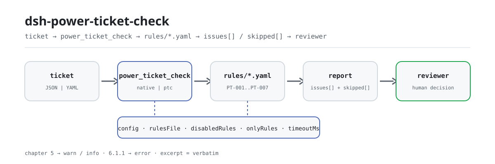

<div align="center">

<picture>
  <source media="(prefers-color-scheme: dark)" srcset="docs/assets/dsh-power-ticket-check-flow-dark.svg">
  
</picture>

# dsh-power-ticket-check

**Entregue un permiso de trabajo eléctrico y reciba una lista de qué columna falta, qué es lo que falta y cómo completarlo: el veredicto de cumplimiento sigue siendo del revisor.**

Un plugin de comprobación basado en datos para DeepSeek Harness: lee un **permiso de trabajo eléctrico** (un mapa plano de los nombres de columna del formulario a sus valores, más los roles de personal que figuran en él), aplica el paquete de reglas versionado que incluye (PT-001..PT-007) y verifica la completitud y el orden temporal emisión → autorización → cierre. Solo enumera las diferencias que puede señalar dentro del material: nunca dicta cumplimiento ni responsabilidad.

[Instalación](#instalación-en-tres-pasos) · [Configuración](#configuración) · [FAQ](#faq) · [简体中文](README.md) · [English](README.en.md) · [Español](README.es.md) · [Português](README.pt.md) · [हिन्दी](README.hi.md)

[](LICENSE)
[](#compatibilidad)
[](https://www.npmjs.com/package/dsh-power-ticket-check)
[](https://github.com/PerryLink/dsh-power-ticket-check/actions/workflows/ci.yml)
[](#compatibilidad)

[](https://github.com/PerryLink/dsh-power-ticket-check/stargazers)
[](https://www.npmjs.com/package/dsh-power-ticket-check)
[](https://dshfind.com/plugins/PerryLink/dsh-power-ticket-check?ref=badge)
[](https://securityscorecards.dev/viewer/?uri=github.com/PerryLink/dsh-power-ticket-check)
[](https://dsh.market/)
[](https://gitee.com/perrylink/dsh-power-ticket-check)

```sh
dsh plugin --profile <name> add dsh-power-ticket-check
```

</div>

<sub>Plugin de la comunidad, no afiliado a DeepSeek. Repositorio canónico: <https://github.com/PerryLink/dsh-power-ticket-check> (Gitee es un espejo).</sub>

## Qué es

`dsh-power-ticket-check` lee un **permiso de trabajo eléctrico** — un mapa plano de los nombres de columna del propio formulario a sus valores, más los roles del personal que figuran en él — y lo comprueba en lo que puede exigirse a un formulario: que esté rellena cada columna de su `requiredFields` configurado, que el tipo de permiso esté en la lista de su implantación, que la hora de emisión → autorización → cierre forme una secuencia físicamente posible, que una prórroga desplace el final hacia adelante y no sea anterior a la autorización, que los roles configurados como exclusivos los desempeñen personas distintas, y que el texto de medidas de seguridad y de autorización contenga los cinco términos de medidas técnicas de seguridad y los tres de trámites de autorización que busca el paquete.

Las comprobaciones que no pudieron ejecutarse se listan en `skipped` con su motivo, en lugar de aprobarse en silencio. No juzga si el trabajo cumplió la norma, no determina responsabilidad y no sustituye al revisor; solo enumera las diferencias que puede señalar dentro del material.

- **Para quién es**: personal de operación eléctrica, emisores de permisos y titulares de autorización; no hace falta línea de comandos: entregue el material en el chat.
- **Qué le entrega**: el material de origen sobre el que trabaja la comprobación (una tabla, un registro o un documento); el original nunca se modifica. Excel puede convertirse antes a JSON/YAML, en el chat si la plataforma lo admite.
- **Qué recibe**: una lista de «qué columna, qué falta, cómo completarlo»; cada comprobación que no pudo ejecutarse aparece en `skipped` con su motivo.

## Instalación en tres pasos

1. **Instalar** (elija un canal):

   ```sh
   # canal git (última main; equivale a git+https://github.com/PerryLink/dsh-power-ticket-check.git)
   dsh plugin --profile <name> add github:PerryLink/dsh-power-ticket-check
   # canal npm (versiones publicadas; actualmente 0.2.10)
   dsh plugin --profile <name> add dsh-power-ticket-check
   # canal tarball: pnpm pack en este repositorio y luego
   dsh plugin --profile <name> add ./dsh-power-ticket-check-<version>.tgz
   ```

2. **Configuración mínima** (valores por defecto; sin un bloque `config` en la fila del bundle todo funciona con los valores por defecto y el paquete de reglas apunta al `rules/power-ticket-check.yaml` incluido):

   ```yaml
   - insert:
       - id: dsh-power-ticket-check
         name: dsh-power-ticket-check
   ```

3. **Verificar que se monta**:

   ```sh
   dsh --profile <name> --dump-config | grep 'dsh-power-ticket-check'
   ```

   También puede ejecutar el ejemplo incluido en local (genere antes `lib/` con `pnpm install && pnpm run build`):

   ```sh
   node samples/quickstart/run.mjs --json
   # => {"tool":"power_ticket_check","issueCount":2,"summary":{"error":1,"warn":1,"info":0},"skippedCount":5}
   ```

   La entrada del ejemplo está en `samples/quickstart/input/` y la salida esperada en `samples/quickstart/expected/result.json`.

**Desinstalar**: `dsh plugin --profile <name> remove dsh-power-ticket-check` (o quite la fila del patch del perfil).

<details>
<summary>Usarlo en WorkBuddy / Coze</summary>

Busque el paquete «Safety Compliance Suite» en WorkBuddy / Coze (esta comprobación es uno de sus elementos; la disponibilidad depende de la tienda) para usar la misma capacidad de comprobación en el chat, sin línea de comandos.

</details>

## Capacidades principales

`dsh-power-ticket-check` registra la herramienta `power_ticket_check`: lee un permiso, aplica un paquete de reglas versionado y devuelve un informe.

- **Siete reglas en un paquete** — el paquete de reglas es datos, no código (`rules/power-ticket-check.yaml`, versión `2026.1`); cambiarlo cambia todo el conjunto de comprobaciones sin tocar una línea de TypeScript.
- **Solo lectura sobre el material** — acepta JSON o YAML y nunca modifica el original; ESM puro, sin peticiones de red y sin llamadas al modelo.
- **Sin citas inventadas** — cada regla lleva `document` / `number` / `clause` / `excerpt` / `kind` / `source`, y `excerpt` debe ser una cita literal. El texto de las cláusulas de DL/T 408—2023 no pudo obtenerse en esta ronda, y el paquete lo dice en lugar de parafrasearlo como cita.
- **La gravedad sigue a la evidencia** — `derived-from-principle` está limitada a `warn`, y la configuración institucional (`institutional-configuration`) a `info`. El prólogo de GB 26860—2011 marca el capítulo 5 (donde vive el régimen del permiso de trabajo) como recomendatorio, así que ninguna regla del capítulo 5 informa `error`; el único `error` es `PT-006`, que se apoya en el capítulo 6 obligatorio.
- **Una lista vacía no es un aprobado** — cada comprobación que no pudo ejecutarse se declara en `skipped` con su motivo; cuando `requiredFields`, `ticketKinds` o `exclusiveRolePairs` vienen vacías, la regla afectada se declara en `skipped` en lugar de pasar en silencio.
- **Sin lenguaje que adjudique** — el informe solo enumera diferencias y nunca se pronuncia sobre cumplimiento, responsabilidad o corrección; un guardián de redacción lo impone y todo informe lleva el descargo de responsabilidad.

| Regla | Qué comprueba | Gravedad | Tipo de base |
|---|---|---|---|
| `PT-001` | toda columna configurada está rellena (desactivada por defecto; el formato es informativo) | info | local |
| `PT-002` | el tipo de permiso está en su lista y coincide con la naturaleza del trabajo | warn | direct |
| `PT-003` | emisión → autorización → cierre es un orden posible; límites opcionales de intervalo y duración | warn | principle |
| `PT-004` | una prórroga mueve el final hacia adelante y sigue a la autorización | warn | direct |
| `PT-005` | los roles que exige separados los desempeñan personas distintas (desactivada por defecto) | warn | direct |
| `PT-006` | las cinco medidas técnicas de seguridad están escritas en el permiso | error | direct |
| `PT-007` | los tres trámites de autorización (revisión del lugar, señalamiento de partes con tensión, ambas firmas) | warn | direct |

### Ejemplos

Estos son los puntos de entrada reales del plugin; instálelo una vez y llame a uno de ellos. El primer bloque es el recorrido detallado y la tabla posterior recoge los casos breves.

**Ejemplo detallado** — herramienta `power_ticket_check`, entrada:

```json
{"工作票编号":"DL-2026-0001","工作票种类":"电气第一种工作票","安全措施":"应停电、验电、装设接地线。"}
```

Salida:

```json
{
  "id": "dsh-power-ticket-check.PT-006.104aebcf",
  "ruleId": "PT-006",
  "severity": "error",
  "locator": {
    "column": "安全措施"
  },
  "found": "安全措施文本中未出现 2 项：悬挂标示牌、装设遮栏",
  "expected": "在电气设备上工作，应有停电、验电、装设接地线、悬挂标示牌和装设遮栏（围栏）等保证安全的技术措施",
  "fix": "核对票面是否写全五项；本条只核对是否写到，不判断措施内容是否与现场相符"
}
```

*Observado en `dsh-power-ticket-check/tests/fixtures/PT-006/PT-006-unsafe.json (cases.json expects 1×PT-006); executed parseMaterial+runCheck, checkedAt=2026-10-06T00:00:00.000Z`*

| Usted pregunta | Qué responde |
|---|---|
| Tal como viene, aprueba todos los permisos que le paso, ¿por qué? | Porque `PT-001` se declara en `skipped`, no como aprobado. Su lista `requiredFields` viene vacía, así que la regla no puede ejecutarse; rellénela con las columnas que exige su propio formulario. Aun configurada, `PT-001` comprueba que la columna esté rellena, no que el valor sea correcto, y su nivel es `info`. |
| El permiso es un permiso de primera clase pero la naturaleza del trabajo menciona trabajo con tensión, ¿se informa de esa contradicción? | No. `PT-002` informa solo de dos cosas: que falte el tipo de permiso, o que no esté entre los tipos que declara su implantación. Su lista `ticketKinds` viene vacía y entonces la regla se declara en `skipped`, igual que `PT-005` cuando su lista `exclusiveRolePairs` está vacía; el plugin no decide qué tipo de permiso necesita un trabajo. Una vez rellene esas listas, configure `PT-005` con el par titular de la autorización y responsable del trabajo para que se informe de la misma persona en ambas columnas. Ninguna de las dos reglas juzga la cualificación de nadie ni si se aprobó desempeñar dos roles. |
| La hora de autorización figura antes de la hora de emisión, y además una columna de tiempo no se puede analizar. | `PT-003` informa de ambas cosas: autorización anterior a la emisión, cierre anterior a la autorización, y cualquier columna ilegible como fecha-hora no analizable, esperando una forma como `2026-03-15 08:30`. Ambos extremos se convierten a un recuento absoluto de minutos, así que un permiso que cruza la medianoche se compara bien. Si la hora de emisión o la de autorización no se pueden leer en absoluto, la regla se declara en `skipped`, porque la comprobación del orden no puede establecerse. Nunca comprueba si el trabajo siguió realmente el permiso, y el límite opcional de intervalo o de duración lo configura usted. |
| La hora de prórroga es anterior al final previsto, así que la prórroga acorta el trabajo en vez de alargarlo. | `PT-004` lo informa, y también informa de una prórroga anterior a la hora de autorización. La norma no fija ningún tope a cuánto ni a cuántas veces puede prorrogarse un permiso, así que la regla no lleva límite cuantitativo ni comprueba si se completaron los trámites de prórroga. |
| La columna de medidas de seguridad está rellena, pero solo menciona corte de corriente y verificación de ausencia de tensión. | `PT-006` informa de los términos que faltan, uno por uno. Es la única regla de nivel `error` aquí, porque su cláusula 6.1.1 está en el capítulo obligatorio, y comprueba que las cinco medidas estén escritas en el permiso, no que coincidan con el lugar ni que se hayan ejecutado. Si no encuentra ninguna columna de medidas legible, se declara en `skipped`. |
| Nada en el permiso muestra que el titular de la autorización volviera al lugar con el responsable del trabajo. | `PT-007` informa de cuáles de los tres términos de los trámites de autorización faltan en el texto que lee, y ese texto son las `permitColumns` más los nombres de las columnas de rol. Solo lee la redacción: no puede saber si la revisión del lugar ocurrió de verdad, y una institución que quiera que esto bloquee puede subir el nivel de la regla en el paquete sin tocar el código. |

## Configuración

Todos los parámetros ajustables son campos Schemastery `Config` en `src/config.ts` (modificables desde cordis.yml); los umbrales por regla viven en el paquete de reglas bajo `rules/`. Una anulación dirigida por id sustituye toda la fila: vuelva a declarar todas las claves que necesite.

| Clave | Tipo | Valor por defecto | Significado |
|---|---|---|---|
| `rulesFile` | string | `rules/power-ticket-check.yaml` | Ruta del paquete de reglas, relativa a la raíz del paquete |
| `disabledRules` | string[] | `[]` | Ids de reglas que se dejan de ejecutar; cada una aparece en `skipped` |
| `onlyRules` | string[] | `[]` | Ejecutar solo estas reglas; vacío ejecuta todas |
| `skipNotes` | string | `""` | Nota añadida a cada motivo de `skipped` |
| `timeoutMs` | number | `120000` | Presupuesto de tiempo de espera cooperativo de la herramienta |

Parámetros de regla que conviene conocer:

- `PT-001` `requiredFields` — las columnas que deben estar rellenas, con los nombres de columna del propio material; vacío desactiva la comprobación.
- `PT-002` `ticketKinds` — sus tipos de permiso, con los nombres del propio material; también puede pasarse en cada llamada.
- `PT-003` `minMinutesBeforeWork` — el intervalo mínimo que exige entre emisión y autorización; `0` desactiva la comparación de intervalo.
- `PT-003` `maxDurationHours` — la duración máxima de un permiso; `0` desactiva la comprobación de duración.
- `PT-005` `exclusiveRolePairs` — pares que no pueden ser la misma persona, escritos como los dos nombres de columna del material unidos por `|`.
- `PT-006` `measureTerms` / `measureColumns` — las cinco palabras clave de medidas y las columnas cuyo texto se recoge.
- `PT-007` `permitTerms` / `permitColumns` — las palabras clave de los trámites de autorización y las columnas cuyo texto se recoge.

```yaml
PT-002.ticketKinds: [第一种工作票, 第二种工作票, 带电作业票]
PT-005.exclusiveRolePairs: ['工作票签发人|工作许可人']
```

Ejemplo de anulación en el patch del perfil:

```yaml
- insert:
    - id: dsh-power-ticket-check
      name: dsh-power-ticket-check
      config:
        disabledRules: [PT-005]
        timeoutMs: 180000
```

## Formato del material

La herramienta acepta JSON o YAML. Un permiso es un mapa plano:

```yaml
工作票编号: DL-2026-0001
工作票种类: 第一种工作票
工作地点: 35kV 某某变电站
工作任务: 10kV 某某线 01 号杆更换隔离开关
计划开始时间: 2026-03-15 08:00
计划结束时间: 2026-03-15 18:00
签发时间: 2026-03-14 16:00
许可时间: 2026-03-15 08:30
终结时间: 2026-03-15 17:00
工作票签发人: 张工
工作负责人: 李工
工作许可人: 王工
```

Las horas se aceptan como `2026-03-15 08:30` o como fecha sola, en cuyo caso se asume medianoche y el informe lo dice cuando importa. Las columnas de rol pueden llevar un sufijo — una columna de firma del responsable del trabajo se reconoce como el rol de responsable — así que un formulario exportado con sus casillas de firma también se mapea limpiamente.

La comprobación cronológica compara ambos extremos en **una sola línea de tiempo continua**, así que una autorización que cae en un día anterior se informa como un instante anterior, no como un pequeño intervalo negativo del mismo día. Los campos son opcionales en la capa de lectura y los valida el motor, de modo que una exportación parcial produce diferencias de «falta un elemento» en lugar de un fallo.

## Normas que sigue

| Documento | Número | Citado por las reglas |
|---|---|---|
| Reglamento de seguridad eléctrica: centrales y subestaciones | GB 26860—2011 | PT-001, PT-002, PT-003, PT-004, PT-005, PT-006, PT-007 |

**Límite:** este plugin comprueba un **permiso de trabajo eléctrico** en lo que puede exigirse a un formulario — que las casillas requeridas estén rellenas, que emisión / autorización / cierre hayan ocurrido en un orden físicamente posible, que una prórroga mueva el final hacia adelante y que los roles que exige separados los desempeñen personas distintas. **No** juzga si las medidas de seguridad escritas en el permiso eran adecuadas, **no** dice qué tipo de permiso necesita un trabajo y **no** verifica que la cualificación de nadie sea real.

Los datos de las reglas viven en `rules/power-ticket-check.yaml`, separados del código. El cargador impone que cada `excerpt` sea una cita real de al menos ocho caracteres y que una comprobación basada en un principio general o en una política local nunca pueda declararse `error`.

### ⚠️ Tres cosas que este plugin se niega a hacer, y el nivel de efecto que fija sus gravedades

**1. Respeta el nivel de efecto de la propia norma.** El prólogo de GB 26860—2011 dice, literalmente:

```text
本标准的第5章和7.3.4为推荐性，其余为强制性
```

Es decir, **el régimen del permiso de trabajo está en el capítulo 5, *recomendatorio*.** Por eso toda regla que se apoya en el capítulo 5 viene como `warn` o `info` y **ninguna de ellas puede bloquear un flujo de trabajo**. `PT-006` (las cinco medidas técnicas de seguridad, cláusula 6.1.1) es el **único** `error`, porque el capítulo 6 es obligatorio. `PT-007` (los trámites de autorización, cláusula 5.5.1) es `warn`; su nota explica que una institución que quiera que esos trámites bloqueen puede subirlo editando el paquete de reglas, sin cambiar código. Una prueba afirma ambas direcciones: ninguna regla del capítulo 5 es `error`, y `PT-006` es la única.

**2. No adopta tres afirmaciones que no tienen base en las normas.** Tras leer GB 26860—2011 y GB 26859—2011 completos: **no** existe en ninguna parte un plazo de «el permiso de primera clase debe entregarse un día laborable antes del trabajo»; las cláusulas 5.3.12 y 5.4.10 solo dicen:

```text
延期应办理手续
```

con **ningún tope de duración ni de número**; y el nombre legal registrado en el paquete es el término corto de 5.2.4, no la variante larga:

```text
紧急抢修单 ≠ 事故应急抢修单
```

Una prueba afirma que el paquete registra las tres cosas.

**3. No trata el formato del permiso como obligatorio.** La cláusula 5.1.2 dice que el permiso «puede incluir» esos elementos, y los apéndices A–D están marcados como informativos en el índice de la norma:

```text
5.1.2: 可包含
附录 A–D: 资料性附录
```

Así que `PT-001` viene con una lista de campos **vacía** para que usted la rellene desde su propio formulario, y se informa en `info`.

Otras dos listas son suyas: los tipos de permiso de `PT-002` y los pares de roles exclusivos de `PT-005`. Ambas vienen vacías. El plugin nunca juzga si las medidas de seguridad escritas en un permiso eran adecuadas, qué tipo de permiso necesita un trabajo, ni si la cualificación de alguien es real: la norma fija las **obligaciones** de los roles (5.4.1–5.4.5) y **ninguna condición de cualificación**.

Las cláusulas citadas proceden de **GB 26860—2011** — 5.1.2, 5.2.1–5.2.4, 5.3.7, 5.3.12, 5.5.1, 5.7.5 y 6.1.1 — y el prólogo de la norma aporta el nivel de efecto que fija la gravedad de cada regla. El texto de las cláusulas se obtuvo de una transcripción de un escaneo completo y se cotejó literalmente contra un segundo sitio independiente.

Normas actuales de esta familia, todas verificadas en la plataforma de normas:

| Norma | En vigor | Nota |
|---|---|---|
| GB 26860—2011, centrales y subestaciones | 2012-06-01 | obligatoria, salvo los capítulos 5 y 7.3.4; hay una revisión «en aprobación» |
| GB 26859—2011, líneas eléctricas | 2012-06-01 | la contraparte del lado de línea |
| DL/T 408—2023, centrales y subestaciones | 2024-06-28 | sustituye a **DL 408—1991** y convive **junto a** GB 26860 — no lo reemplaza |
| DL/T 409—2023, líneas eléctricas | 2024-06-28 | |
| DL/T 560—2022, laboratorios de alta tensión | 2022-11-13 | sustituye a DL 560—1995 |

**El texto de las cláusulas de DL/T 408—2023 no pudo obtenerse, así que este paquete no cita ninguna.** Se verificaron su identidad y estructura de capítulos; DL/T 408—2023 renombra el formulario de reparación de emergencia y añade el tipo de permiso para trabajo con tensión y la doble emisión — por eso `PT-002` acepta ambos nombres en lugar de elegir uno:

```text
紧急抢修单 → 故障紧急抢修单 · + 带电作业票 · + 双签发
```

El informe completo de verificación de cláusulas, incluidas las fuentes comprobadas y rechazadas, está en `rules/evidence/clause-verification.md`.

## FAQ

<details>
<summary>¿Se sube el material? ¿Dónde viven los datos?</summary>

No se sube nada. Es un comprobador local de solo lectura: lee únicamente el material que le entrega a la herramienta, no hace peticiones de red, no llama al modelo y no incorpora telemetría; no escribe datos más allá del resultado de la herramienta y el almacenamiento de sesión/registro del propio host DSH. El host controla ese almacenamiento y su retención; este paquete no guarda una segunda copia. Quitar el paquete elimina su código, no los registros de sesión ni los documentos que ya haya creado.

</details>

<details>
<summary>Mis permisos están en Excel, ¿puedo usarlos directamente?</summary>

Sí: conviértalos antes a JSON o YAML; en el chat la plataforma puede hacer la conversión cuando lo admite. La herramienta solo lee el material y nunca modifica el original.

</details>

<details>
<summary>Una lista `issues` vacía significa que el permiso está bien, ¿verdad?</summary>

No. Cada comprobación que no pudo ejecutarse se lista en `skipped` con su motivo (por ejemplo, `requiredFields` sin configurar, falta la hora de emisión o no se encontró una columna de medidas de seguridad). Lea `issues` y `skipped` juntos. `PT-001`, `PT-002` y `PT-005` vienen con listas vacías, así que por defecto se declaran en `skipped`.

</details>

<details>
<summary>¿Por qué casi todos los hallazgos son `warn` / `info`? ¿Bloquea un flujo de trabajo?</summary>

No por defecto. El prólogo de GB 26860—2011 marca el capítulo 5 — donde vive el régimen del permiso de trabajo — como recomendatorio, así que las reglas del capítulo 5 llegan como mucho a `warn`; el único `error` es `PT-006`, que se apoya en el capítulo 6 obligatorio. Una institución que quiera que una clase de hallazgos bloquee puede subir la `severity` de esa regla en el paquete, sin cambiar código.

</details>

<details>
<summary>¿Cómo maneja un mes de permisos de una vez?</summary>

La herramienta funciona tanto en `native` como en `ptc`; para comprobar en lote (por ejemplo, un mes de permisos) use `ptc`, así el coste del esquema se paga una vez. La comprobación en sí es coincidencia local de campos y aritmética de tiempos — sin peticiones de red ni llamadas al modelo; `timeoutMs` (120 segundos por defecto) es el presupuesto de tiempo de espera cooperativo.

</details>

## Solución de problemas

- **`PT-001`, `PT-002` o `PT-005` se declaran en `skipped`.** Sus listas están vacías. Rellene las que exijan las reglas de su empresa.
- **`PT-003` no informa nada sobre el orden.** La hora de emisión y la de autorización no están ambas presentes; la regla lo dice en `skipped`. Si una hora está presente pero es ilegible, la regla informa *eso* en lugar de omitirse, así que una celda no analizable nunca oculta la comprobación.
- **`PT-003` salta con una duración normal para nosotros.** `maxDurationHours` es `0` por defecto; si lo fija, se aplica a todos los permisos que vea la herramienta. Déjelo en `0` si sus permisos son legítimamente largos.
- **`PT-005` no ve un caso que conozco.** Añada el par de roles. El plugin solo compara los pares que usted enumera, porque qué roles deben estar separados depende del tipo de permiso y de su normativa de desarrollo.
- **El plugin se instala pero la herramienta nunca aparece.** Compruebe que `main` resuelve a `lib/index.mjs` y que `pnpm run build` lo generó; un `main` incorrecto hace que el cargador omita la entrada en silencio.
- **`dsh plugin add` rechaza el paquete como incompatible.** El rango de peers cubre `0.1.x` y `0.2.x`; si su runtime queda fuera, conceda una exención explícita: `dsh plugin --profile <name> allow-version dsh-power-ticket-check@0.1.0 --dsh-version <runtime> --accept-risk`
- **`check` informa `manifest-peers` como fallo.** El comprobador estático compara con un rango de peers codificado que es anterior a la línea 0.2. El runtime aplica la compatibilidad de peers al instalar, así que el rango declarado es el correcto; es un problema conocido de `dsh-plugin-dev`.
- **Las horas parecen desplazadas.** Toda la aritmética es de reloj de pared sobre las cadenas de entrada; no se hace conversión de zona horaria.

## Límites de seguridad y limitaciones conocidas

- **Solo lectura, local, sin conexión.** La herramienta solo lee el material que se le pasa y nunca modifica el original; no hace peticiones de red, no llama al modelo y no incorpora telemetría; no escribe nada más allá del resultado de la herramienta y el almacenamiento de sesión del host.
- **Sin veredicto de cumplimiento, sin determinación de responsabilidad, sin sustituir al revisor.** El informe solo enumera diferencias que puede señalar dentro del material; un guardián de redacción lo impone y todo informe lleva el descargo de responsabilidad.
- **No juzga si las medidas eran adecuadas, qué tipo de permiso necesita un trabajo, ni si una cualificación es real.** La norma fija las **obligaciones** de los roles (5.4.1–5.4.5) y **ninguna condición de cualificación**; por eso `requiredFields`, `ticketKinds` y `exclusiveRolePairs` quedan para que los configure la implantación.
- **Una lista vacía no es un aprobado.** Cada comprobación que no pudo ejecutarse va a `skipped`; cuando `requiredFields`, `ticketKinds` o `exclusiveRolePairs` no están configuradas, la regla afectada se declara en `skipped`.
- **Limitación de un solo permiso.** La cláusula 5.3.7 dice que un responsable del trabajo no debe ejecutar dos o más permisos al mismo tiempo; el material de un solo permiso no puede mostrar «al mismo tiempo», así que en modo de un solo permiso el plugin solo comprueba la separación de roles configurada (`exclusiveRolePairs`). Para comprobar la propia 5.3.7, combine los permisos que comparten una ventana temporal y compruébelos juntos.
- **Laguna conocida del paquete de reglas.** El texto de las cláusulas de DL/T 408—2023 no pudo obtenerse, así que el paquete no cita ninguna; se verificaron su identidad y estructura de capítulos, y `PT-002` acepta ambos nombres del formulario de reparación de emergencia. El registro completo de verificación está en `rules/evidence/clause-verification.md`.
- **Las horas son de reloj de pared.** Toda la aritmética es de reloj de pared sobre las cadenas de entrada, sin conversión de zona horaria; una columna de tiempo ilegible se informa como fecha-hora no analizable, y `PT-003` se declara en `skipped` cuando no se puede leer ni la hora de emisión ni la de autorización.
- **Sin bloqueo por defecto.** Las reglas del capítulo 5 llegan como mucho a `warn`; una institución que necesite bloqueo sube la `severity` de esa entrada en el paquete, sin cambiar código.

## Compatibilidad

| Superficie | Estado |
|---|---|
| Harness | Rango de peers `>=0.1.2-rc.1 <0.2.0 \|\| >=0.2.0-0 <0.3.0` — verificado para aceptar tanto `0.2.0-rc.2` como `0.2.1-rc.2`. `engines.dsh` se declara como `>=0.2.1-0 <0.3.0` y el host lo aplica desde 0.2.1 |
| Node | `^22.19.0 \|\| >=24.0.0` |
| Plataformas | Todas (ESM puro; sin código nativo, sin red, sin llamada al modelo) |
| Modo de herramienta | Funciona en `native` y `ptc`; para un mes de permisos use `ptc` |

## Ecosistema y calidad

- [Espejo en Gitee](https://gitee.com/perrylink/dsh-power-ticket-check) (espejo sincronizado; GitHub es el canónico)
- [Página del plugin en dshfind](https://dshfind.com/plugins/PerryLink/dsh-power-ticket-check) (instalaciones y clasificación)
- [Informe OpenSSF Scorecard](https://securityscorecards.dev/viewer/?uri=github.com/PerryLink/dsh-power-ticket-check) (impulsado por [.github/workflows/scorecard.yml](.github/workflows/scorecard.yml))
- [DSH Market](https://dsh.market/) (listado)
- [Base de conocimiento del ecosistema](https://perrylink.github.io/dsh-plugin-guide/) — guía de desarrollo de plugins · datos de selección · criterios de mantenimiento

## Desarrollo

```sh
pnpm install                                        # node ^22.19 || >=24
pnpm run typecheck                                  # tsc --noEmit
pnpm test                                           # vitest: suite compartida de plugins de tabla + fixtures emparejados
pnpm run build                                      # tsdown -> lib/index.mjs + lib/index.d.mts
pnpm run verify:self-contained                      # las dependencias resuelven desde el registro
pnpm run check:lockfile                             # comprobación de deriva del lockfile
pnpm run check:readmes                              # consistencia de los README en cinco idiomas
pnpm run check:citations                            # línea base de citas del paquete de reglas
node ../scripts/sync-shared.mjs dsh-power-ticket-check   # refrescar src/shared desde ../_shared
pnpm pack                                           # el tarball publicado
```

| Ruta | Función |
|---|---|
| `src/index.ts` | contrato de plugin de función; registra `power_ticket_check` y resuelve el paquete de reglas incluido |
| `src/config.ts` | esquema Schemastery — todo lo ajustable vive aquí |
| `src/check.ts` | núcleo de comprobación puro, `(input, ruleset, options) => Report`; sin contexto de plugin, sin E/S, sin reloj, sin modelo |
| `src/parse.ts` | lector JSON/YAML que normaliza el material en campos y roles del permiso |
| `src/view.ts` | proyección del informe para el modelo |
| `src/shared/` | kit compartido (cargador de reglas, forma del informe, subconjunto YAML, aritmética de calendario, guardián de redacción, ayudas de tabla); copiado, no importado |
| `rules/power-ticket-check.yaml` | el paquete de reglas (7 reglas) |
| `rules/evidence/` | registro de verificación de cláusulas de cada cita del paquete |
| `tests/` | vitest; cada regla tiene un fixture emparejado conforme/violante en `tests/fixtures/<RULE>/` |

El plugin es **de forma de datos**: el paquete de reglas declara cada comprobación y el código solo lee, ejecuta y renderiza. Ejecución local del ejemplo (genere antes `lib/`):

```sh
node samples/quickstart/run.mjs --json
# => {"tool":"power_ticket_check","issueCount":2,"summary":{"error":1,"warn":1,"info":0},"skippedCount":5}
```

Las imágenes del README las genera programáticamente [`scripts/gen-readme-assets.py`](scripts/gen-readme-assets.py) (Python + Pillow): un plugin sin interfaz recibe un par de SVG de flujo claro/oscuro como héroe, y el script puede volver a ejecutarse. El flujo de una sola piel y las imágenes de demostración antiguas permanecen en `docs/assets/` para enlaces externos; el README solo referencia el par nuevo.

Temas: `deepseek-harness`, `dsh`, `dsh-plugin`, `cordis`, `power`, `ticket`

## Familia y agradecimientos

Este proyecto forma parte de la familia de plugins de DeepSeek Harness de [PerryLink](https://github.com/PerryLink) (todos Apache-2.0). Índice completo de la familia: [elegir un comprobador por material](https://perrylink.github.io/zh/checkers/choose/). Si le resulta útil, **una estrella ayuda a que la siguiente persona lo encuentre** — no desbloquea nada.

- [@PerryLink](https://github.com/PerryLink) — creador y mantenedor: el paquete de reglas con forma de datos (PT-001..PT-007), la herramienta `power_ticket_check`, el registro de verificación de cláusulas y la documentación en cinco idiomas.

<details>
<summary>Mostrar todos los plugins</summary>

| Plugin | Estado |
|---|---|
| **[dsh-aqua-input-check](https://github.com/PerryLink/dsh-aqua-input-check)** |  |
| **[dsh-archive-check](https://github.com/PerryLink/dsh-archive-check)** |  |
| **[dsh-auto-review](https://github.com/PerryLink/dsh-auto-review)** |  |
| **[dsh-autotier](https://github.com/PerryLink/dsh-autotier)** | 🧊 CONGELADO — ver el README del repo |
| **[dsh-bid-ca-precheck](https://github.com/PerryLink/dsh-bid-ca-precheck)** |  |
| **[dsh-bid-qual-check](https://github.com/PerryLink/dsh-bid-qual-check)** |  |
| **[dsh-cert-mcp](https://github.com/PerryLink/dsh-cert-mcp)** | 🧊 CONGELADO — ver el README del repo |
| **[dsh-checkpoint-rewind](https://github.com/PerryLink/dsh-checkpoint-rewind)** |  |
| **[dsh-click](https://github.com/PerryLink/dsh-click)** |  |
| **[dsh-composer-history](https://github.com/PerryLink/dsh-composer-history)** |  |
| **[dsh-contract-stance](https://github.com/PerryLink/dsh-contract-stance)** |  |
| **[dsh-customs-doc-check](https://github.com/PerryLink/dsh-customs-doc-check)** |  |
| **[dsh-data-quality](https://github.com/PerryLink/dsh-data-quality)** |  |
| **[dsh-demurrage-ledger](https://github.com/PerryLink/dsh-demurrage-ledger)** |  |
| **[dsh-doublecheck](https://github.com/PerryLink/dsh-doublecheck)** |  |
| **[dsh-drill-script-check](https://github.com/PerryLink/dsh-drill-script-check)** |  |
| **[dsh-eia-guide-check](https://github.com/PerryLink/dsh-eia-guide-check)** |  |
| **[dsh-emergency-plan](https://github.com/PerryLink/dsh-emergency-plan)** |  |
| **[dsh-essay-rubric-check](https://github.com/PerryLink/dsh-essay-rubric-check)** |  |
| **[dsh-evidence-check](https://github.com/PerryLink/dsh-evidence-check)** |  |
| **[dsh-export-ctl-check](https://github.com/PerryLink/dsh-export-ctl-check)** |  |
| **[dsh-fast](https://github.com/PerryLink/dsh-fast)** |  |
| **[dsh-fmea-table-check](https://github.com/PerryLink/dsh-fmea-table-check)** |  |
| **[dsh-forecast-penalty](https://github.com/PerryLink/dsh-forecast-penalty)** |  |
| **[dsh-fund-research](https://github.com/PerryLink/dsh-fund-research)** |  |
| **[dsh-github](https://github.com/PerryLink/dsh-github)** |  |
| **[dsh-gongwen-flow-check](https://github.com/PerryLink/dsh-gongwen-flow-check)** |  |
| **[dsh-gongwen-word-check](https://github.com/PerryLink/dsh-gongwen-word-check)** |  |
| **[dsh-guard-plan-qc](https://github.com/PerryLink/dsh-guard-plan-qc)** |  |
| **[dsh-hazchem-check](https://github.com/PerryLink/dsh-hazchem-check)** |  |
| **[dsh-hazplan-check](https://github.com/PerryLink/dsh-hazplan-check)** |  |
| **[dsh-hidden-risk-map](https://github.com/PerryLink/dsh-hidden-risk-map)** |  |
| **[dsh-hs-classify](https://github.com/PerryLink/dsh-hs-classify)** |  |
| **[dsh-icd-rule-check](https://github.com/PerryLink/dsh-icd-rule-check)** |  |
| **[dsh-industry-research](https://github.com/PerryLink/dsh-industry-research)** |  |
| **[dsh-lawcite-adapter](https://github.com/PerryLink/dsh-lawcite-adapter)** |  |
| **[dsh-laya](https://github.com/PerryLink/dsh-laya)** |  |
| **[dsh-lc-doc-check](https://github.com/PerryLink/dsh-lc-doc-check)** |  |
| **[dsh-learning-gap-check](https://github.com/PerryLink/dsh-learning-gap-check)** |  |
| **[dsh-library](https://github.com/PerryLink/dsh-library)** |  |
| **[dsh-local-ai](https://github.com/PerryLink/dsh-local-ai)** |  |
| **[dsh-lsp-actions](https://github.com/PerryLink/dsh-lsp-actions)** |  |
| **[dsh-mask](https://github.com/PerryLink/dsh-mask)** |  |
| **[dsh-mcp-panel](https://github.com/PerryLink/dsh-mcp-panel)** |  |
| **[dsh-medrec-qc](https://github.com/PerryLink/dsh-medrec-qc)** |  |
| **[dsh-memento](https://github.com/PerryLink/dsh-memento)** |  |
| **[dsh-nsfc-form-check](https://github.com/PerryLink/dsh-nsfc-form-check)** |  |
| **[dsh-nurse-record-check](https://github.com/PerryLink/dsh-nurse-record-check)** |  |
| **[dsh-observe](https://github.com/PerryLink/dsh-observe)** |  |
| **[dsh-origin-rvc-check](https://github.com/PerryLink/dsh-origin-rvc-check)** |  |
| **[dsh-ota-review-check](https://github.com/PerryLink/dsh-ota-review-check)** |  |
| **[dsh-output-styles](https://github.com/PerryLink/dsh-output-styles)** |  |
| **[dsh-paper-doc-adapter](https://github.com/PerryLink/dsh-paper-doc-adapter)** |  |
| **[dsh-permission-rules](https://github.com/PerryLink/dsh-permission-rules)** |  |
| **[dsh-permit-report-check](https://github.com/PerryLink/dsh-permit-report-check)** |  |
| **[dsh-pipeline-check](https://github.com/PerryLink/dsh-pipeline-check)** |  |
| **[dsh-pleading-draft](https://github.com/PerryLink/dsh-pleading-draft)** |  |
| **[dsh-plugin-doctor](https://github.com/PerryLink/dsh-plugin-doctor)** | 🚫 RETIRADO (repo archivado) |
| **[dsh-plugin-guide](https://github.com/PerryLink/dsh-plugin-guide)** |  |
| **[dsh-plugin-kit](https://github.com/PerryLink/dsh-plugin-kit)** | 🚫 RETIRADO (repo archivado) |
| **[dsh-plugin-upgrade](https://github.com/PerryLink/dsh-plugin-upgrade)** | 🚫 RETIRADO (repo archivado) |
| **[dsh-policy-brief-draft](https://github.com/PerryLink/dsh-policy-brief-draft)** |  |
| **[dsh-power-loss-split](https://github.com/PerryLink/dsh-power-loss-split)** |  |
| **[dsh-power-ticket-check](https://github.com/PerryLink/dsh-power-ticket-check)** |  |
| **[dsh-ppap-check](https://github.com/PerryLink/dsh-ppap-check)** |  |
| **[dsh-protest-deadline](https://github.com/PerryLink/dsh-protest-deadline)** |  |
| **[dsh-railway-window](https://github.com/PerryLink/dsh-railway-window)** |  |
| **[dsh-repair-order-qc](https://github.com/PerryLink/dsh-repair-order-qc)** |  |
| **[dsh-research-report](https://github.com/PerryLink/dsh-research-report)** |  |
| **[dsh-review-reply-check](https://github.com/PerryLink/dsh-review-reply-check)** |  |
| **[dsh-rulefile-check](https://github.com/PerryLink/dsh-rulefile-check)** |  |
| **[dsh-safety-brief-check](https://github.com/PerryLink/dsh-safety-brief-check)** |  |
| **[dsh-score](https://github.com/PerryLink/dsh-score)** |  |
| **[dsh-session-sync](https://github.com/PerryLink/dsh-session-sync)** |  |
| **[dsh-site-log-check](https://github.com/PerryLink/dsh-site-log-check)** |  |
| **[dsh-skill-pack-security](https://github.com/PerryLink/dsh-skill-pack-security)** |  |
| **[dsh-soe-decision-check](https://github.com/PerryLink/dsh-soe-decision-check)** |  |
| **[dsh-soilwater-check](https://github.com/PerryLink/dsh-soilwater-check)** |  |
| **[dsh-sop-sync-check](https://github.com/PerryLink/dsh-sop-sync-check)** |  |
| **[dsh-spc-gbt-adapter](https://github.com/PerryLink/dsh-spc-gbt-adapter)** |  |
| **[dsh-talk](https://github.com/PerryLink/dsh-talk)** |  |
| **[dsh-tender-extract](https://github.com/PerryLink/dsh-tender-extract)** |  |
| **[dsh-tender-matrix](https://github.com/PerryLink/dsh-tender-matrix)** |  |
| **[dsh-test-drive](https://github.com/PerryLink/dsh-test-drive)** |  |
| **[dsh-ticktick](https://github.com/PerryLink/dsh-ticktick)** | 🚫 RETIRADO (repo archivado) |
| **[dsh-translate](https://github.com/PerryLink/dsh-translate)** |  |
| **[dsh-warranty-calc](https://github.com/PerryLink/dsh-warranty-calc)** |  |
| **[dsh-budget](https://github.com/PerryLink/dsh-budget)** | 🧊 CONGELADO — ver el README del repo |
| **[dsh-claude-move](https://github.com/PerryLink/dsh-claude-move)** | 🧊 CONGELADO — ver el README del repo |
| **[dsh-defend](https://github.com/PerryLink/dsh-defend)** | 🧊 CONGELADO — ver el README del repo |
| **[dsh-draw](https://github.com/PerryLink/dsh-draw)** | 🧊 CONGELADO — ver el README del repo |
| **[dsh-reach](https://github.com/PerryLink/dsh-reach)** | 🧊 CONGELADO — ver el README del repo |
| **[dsh-background-agents](https://github.com/PerryLink/dsh-background-agents)** | 🚫 RETIRADO (repo archivado) |
| **[dsh-session-pin](https://github.com/PerryLink/dsh-session-pin)** | 🚫 RETIRADO (repo archivado) |
| **[dsh-team-rooms](https://github.com/PerryLink/dsh-team-rooms)** | 🚫 RETIRADO (repo archivado) |

</details>

## Licencia

[LICENSE](LICENSE) (Apache License 2.0) © 2026 dsh-power-ticket-check contributors

<p align="center"><sub>Apache-2.0 · Plugin de la comunidad, no afiliado a DeepSeek.</sub></p>
