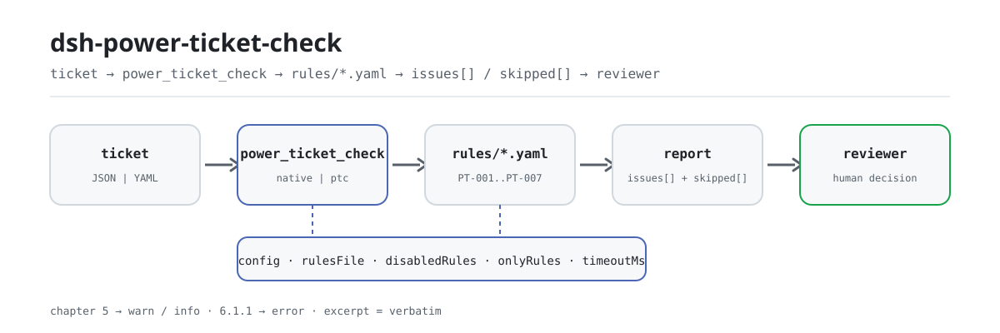

<div align="center">

<picture>
  <source media="(prefers-color-scheme: dark)" srcset="docs/assets/dsh-power-ticket-check-flow-dark.svg">
  
</picture>

# dsh-power-ticket-check

**एक बिजली कार्य-टिकट दीजिए और वापस पाइए कि कौन-सा कॉलम अधूरा है, क्या छूट रहा है और उसे कैसे पूरा करना है — अनुपालन का अंतिम निर्णय समीक्षक के पास ही रहता है।**

DeepSeek Harness के लिए एक डेटा-आधारित जाँच प्लगइन: यह एक **बिजली कार्य-टिकट** (टिकट के अपने कॉलम नामों से उनके मानों तक का सपाट मैप, साथ में टिकट पर लिखे कार्मिक भूमिकाएँ) पढ़ता है, अपने साथ आने वाले संस्करण-बद्ध नियम पैक (PT-001..PT-007) को लागू करता है, और पूर्णता तथा जारी → अनुमति → समापन के समय-क्रम की जाँच करता है। यह केवल वे अंतर गिनाता है जिन्हें सामग्री के भीतर इंगित किया जा सकता है — कभी अनुपालन का निर्णय नहीं, कभी दायित्व का निष्कर्ष नहीं।

[इंस्टॉल](#तीन-चरणों-में-शुरुआत) · [कॉन्फ़िगरेशन](#कॉन्फ़िगरेशन) · [FAQ](#faq) · [简体中文](README.md) · [English](README.en.md) · [Español](README.es.md) · [Português](README.pt.md) · [हिन्दी](README.hi.md)

[](LICENSE)
[](#संगतता)
[](https://www.npmjs.com/package/dsh-power-ticket-check)
[](https://github.com/PerryLink/dsh-power-ticket-check/actions/workflows/ci.yml)
[](#संगतता)

[](https://github.com/PerryLink/dsh-power-ticket-check/stargazers)
[](https://www.npmjs.com/package/dsh-power-ticket-check)
[](https://dshfind.com/plugins/PerryLink/dsh-power-ticket-check?ref=badge)
[](https://securityscorecards.dev/viewer/?uri=github.com/PerryLink/dsh-power-ticket-check)
[](https://dsh.market/)
[](https://gitee.com/perrylink/dsh-power-ticket-check)

```sh
dsh plugin --profile <name> add dsh-power-ticket-check
```

</div>

<sub>समुदाय प्लगइन, DeepSeek से संबद्ध नहीं। एकमात्र रिपॉज़िटरी: <https://github.com/PerryLink/dsh-power-ticket-check> (Gitee एक मिरर है)।</sub>

## यह क्या है

`dsh-power-ticket-check` एक **बिजली कार्य-टिकट** पढ़ता है — टिकट के अपने कॉलम नामों से उनके मानों तक का सपाट मैप, साथ में टिकट पर लिखे कार्मिक भूमिकाएँ — और उसी सीमा तक जाँचता है जितनी एक फ़ॉर्म से अपेक्षा की जा सकती है: आपके कॉन्फ़िगर किए गए `requiredFields` का हर कॉलम भरा हो, टिकट का प्रकार आपकी संस्था की सूची में हो, जारी समय → अनुमति समय → समापन समय एक भौतिक रूप से संभव क्रम बनाते हों, विस्तार समय अंत को आगे बढ़ाता हो और अनुमति से पहले न हो, आपके द्वारा अलग-अलग रखने के लिए कॉन्फ़िगर की गई भूमिकाएँ अलग-अलग लोगों के पास हों, और सुरक्षा-उपाय तथा अनुमति पाठ में वे पाँच सुरक्षा-तकनीकी-उपाय शब्द और तीन अनुमति-औपचारिकता शब्द हों जिन्हें पैक खोजता है।

जो जाँचें नहीं चल सकीं, वे चुपचाप पास होने के बजाय `skipped` में कारण के साथ सूचीबद्ध होती हैं। यह यह नहीं तय करता कि कार्य अनुपालन में था या नहीं, दायित्व नहीं ढूँढता, और समीक्षक का स्थान नहीं लेता; यह केवल वे अंतर गिनाता है जिन्हें सामग्री के भीतर इंगित किया जा सकता है।

- **किसके लिए**: बिजली संचालन कर्मी, टिकट जारीकर्ता और अनुमति धारक; कमांड लाइन की ज़रूरत नहीं — सामग्री चैट में सौंप दें।
- **आप क्या देते हैं**: वह मूल सामग्री जिस पर जाँच चलती है (तालिका, रजिस्टर या दस्तावेज़); मूल कभी नहीं बदला जाता। Excel को पहले JSON/YAML में बदला जा सकता है, चैट में भी यदि प्लेटफ़ॉर्म सहयता करता हो।
- **आपको क्या मिलता है**: «कौन-सा कॉलम, क्या छूटा, कैसे पूरा करें» की सूची; हर वह जाँच जो नहीं चल सकी, `skipped` में कारण के साथ आती है।

## तीन चरणों में शुरुआत

1. **इंस्टॉल** (कोई एक चैनल चुनें):

   ```sh
   # git चैनल (नवीनतम main; git+https://github.com/PerryLink/dsh-power-ticket-check.git के बराबर)
   dsh plugin --profile <name> add github:PerryLink/dsh-power-ticket-check
   # npm चैनल (प्रकाशित संस्करण; अभी 0.2.10)
   dsh plugin --profile <name> add dsh-power-ticket-check
   # tarball चैनल: इस रिपॉज़िटरी में pnpm pack के बाद
   dsh plugin --profile <name> add ./dsh-power-ticket-check-<version>.tgz
   ```

2. **न्यूनतम कॉन्फ़िगरेशन** (डिफ़ॉल्ट ही काम करते हैं; bundle पंक्ति पर `config` ब्लॉक न होने पर सब डिफ़ॉल्ट पर चलता है और नियम पैक साथ आए `rules/power-ticket-check.yaml` की ओर इंगित रहता है):

   ```yaml
   - insert:
       - id: dsh-power-ticket-check
         name: dsh-power-ticket-check
   ```

3. **माउंट होने की पुष्टि**:

   ```sh
   dsh --profile <name> --dump-config | grep 'dsh-power-ticket-check'
   ```

   साथ आए नमूने को स्थानीय रूप से भी चला सकते हैं (पहले `pnpm install && pnpm run build` से `lib/` बनाएँ):

   ```sh
   node samples/quickstart/run.mjs --json
   # => {"tool":"power_ticket_check","issueCount":2,"summary":{"error":1,"warn":1,"info":0},"skippedCount":5}
   ```

   नमूना इनपुट `samples/quickstart/input/` में और अपेक्षित आउटपुट `samples/quickstart/expected/result.json` में है।

**अनइंस्टॉल**: `dsh plugin --profile <name> remove dsh-power-ticket-check` (या profile patch से वह पंक्ति हटा दें)।

<details>
<summary>WorkBuddy / Coze में उपयोग</summary>

WorkBuddy / Coze में «Safety Compliance Suite» पैक खोजें (यह जाँच उसका एक हिस्सा है; उपलब्धता स्टोर पर निर्भर है) और वही जाँच क्षमता चैट में, बिना कमांड लाइन, इस्तेमाल करें।

</details>

## मुख्य क्षमताएँ

`dsh-power-ticket-check` टूल `power_ticket_check` पंजीकृत करता है: एक टिकट पढ़ता है, संस्करण-बद्ध नियम पैक लागू करता है और रिपोर्ट लौटाता है।

- **सात नियम एक पैक में** — नियम पैक कोड नहीं, डेटा है (`rules/power-ticket-check.yaml`, संस्करण `2026.1`); उसे बदलने से पूरा जाँच-समूह TypeScript की एक पंक्ति छुए बिना बदल जाता है।
- **सामग्री पर केवल पढ़ना** — JSON या YAML स्वीकार करता है और मूल कभी नहीं बदलता; शुद्ध ESM, कोई नेटवर्क अनुरोध नहीं, कोई मॉडल कॉल नहीं।
- **कोई गढ़ा हुआ उद्धरण नहीं** — हर नियम के साथ `document` / `number` / `clause` / `excerpt` / `kind` / `source` आते हैं, और `excerpt` शब्दशः उद्धरण होना चाहिए। DL/T 408—2023 के धारा-पाठ इस बार नहीं मिल सके, और पैक यह कहता है — उसे उद्धरण बनाकर पुनर्लिखित नहीं करता।
- **गंभीरता साक्ष्य के साथ चलती है** — `derived-from-principle` अधिकतम `warn` और संस्थागत कॉन्फ़िगरेशन (`institutional-configuration`) अधिकतम `info` है। GB 26860—2011 की प्रस्तावना अध्याय 5 (जहाँ कार्य-टिकट व्यवस्था है) को सिफ़ारिशी बताती है, इसलिए अध्याय 5 पर आधारित कोई नियम `error` नहीं देता; एकमात्र `error` `PT-006` है, जो अनिवार्य अध्याय 6 पर टिका है।
- **खाली सूची पास नहीं है** — हर वह जाँच जो नहीं चल सकी, कारण के साथ `skipped` में आती है; जब `requiredFields`, `ticketKinds` या `exclusiveRolePairs` खाली आते हैं, संबंधित नियम चुपचाप पास होने के बजाय स्वयं को `skipped` में बताता है।
- **कोई निर्णायक भाषा नहीं** — रिपोर्ट केवल अंतर गिनाती है और अनुपालन, दायित्व या सत्यता पर कभी निर्णय नहीं देती; एक शब्द-रक्षक इसे लागू करता है और हर रिपोर्ट के साथ अस्वीकरण आता है।

| नियम | क्या जाँचता है | गंभीरता | आधार प्रकार |
|---|---|---|---|
| `PT-001` | हर कॉन्फ़िगर किया गया कॉलम भरा है (डिफ़ॉल्ट रूप से बंद; प्रारूप सूचनात्मक है) | info | local |
| `PT-002` | टिकट प्रकार आपकी सूची में है और कार्य की प्रकृति से मेल खाता है | warn | direct |
| `PT-003` | जारी → अनुमति → समापन एक संभव क्रम है; वैकल्पिक अंतराल और अवधि सीमाएँ | warn | principle |
| `PT-004` | विस्तार अंत को आगे बढ़ाता है और अनुमति के बाद आता है | warn | direct |
| `PT-005` | जिन भूमिकाओं को अलग रखना चाहिए वे अलग-अलग लोगों के पास हैं (डिफ़ॉल्ट रूप से बंद) | warn | direct |
| `PT-006` | पाँच सुरक्षा तकनीकी उपाय टिकट पर लिखे हैं | error | direct |
| `PT-007` | तीन अनुमति औपचारिकताएँ (स्थल पुनर्निरीक्षण, आवेशित भागों का संकेत, दोनों हस्ताक्षर) | warn | direct |

### उदाहरण

ये प्लगइन के वास्तविक प्रवेश-बिंदु हैं; एक बार इंस्टॉल करें, फिर किसी एक को कॉल करें। पहला ब्लॉक विस्तृत मार्गदर्शन है, उसके बाद की तालिका संक्षिप्त मामलों की है।

**विस्तृत उदाहरण** — टूल `power_ticket_check`, इनपुट:

```json
{"工作票编号":"DL-2026-0001","工作票种类":"电气第一种工作票","安全措施":"应停电、验电、装设接地线。"}
```

आउटपुट:

```json
{
  "id": "dsh-power-ticket-check.PT-006.104aebcf",
  "ruleId": "PT-006",
  "severity": "error",
  "locator": {
    "column": "安全措施"
  },
  "found": "安全措施文本中未出现 2 项：悬挂标示牌、装设遮栏",
  "expected": "在电气设备上工作，应有停电、验电、装设接地线、悬挂标示牌和装设遮栏（围栏）等保证安全的技术措施",
  "fix": "核对票面是否写全五项；本条只核对是否写到，不判断措施内容是否与现场相符"
}
```

*Observed from `dsh-power-ticket-check/tests/fixtures/PT-006/PT-006-unsafe.json (cases.json expects 1×PT-006); executed parseMaterial+runCheck, checkedAt=2026-10-06T00:00:00.000Z`*

| आप पूछते हैं | यह क्या उत्तर देता है |
|---|---|
| जैसा है वैसा ही हर टिकट पास कर देता है — क्यों? | क्योंकि `PT-001` स्वयं को `skipped` में बताता है, पास के रूप में नहीं। उसकी `requiredFields` सूची खाली आती है, इसलिए नियम नहीं चल सकता; उसे अपने फ़ॉर्म के अनिवार्य कॉलमों से भरें। कॉन्फ़िगर होने पर भी `PT-001` केवल यह जाँचता है कि कॉलम भरा है, यह नहीं कि उसमें लिखा मान सही है, और उसका स्तर `info` है। |
| टिकट पहले प्रकार का है पर कार्य की प्रकृति आवेशित कार्य बताती है — यह विरोधाभास रिपोर्ट होता है? | नहीं। `PT-002` केवल दो बातें बताता है: टिकट प्रकार लिखा न हो, या लिखा प्रकार आपकी संस्था की सूची में न हो। उसकी `ticketKinds` सूची खाली आती है और तब नियम स्वयं को `skipped` में बताता है, ठीक वैसे ही जैसे `exclusiveRolePairs` खाली होने पर `PT-005`; प्लगइन यह नहीं तय करता कि किसी काम के लिए कौन-सा टिकट चाहिए। सूचियाँ भरने के बाद `PT-005` में अनुमति धारक और कार्य प्रभारी का जोड़ा कॉन्फ़िगर करें, ताकि दोनों कॉलमों में एक ही व्यक्ति होने पर रिपोर्ट हो। कोई भी नियम किसी की योग्यता या दो भूमिकाओं की स्वीकृति पर निर्णय नहीं देता। |
| अनुमति समय जारी समय से पहले लिखा है, और एक समय कॉलम पढ़ा नहीं जा सकता। | `PT-003` दोनों बताता है: जारी से पहले अनुमति, अनुमति से पहले समापन, और अपठनीय कॉलम को दिनांक-समय के रूप में अपठनीय बताता है, `2026-03-15 08:30` जैसी एकरूपता की अपेक्षा के साथ। दोनों सिरों को पूर्ण मिनट-गणना में बदला जाता है, इसलिए आधी रात पार करने वाला टिकट भी सही तुलना में आता है। यदि जारी या अनुमति समय बिल्कुल पढ़ा न जा सके, नियम स्वयं को `skipped` में बताता है, क्योंकि क्रम की जाँच स्थापित नहीं होती। यह यह नहीं जाँचता कि काम वास्तव में टिकट के अनुसार हुआ; वैकल्पिक अंतराल या अवधि सीमा आपकी कॉन्फ़िगरेशन है। |
| विस्तार समय नियोजित समाप्ति से पहले है, यानी विस्तार काम को छोटा कर रहा है। | `PT-004` इसे बताता है, और अनुमति समय से पहले के विस्तार को भी बताता है। मानक यह तय नहीं करता कि विस्तार कितना लंबा या कितनी बार हो सकता है, इसलिए नियम कोई मात्रात्मक सीमा नहीं रखता और विस्तार की औपचारिकताएँ पूरी हुईं या नहीं, यह भी नहीं जाँचता। |
| सुरक्षा-उपाय कॉलम भरा है, पर केवल बिजली बंद करना और वोल्टेज परीक्षण का ज़िक्र है। | `PT-006` छूटे तीनों शब्द एक-एक करके बताता है। यहाँ यही एकमात्र `error` स्तर का नियम है, क्योंकि उसकी धारा 6.1.1 अनिवार्य अध्याय में है; यह जाँचता है कि पाँचों उपाय टिकट पर लिखे हैं, यह नहीं कि वे स्थल से मेल खाते हैं या पूरे हुए। यदि कोई पठनीय सुरक्षा-उपाय कॉलम न मिले, तो यह स्वयं को `skipped` में बताता है। |
| टिकट से यह नहीं दिखता कि अनुमति धारक कार्य प्रभारी के साथ दोबारा स्थल पर गया। | `PT-007` उस पाठ में तीन अनुमति-औपचारिकता शब्दों में से कौन छूटे हैं, यह बताता है; वह पाठ `permitColumns` और भूमिका कॉलमों के नाम हैं। यह केवल शब्दावली पढ़ता है: स्थल पुनर्निरीक्षण वास्तव में हुआ या नहीं, यह नहीं जान सकता; और यदि संस्था चाहे कि यह ब्लॉक करे, तो वह बिना कोड बदले नियम पैक में उसकी गंभीरता बढ़ा सकती है। |

## कॉन्फ़िगरेशन

सभी समायोज्य पैरामीटर `src/config.ts` में Schemastery `Config` फ़ील्ड हैं (cordis.yml से बदले जा सकते हैं); प्रति-नियम सीमाएँ `rules/` के नियम पैक में हैं। id-लक्षित ओवरराइड पूरी पंक्ति बदल देता है — जिन भी कुंजियों की ज़रूरत हो, सब दोबारा लिखें।

| कुंजी | प्रकार | डिफ़ॉल्ट | अर्थ |
|---|---|---|---|
| `rulesFile` | string | `rules/power-ticket-check.yaml` | नियम पैक का पथ, पैकेज रूट के सापेक्ष |
| `disabledRules` | string[] | `[]` | जिन नियम ids को चलाना बंद करना है; हर एक `skipped` में आता है |
| `onlyRules` | string[] | `[]` | केवल ये नियम ids चलाएँ; खाली का अर्थ सभी नियम |
| `skipNotes` | string | `""` | हर `skipped` कारण के आगे जोड़ा जाने वाला नोट |
| `timeoutMs` | number | `120000` | टूल का सहयोगात्मक टाइमआउट बजट |

जानने योग्य नियम-स्तरीय पैरामीटर:

- `PT-001` `requiredFields` — वे कॉलम जो भरे होने चाहिए, सामग्री के अपने कॉलम नामों में; खाली छोड़ने पर जाँच बंद।
- `PT-002` `ticketKinds` — आपके टिकट प्रकार, सामग्री के अपने नामों में; प्रति कॉल भी भेजे जा सकते हैं।
- `PT-003` `minMinutesBeforeWork` — जारी और अनुमति के बीच आपका न्यूनतम अंतराल; `0` अंतराल तुलना बंद करता है।
- `PT-003` `maxDurationHours` — एक टिकट की अधिकतम अवधि; `0` अवधि जाँच बंद करता है।
- `PT-005` `exclusiveRolePairs` — वे जोड़े जो एक ही व्यक्ति के नहीं हो सकते, सामग्री के दो कॉलम नामों को `|` से जोड़कर।
- `PT-006` `measureTerms` / `measureColumns` — पाँच उपाय कीवर्ड और वे कॉलम जिनका पाठ एकत्र होता है।
- `PT-007` `permitTerms` / `permitColumns` — अनुमति-औपचारिकता कीवर्ड और वे कॉलम जिनका पाठ एकत्र होता है।

```yaml
PT-002.ticketKinds: [第一种工作票, 第二种工作票, 带电作业票]
PT-005.exclusiveRolePairs: ['工作票签发人|工作许可人']
```

profile patch में ओवरराइड का उदाहरण:

```yaml
- insert:
    - id: dsh-power-ticket-check
      name: dsh-power-ticket-check
      config:
        disabledRules: [PT-005]
        timeoutMs: 180000
```

## सामग्री प्रारूप

टूल JSON या YAML स्वीकार करता है। एक टिकट एक सपाट मैप है:

```yaml
工作票编号: DL-2026-0001
工作票种类: 第一种工作票
工作地点: 35kV 某某变电站
工作任务: 10kV 某某线 01 号杆更换隔离开关
计划开始时间: 2026-03-15 08:00
计划结束时间: 2026-03-15 18:00
签发时间: 2026-03-14 16:00
许可时间: 2026-03-15 08:30
终结时间: 2026-03-15 17:00
工作票签发人: 张工
工作负责人: 李工
工作许可人: 王工
```

समय `2026-03-15 08:30` जैसे या केवल दिनांक के रूप में स्वीकार किए जाते हैं; केवल दिनांक पर उसी दिन आधी रात मान ली जाती है और जब यह मायने रखे तो रिपोर्ट इसे बताती है। भूमिका कॉलमों पर प्रत्यय हो सकता है — कार्य प्रभारी का हस्ताक्षर कॉलम कार्य प्रभारी भूमिका के रूप में पहचाना जाता है — इसलिए हस्ताक्षर खानों सहित निर्यात किया फ़ॉर्म भी साफ़ मैप हो जाता है।

क्रम-जाँच दोनों सिरों की तुलना **एक सतत समयरेखा** पर करती है, इसलिए पिछले दिन पड़ने वाली अनुमति पहले के क्षण के रूप में रिपोर्ट होती है, न कि उसी दिन के छोटे ऋणात्मक अंतराल के रूप में। फ़ील्ड पढ़ने की परत में वैकल्पिक हैं और जाँच इंजन उन्हें सत्यापित करता है, इसलिए आंशिक निर्यात «छूटा हुआ» प्रकार के अंतर देता है, न कि क्रैश।

## जिन मानकों का पालन होता है

| दस्तावेज़ | संख्या | किन नियमों द्वारा उद्धृत |
|---|---|---|
| विद्युत सुरक्षा कार्य नियम: विद्युत केंद्र और सबस्टेशन | GB 26860—2011 | PT-001, PT-002, PT-003, PT-004, PT-005, PT-006, PT-007 |

**सीमा:** यह प्लगइन एक **बिजली कार्य-टिकट** की उतनी ही जाँच करता है जितनी एक फ़ॉर्म से अपेक्षा की जा सकती है — अनिवार्य खाने भरे हों, जारी / अनुमति / समापन एक भौतिक रूप से संभव क्रम में हुए हों, विस्तार अंत को आगे बढ़ाता हो, और जिन भूमिकाओं को अलग रखना चाहिए वे अलग-अलग लोगों के पास हों। यह यह **नहीं** जाँचता कि टिकट पर लिखे सुरक्षा उपाय पर्याप्त थे, यह **नहीं** बताता कि किसी काम के लिए कौन-सा टिकट चाहिए, और यह **नहीं** सत्यापित करता कि किसी की योग्यता वास्तविक है।

नियम डेटा `rules/power-ticket-check.yaml` में कोड से अलग रहता है। लोडर यह लागू करता है कि हर `excerpt` कम से कम आठ अक्षरों का वास्तविक उद्धरण हो, और सामान्य सिद्धांत या स्थानीय नीति पर टिकी जाँच को कभी `error` घोषित नहीं किया जा सके।

### ⚠️ तीन चीज़ें जो यह प्लगइन करने से इनकार करता है, और उनकी गंभीरता तय करने वाला प्रभाव-स्तर

**1. यह मानक के अपने प्रभाव-स्तर का सम्मान करता है।** GB 26860—2011 की प्रस्तावना शब्दशः कहती है:

```text
本标准的第5章和7.3.4为推荐性，其余为强制性
```

यानी **कार्य-टिकट व्यवस्था *सिफ़ारिशी* अध्याय 5 में है।** इसलिए अध्याय 5 पर टिकने वाला हर नियम `warn` या `info` में आता है और **वहाँ कोई भी कार्यप्रवाह को ब्लॉक नहीं कर सकता**। `PT-006` (पाँच सुरक्षा तकनीकी उपाय, धारा 6.1.1) **एकमात्र** `error` है, क्योंकि अध्याय 6 अनिवार्य है। `PT-007` (अनुमति औपचारिकताएँ, धारा 5.5.1) `warn` है; उसका नोट बताता है कि जो संस्था इन औपचारिकताओं को ब्लॉक कराना चाहे, वह बिना कोड बदले नियम पैक संपादित करके इसे बढ़ा सकती है। एक परीक्षण दोनों दिशाएँ जाँचता है: अध्याय 5 का कोई नियम `error` नहीं है, और `PT-006` एकमात्र है।

**2. यह तीन ऐसी बातें नहीं अपनाता जिनका मानकों में आधार नहीं।** GB 26860—2011 और GB 26859—2011 पूरी तरह पढ़ने के बाद: कहीं भी «पहले प्रकार का टिकट काम से एक कार्यदिवस पहले पहुँचाना चाहिए» जैसी कोई समय-सीमा **नहीं** है; धाराएँ 5.3.12 और 5.4.10 केवल कहती हैं:

```text
延期应办理手续
```

और **अवधि या बार-संख्या की कोई सीमा नहीं**; और पैक में दर्ज विधिक नाम 5.2.4 का छोटा शब्द है, लंबा रूप नहीं:

```text
紧急抢修单 ≠ 事故应急抢修单
```

एक परीक्षण पुष्टि करता है कि पैक तीनों बातें दर्ज करता है।

**3. यह टिकट के प्रारूप को अनिवार्य नहीं मानता।** धारा 5.1.2 कहती है कि टिकट उन मदों को «सम्मिलित कर सकता है», और परिशिष्ट A–D मानक की विषय-सूची में सूचनात्मक चिह्नित हैं:

```text
5.1.2: 可包含
附录 A–D: 资料性附录
```

इसलिए `PT-001` **खाली** फ़ील्ड सूची के साथ आता है ताकि आप उसे अपने फ़ॉर्म से भरें, और वह `info` पर रिपोर्ट करता है।

दो और सूचियाँ आपकी हैं: `PT-002` के टिकट प्रकार और `PT-005` के अनन्य भूमिका-जोड़े। दोनों खाली आती हैं। प्लगइन कभी यह नहीं जाँचता कि टिकट पर लिखे सुरक्षा उपाय पर्याप्त थे, किसी काम के लिए कौन-सा टिकट चाहिए, या किसी की योग्यता वास्तविक है — मानक भूमिकाओं के **कर्तव्य** (5.4.1–5.4.5) तय करता है और **कोई योग्यता-शर्त नहीं**।

उद्धृत धाराएँ **GB 26860—2011** से हैं — 5.1.2, 5.2.1–5.2.4, 5.3.7, 5.3.12, 5.5.1, 5.7.5 और 6.1.1 — और मानक की प्रस्तावना वह प्रभाव-स्तर देती है जो हर नियम की गंभीरता तय करता है। धारा-पाठ पूर्ण-पाठ स्कैन की प्रतिलिपि से लिया गया और एक दूसरी स्वतंत्र साइट से शब्दशः मिलाया गया।

इस परिवार के वर्तमान मानक, सभी मानक प्लेटफ़ॉर्म पर सत्यापित:

| मानक | प्रभावी | टिप्पणी |
|---|---|---|
| GB 26860—2011, विद्युत केंद्र और सबस्टेशन | 2012-06-01 | अनिवार्य, अध्याय 5 और 7.3.4 को छोड़कर; संशोधन «स्वीकृति में» है |
| GB 26859—2011, विद्युत लाइनें | 2012-06-01 | लाइन-पक्ष का समकक्ष |
| DL/T 408—2023, विद्युत केंद्र और सबस्टेशन | 2024-06-28 | **DL 408—1991** का स्थान लेता है, GB 26860 के **साथ** चलता है — उसका प्रतिस्थापन नहीं |
| DL/T 409—2023, विद्युत लाइनें | 2024-06-28 | |
| DL/T 560—2022, उच्च-वोल्टेज प्रयोगशालाएँ | 2022-11-13 | DL 560—1995 का स्थान लेता है |

**DL/T 408—2023 का धारा-पाठ नहीं मिल सका, इसलिए यह पैक उसका कोई उद्धरण नहीं देता।** उसकी पहचान और अध्याय-संरचना सत्यापित की गई; DL/T 408—2023 आपातकालीन मरम्मत फ़ॉर्म का नाम बदलता है और आवेशित-कार्य टिकट तथा दोहरा जारीकरण जोड़ता है — इसीलिए `PT-002` एक नाम चुनने के बजाय दोनों नाम स्वीकार करता है:

```text
紧急抢修单 → 故障紧急抢修单 · + 带电作业票 · + 双签发
```

धारा-सत्यापन की पूरी रिपोर्ट, जाँचे गए और अस्वीकृत स्रोतों सहित, `rules/evidence/clause-verification.md` में है।

## FAQ

<details>
<summary>क्या सामग्री अपलोड होती है? डेटा कहाँ रहता है?</summary>

कोई अपलोड नहीं। यह स्थानीय, केवल-पढ़ने वाला जाँचकर्ता है: यह केवल वही सामग्री पढ़ता है जो आप टूल को देते हैं, कोई नेटवर्क अनुरोध नहीं करता, कोई मॉडल कॉल नहीं करता और कोई टेलीमेट्री नहीं भेजता; टूल परिणाम और DSH होस्ट के अपने सत्र/लॉग भंडारण के अलावा कहीं डेटा नहीं लिखता। वह भंडारण और उसकी अवधि होस्ट नियंत्रित करता है; यह पैकेज दूसरी प्रति नहीं रखता। पैकेज हटाने से उसका कोड हटता है, होस्ट के सत्र लॉग या आपके बनाए दस्तावेज़ नहीं।

</details>

<details>
<summary>मेरे टिकट Excel में हैं — सीधे उपयोग कर सकते हैं?</summary>

हाँ: पहले उन्हें JSON या YAML में बदलें; चैट में प्लेटफ़ॉर्म यह रूपांतरण कर सकता है जब वह सहयता करता हो। टूल केवल सामग्री पढ़ता है और मूल कभी नहीं बदलता।

</details>

<details>
<summary>खाली `issues` सूची का अर्थ है टिकट ठीक है, है ना?</summary>

नहीं। हर वह जाँच जो नहीं चल सकी, कारण के साथ `skipped` में सूचीबद्ध होती है (जैसे `requiredFields` सेट नहीं, जारी समय अनुपस्थित, कोई सुरक्षा-उपाय कॉलम नहीं मिला)। `issues` और `skipped` दोनों साथ पढ़ें। `PT-001`, `PT-002` और `PT-005` खाली सूचियों के साथ आते हैं, इसलिए डिफ़ॉल्ट रूप से स्वयं को `skipped` में बताते हैं।

</details>

<details>
<summary>लगभग सभी निष्कर्ष `warn` / `info` क्यों हैं? क्या यह कार्यप्रवाह ब्लॉक करता है?</summary>

डिफ़ॉल्ट रूप से नहीं। GB 26860—2011 की प्रस्तावना अध्याय 5 — जहाँ कार्य-टिकट व्यवस्था है — को सिफ़ारिशी बताती है, इसलिए अध्याय 5 के नियम अधिकतम `warn` तक जाते हैं; एकमात्र `error` `PT-006` है, जो अनिवार्य अध्याय 6 पर टिका है। जो संस्था चाहे कि किसी श्रेणी के निष्कर्ष ब्लॉक करें, वह बिना कोड बदले पैक में उस नियम की `severity` बढ़ा सकती है।

</details>

<details>
<summary>एक महीने के टिकट एक साथ कैसे संभालता है?</summary>

टूल `native` और `ptc` दोनों में चलता है; बैच जाँच (जैसे एक महीने के टिकट) के लिए `ptc` उपयोग करें, जिससे schema लागत एक बार चुकाई जाए। जाँच स्वयं स्थानीय फ़ील्ड मिलान और समय-गणित है — कोई नेटवर्क अनुरोध नहीं, कोई मॉडल कॉल नहीं; `timeoutMs` (डिफ़ॉल्ट 120 सेकंड) सहयोगात्मक टाइमआउट बजट है।

</details>

## समस्या निवारण

- **`PT-001`, `PT-002` या `PT-005` स्वयं को `skipped` में बताते हैं।** उनकी सूचियाँ खाली हैं। अपनी संस्था के नियमों के अनुसार उन्हें भरें।
- **`PT-003` क्रम के बारे में कुछ नहीं बताता।** जारी समय और अनुमति समय दोनों उपस्थित नहीं हैं; नियम यह `skipped` में बताता है। यदि समय उपस्थित है पर अपठनीय है, नियम छोड़ने के बजाय *वही* बताता है, इसलिए अपठनीय सेल जाँच को कभी नहीं छिपाता।
- **`PT-003` हमारे लिए सामान्य अवधि पर चेतावनी देता है।** `maxDurationHours` डिफ़ॉल्ट रूप से `0` है; सेट करने पर यह टूल के हर टिकट पर लागू होता है। यदि आपके टिकट वैध रूप से लंबे चलते हैं तो उसे `0` ही रहने दें।
- **`PT-005` कोई ऐसा मामला छोड़ रहा है जो मुझे पता है।** भूमिका-जोड़ा जोड़ें। प्लगइन केवल आपकी दी गई जोड़ियों की तुलना करता है, क्योंकि कौन-सी भूमिकाएँ अलग होनी चाहिए यह टिकट प्रकार और आपके कार्यान्वयन नियमों पर निर्भर है।
- **प्लगइन इंस्टॉल होता है पर टूल कभी नहीं दिखता।** जाँचें कि `main` `lib/index.mjs` पर हल होता है और `pnpm run build` ने उसे बनाया है; गलत `main` लोडर को प्रविष्टि चुपचाप छोड़ने पर मजबूर करता है।
- **`dsh plugin add` पैकेज को असंगत कहकर अस्वीकार करता है।** peer रेंज `0.1.x` और `0.2.x` को कवर करती है; यदि आपका रनटाइम उससे बाहर है, तो स्पष्ट छूट दें: `dsh plugin --profile <name> allow-version dsh-power-ticket-check@0.1.0 --dsh-version <runtime> --accept-risk`
- **`check` `manifest-peers` को विफल बताता है।** स्थैतिक जाँचकर्ता 0.2 शृंखला से पहले की हार्डकोडेड peer रेंज से तुलना करता है। रनटाइम इंस्टॉल के समय peer अनुकूलता लागू करता है, इसलिए घोषित रेंज सही है; यह `dsh-plugin-dev` की ज्ञात अपस्ट्रीम समस्या है।
- **समय खिसका हुआ लगता है।** सारी गणना इनपुट स्ट्रिंग्स पर वॉल-क्लॉक है; कोई समय-क्षेत्र रूपांतरण नहीं होता।

## सुरक्षा सीमाएँ और ज्ञात सीमाएँ

- **केवल पढ़ना, स्थानीय, ऑफ़लाइन।** टूल केवल दी गई सामग्री पढ़ता है और मूल कभी नहीं बदलता; कोई नेटवर्क अनुरोध नहीं, कोई मॉडल कॉल नहीं, कोई टेलीमेट्री नहीं; टूल परिणाम और होस्ट के सत्र भंडारण के अलावा कुछ नहीं लिखता।
- **कोई अनुपालन निर्णय नहीं, कोई दायित्व निष्कर्ष नहीं, समीक्षक का प्रतिस्थापन नहीं।** रिपोर्ट केवल वे अंतर गिनाती है जिन्हें सामग्री के भीतर इंगित किया जा सकता है; एक शब्द-रक्षक इसे लागू करता है और हर रिपोर्ट के साथ अस्वीकरण आता है।
- **यह नहीं जाँचता कि उपाय पर्याप्त थे, किसी काम के लिए कौन-सा टिकट चाहिए, या किसी की योग्यता वास्तविक है।** मानक भूमिकाओं के **कर्तव्य** (5.4.1–5.4.5) और **कोई योग्यता-शर्त** तय करता है; इसीलिए `requiredFields`, `ticketKinds` और `exclusiveRolePairs` संस्था के कॉन्फ़िगरेशन के लिए छोड़े गए हैं।
- **खाली सूची पास नहीं है।** हर वह जाँच जो नहीं चल सकी, `skipped` में जाती है; जब `requiredFields`, `ticketKinds` या `exclusiveRolePairs` सेट नहीं हों, संबंधित नियम स्वयं को `skipped` में बताता है।
- **एक-टिकट सीमा।** धारा 5.3.7 कहती है कि एक कार्य प्रभारी को एक ही समय दो या अधिक टिकट नहीं चलाने चाहिए; एक टिकट की सामग्री «एक ही समय» नहीं दिखा सकती, इसलिए एक-टिकट मोड में प्लगइन केवल कॉन्फ़िगर की गई भूमिका-अलगाव (`exclusiveRolePairs`) जाँचता है। 5.3.7 की जाँच के लिए एक ही समय-खिड़की वाले टिकट मिलाकर जाँचें।
- **नियम पैक की ज्ञात कमी।** DL/T 408—2023 का धारा-पाठ नहीं मिल सका, इसलिए पैक उसका कोई उद्धरण नहीं देता; उसकी पहचान और अध्याय-संरचना सत्यापित की गई, और `PT-002` आपातकालीन मरम्मत फ़ॉर्म के दोनों नाम स्वीकार करता है। पूरा सत्यापन रिकॉर्ड `rules/evidence/clause-verification.md` में है।
- **समय वॉल-क्लॉक हैं।** सारी गणना इनपुट स्ट्रिंग्स पर वॉल-क्लॉक है, बिना समय-क्षेत्र रूपांतरण; अपठनीय समय कॉलम दिनांक-समय के रूप में अपठनीय बताया जाता है, और जब न जारी न अनुमति समय पढ़ा जा सके तो `PT-003` स्वयं को `skipped` में बताता है।
- **डिफ़ॉल्ट रूप से कोई ब्लॉकिंग नहीं।** अध्याय 5 के नियम अधिकतम `warn` तक जाते हैं; जिस संस्था को ब्लॉकिंग चाहिए वह बिना कोड बदले पैक में उस प्रविष्टि की `severity` बढ़ाती है।

## संगतता

| सतह | स्थिति |
|---|---|
| Harness | peer रेंज `>=0.1.2-rc.1 <0.2.0 \|\| >=0.2.0-0 <0.3.0` — `0.2.0-rc.2` और `0.2.1-rc.2` दोनों स्वीकार करने के लिए सत्यापित। `engines.dsh` `>=0.2.1-0 <0.3.0` के रूप में घोषित है और 0.2.1 से होस्ट इसे लागू करता है |
| Node | `^22.19.0 \|\| >=24.0.0` |
| प्लेटफ़ॉर्म | सभी (शुद्ध ESM; कोई नेटिव कोड नहीं, कोई नेटवर्क नहीं, कोई मॉडल कॉल नहीं) |
| टूल मोड | `native` और `ptc` दोनों में चलता है; एक महीने के टिकटों के लिए `ptc` |

## इकोसिस्टम और गुणवत्ता

- [Gitee मिरर](https://gitee.com/perrylink/dsh-power-ticket-check) (समन्वित मिरर; GitHub मानक है)
- [dshfind प्लगइन पृष्ठ](https://dshfind.com/plugins/PerryLink/dsh-power-ticket-check) (इंस्टॉल और रैंकिंग)
- [OpenSSF Scorecard रिपोर्ट](https://securityscorecards.dev/viewer/?uri=github.com/PerryLink/dsh-power-ticket-check) ([.github/workflows/scorecard.yml](.github/workflows/scorecard.yml) द्वारा संचालित)
- [DSH Market](https://dsh.market/) (सूचीबद्ध)
- [इकोसिस्टम ज्ञानकोश](https://perrylink.github.io/dsh-plugin-guide/) — प्लगइन विकास गाइड · चयन डेटा · रखरखाव मानदंड

## विकास

```sh
pnpm install                                        # node ^22.19 || >=24
pnpm run typecheck                                  # tsc --noEmit
pnpm test                                           # vitest: साझा टेबल-प्लगइन सूट + युग्मित फ़िक्सचर
pnpm run build                                      # tsdown -> lib/index.mjs + lib/index.d.mts
pnpm run verify:self-contained                      # निर्भरताएँ रजिस्ट्री से हल होती हैं
pnpm run check:lockfile                             # lockfile ड्रिफ़्ट जाँच
pnpm run check:readmes                              # पाँच-भाषा README एकरूपता
pnpm run check:citations                            # नियम पैक उद्धरण आधार-रेखा
node ../scripts/sync-shared.mjs dsh-power-ticket-check   # ../_shared से src/shared ताज़ा करें
pnpm pack                                           # प्रकाशित tarball
```

| पथ | भूमिका |
|---|---|
| `src/index.ts` | function-plugin अनुबंध; `power_ticket_check` पंजीकृत करता है और साथ आए नियम पैक को हल करता है |
| `src/config.ts` | Schemastery schema — हर समायोज्य वस्तु यहीं रहती है |
| `src/check.ts` | शुद्ध जाँच कोर, `(input, ruleset, options) => Report`; कोई प्लगइन संदर्भ नहीं, कोई I/O नहीं, कोई घड़ी नहीं, कोई मॉडल नहीं |
| `src/parse.ts` | JSON/YAML पाठक जो सामग्री को टिकट फ़ील्ड और भूमिकाओं में सामान्य करता है |
| `src/view.ts` | रिपोर्ट का मॉडल-दृश्य प्रक्षेपण |
| `src/shared/` | साझा किट (नियम लोडर, रिपोर्ट आकार, YAML उपसमुच्चय, कैलेंडर अंकगणित, शब्द-रक्षक, टेबल सहायक); प्रतिलिपि, आयात नहीं |
| `rules/power-ticket-check.yaml` | नियम पैक (7 नियम) |
| `rules/evidence/` | पैक के हर उद्धरण का धारा-सत्यापन रिकॉर्ड |
| `tests/` | vitest; हर नियम के `tests/fixtures/<RULE>/` में अनुपालक/उल्लंघनक युग्मित फ़िक्सचर |

प्लगइन **डेटा-आकार** का है: नियम पैक हर जाँच घोषित करता है और कोड केवल पढ़ता, चलाता और प्रस्तुत करता है। स्थानीय नमूना चलाएँ (पहले `lib/` बनाएँ):

```sh
node samples/quickstart/run.mjs --json
# => {"tool":"power_ticket_check","issueCount":2,"summary":{"error":1,"warn":1,"info":0},"skippedCount":5}
```

README की छवियाँ [`scripts/gen-readme-assets.py`](scripts/gen-readme-assets.py) (Python + Pillow) द्वारा क्रमादेशिक रूप से बनाई जाती हैं — बिना UI वाले प्लगइन को हल्के/गहरे SVG प्रवाह-युग्म hero के रूप में मिलता है, और स्क्रिप्ट दोबारा चलाई जा सकती है। पुराना एक-रूप प्रवाह और डेमो छवियाँ बाहरी लिंक के लिए `docs/assets/` में रहती हैं; README केवल नए युग्म का संदर्भ देता है।

विषय: `deepseek-harness`, `dsh`, `dsh-plugin`, `cordis`, `power`, `ticket`

## परिवार और आभार

यह परियोजना [PerryLink](https://github.com/PerryLink) द्वारा अनुरक्षित DeepSeek Harness प्लगइन परिवार का हिस्सा है (सभी Apache-2.0)। पूरा परिवार सूचकांक: [सामग्री के अनुसार जाँचकर्ता चुनें](https://perrylink.github.io/zh/checkers/choose/)। अगर यह उपयोगी लगे, तो **एक स्टार अगले व्यक्ति को इसे खोजने में मदद करता है** — इससे कोई सुविधा अनलॉक नहीं होती।

- [@PerryLink](https://github.com/PerryLink) — निर्माता और अनुरक्षक: डेटा-आकार नियम पैक (PT-001..PT-007), `power_ticket_check` टूल, धारा-सत्यापन रिकॉर्ड और पाँच-भाषा दस्तावेज़।

<details>
<summary>सभी प्लगइन दिखाएँ</summary>

| प्लगइन | स्थिति |
|---|---|
| **[dsh-aqua-input-check](https://github.com/PerryLink/dsh-aqua-input-check)** |  |
| **[dsh-archive-check](https://github.com/PerryLink/dsh-archive-check)** |  |
| **[dsh-auto-review](https://github.com/PerryLink/dsh-auto-review)** |  |
| **[dsh-autotier](https://github.com/PerryLink/dsh-autotier)** | 🧊 फ़्रोज़न — रेपो README देखें |
| **[dsh-bid-ca-precheck](https://github.com/PerryLink/dsh-bid-ca-precheck)** |  |
| **[dsh-bid-qual-check](https://github.com/PerryLink/dsh-bid-qual-check)** |  |
| **[dsh-cert-mcp](https://github.com/PerryLink/dsh-cert-mcp)** | 🧊 फ़्रोज़न — रेपो README देखें |
| **[dsh-checkpoint-rewind](https://github.com/PerryLink/dsh-checkpoint-rewind)** |  |
| **[dsh-click](https://github.com/PerryLink/dsh-click)** |  |
| **[dsh-composer-history](https://github.com/PerryLink/dsh-composer-history)** |  |
| **[dsh-contract-stance](https://github.com/PerryLink/dsh-contract-stance)** |  |
| **[dsh-customs-doc-check](https://github.com/PerryLink/dsh-customs-doc-check)** |  |
| **[dsh-data-quality](https://github.com/PerryLink/dsh-data-quality)** |  |
| **[dsh-demurrage-ledger](https://github.com/PerryLink/dsh-demurrage-ledger)** |  |
| **[dsh-doublecheck](https://github.com/PerryLink/dsh-doublecheck)** |  |
| **[dsh-drill-script-check](https://github.com/PerryLink/dsh-drill-script-check)** |  |
| **[dsh-eia-guide-check](https://github.com/PerryLink/dsh-eia-guide-check)** |  |
| **[dsh-emergency-plan](https://github.com/PerryLink/dsh-emergency-plan)** |  |
| **[dsh-essay-rubric-check](https://github.com/PerryLink/dsh-essay-rubric-check)** |  |
| **[dsh-evidence-check](https://github.com/PerryLink/dsh-evidence-check)** |  |
| **[dsh-export-ctl-check](https://github.com/PerryLink/dsh-export-ctl-check)** |  |
| **[dsh-fast](https://github.com/PerryLink/dsh-fast)** |  |
| **[dsh-fmea-table-check](https://github.com/PerryLink/dsh-fmea-table-check)** |  |
| **[dsh-forecast-penalty](https://github.com/PerryLink/dsh-forecast-penalty)** |  |
| **[dsh-fund-research](https://github.com/PerryLink/dsh-fund-research)** |  |
| **[dsh-github](https://github.com/PerryLink/dsh-github)** |  |
| **[dsh-gongwen-flow-check](https://github.com/PerryLink/dsh-gongwen-flow-check)** |  |
| **[dsh-gongwen-word-check](https://github.com/PerryLink/dsh-gongwen-word-check)** |  |
| **[dsh-guard-plan-qc](https://github.com/PerryLink/dsh-guard-plan-qc)** |  |
| **[dsh-hazchem-check](https://github.com/PerryLink/dsh-hazchem-check)** |  |
| **[dsh-hazplan-check](https://github.com/PerryLink/dsh-hazplan-check)** |  |
| **[dsh-hidden-risk-map](https://github.com/PerryLink/dsh-hidden-risk-map)** |  |
| **[dsh-hs-classify](https://github.com/PerryLink/dsh-hs-classify)** |  |
| **[dsh-icd-rule-check](https://github.com/PerryLink/dsh-icd-rule-check)** |  |
| **[dsh-industry-research](https://github.com/PerryLink/dsh-industry-research)** |  |
| **[dsh-lawcite-adapter](https://github.com/PerryLink/dsh-lawcite-adapter)** |  |
| **[dsh-laya](https://github.com/PerryLink/dsh-laya)** |  |
| **[dsh-lc-doc-check](https://github.com/PerryLink/dsh-lc-doc-check)** |  |
| **[dsh-learning-gap-check](https://github.com/PerryLink/dsh-learning-gap-check)** |  |
| **[dsh-library](https://github.com/PerryLink/dsh-library)** |  |
| **[dsh-local-ai](https://github.com/PerryLink/dsh-local-ai)** |  |
| **[dsh-lsp-actions](https://github.com/PerryLink/dsh-lsp-actions)** |  |
| **[dsh-mask](https://github.com/PerryLink/dsh-mask)** |  |
| **[dsh-mcp-panel](https://github.com/PerryLink/dsh-mcp-panel)** |  |
| **[dsh-medrec-qc](https://github.com/PerryLink/dsh-medrec-qc)** |  |
| **[dsh-memento](https://github.com/PerryLink/dsh-memento)** |  |
| **[dsh-nsfc-form-check](https://github.com/PerryLink/dsh-nsfc-form-check)** |  |
| **[dsh-nurse-record-check](https://github.com/PerryLink/dsh-nurse-record-check)** |  |
| **[dsh-observe](https://github.com/PerryLink/dsh-observe)** |  |
| **[dsh-origin-rvc-check](https://github.com/PerryLink/dsh-origin-rvc-check)** |  |
| **[dsh-ota-review-check](https://github.com/PerryLink/dsh-ota-review-check)** |  |
| **[dsh-output-styles](https://github.com/PerryLink/dsh-output-styles)** |  |
| **[dsh-paper-doc-adapter](https://github.com/PerryLink/dsh-paper-doc-adapter)** |  |
| **[dsh-permission-rules](https://github.com/PerryLink/dsh-permission-rules)** |  |
| **[dsh-permit-report-check](https://github.com/PerryLink/dsh-permit-report-check)** |  |
| **[dsh-pipeline-check](https://github.com/PerryLink/dsh-pipeline-check)** |  |
| **[dsh-pleading-draft](https://github.com/PerryLink/dsh-pleading-draft)** |  |
| **[dsh-plugin-doctor](https://github.com/PerryLink/dsh-plugin-doctor)** | 🚫 रिटायर्ड (रेपो संग्रहीत) |
| **[dsh-plugin-guide](https://github.com/PerryLink/dsh-plugin-guide)** |  |
| **[dsh-plugin-kit](https://github.com/PerryLink/dsh-plugin-kit)** | 🚫 रिटायर्ड (रेपो संग्रहीत) |
| **[dsh-plugin-upgrade](https://github.com/PerryLink/dsh-plugin-upgrade)** | 🚫 रिटायर्ड (रेपो संग्रहीत) |
| **[dsh-policy-brief-draft](https://github.com/PerryLink/dsh-policy-brief-draft)** |  |
| **[dsh-power-loss-split](https://github.com/PerryLink/dsh-power-loss-split)** |  |
| **[dsh-power-ticket-check](https://github.com/PerryLink/dsh-power-ticket-check)** |  |
| **[dsh-ppap-check](https://github.com/PerryLink/dsh-ppap-check)** |  |
| **[dsh-protest-deadline](https://github.com/PerryLink/dsh-protest-deadline)** |  |
| **[dsh-railway-window](https://github.com/PerryLink/dsh-railway-window)** |  |
| **[dsh-repair-order-qc](https://github.com/PerryLink/dsh-repair-order-qc)** |  |
| **[dsh-research-report](https://github.com/PerryLink/dsh-research-report)** |  |
| **[dsh-review-reply-check](https://github.com/PerryLink/dsh-review-reply-check)** |  |
| **[dsh-rulefile-check](https://github.com/PerryLink/dsh-rulefile-check)** |  |
| **[dsh-safety-brief-check](https://github.com/PerryLink/dsh-safety-brief-check)** |  |
| **[dsh-score](https://github.com/PerryLink/dsh-score)** |  |
| **[dsh-session-sync](https://github.com/PerryLink/dsh-session-sync)** |  |
| **[dsh-site-log-check](https://github.com/PerryLink/dsh-site-log-check)** |  |
| **[dsh-skill-pack-security](https://github.com/PerryLink/dsh-skill-pack-security)** |  |
| **[dsh-soe-decision-check](https://github.com/PerryLink/dsh-soe-decision-check)** |  |
| **[dsh-soilwater-check](https://github.com/PerryLink/dsh-soilwater-check)** |  |
| **[dsh-sop-sync-check](https://github.com/PerryLink/dsh-sop-sync-check)** |  |
| **[dsh-spc-gbt-adapter](https://github.com/PerryLink/dsh-spc-gbt-adapter)** |  |
| **[dsh-talk](https://github.com/PerryLink/dsh-talk)** |  |
| **[dsh-tender-extract](https://github.com/PerryLink/dsh-tender-extract)** |  |
| **[dsh-tender-matrix](https://github.com/PerryLink/dsh-tender-matrix)** |  |
| **[dsh-test-drive](https://github.com/PerryLink/dsh-test-drive)** |  |
| **[dsh-ticktick](https://github.com/PerryLink/dsh-ticktick)** | 🚫 रिटायर्ड (रेपो संग्रहीत) |
| **[dsh-translate](https://github.com/PerryLink/dsh-translate)** |  |
| **[dsh-warranty-calc](https://github.com/PerryLink/dsh-warranty-calc)** |  |
| **[dsh-budget](https://github.com/PerryLink/dsh-budget)** | 🧊 फ़्रोज़न — रेपो README देखें |
| **[dsh-claude-move](https://github.com/PerryLink/dsh-claude-move)** | 🧊 फ़्रोज़न — रेपो README देखें |
| **[dsh-defend](https://github.com/PerryLink/dsh-defend)** | 🧊 फ़्रोज़न — रेपो README देखें |
| **[dsh-draw](https://github.com/PerryLink/dsh-draw)** | 🧊 फ़्रोज़न — रेपो README देखें |
| **[dsh-reach](https://github.com/PerryLink/dsh-reach)** | 🧊 फ़्रोज़न — रेपो README देखें |
| **[dsh-background-agents](https://github.com/PerryLink/dsh-background-agents)** | 🚫 रिटायर्ड (रेपो संग्रहीत) |
| **[dsh-session-pin](https://github.com/PerryLink/dsh-session-pin)** | 🚫 रिटायर्ड (रेपो संग्रहीत) |
| **[dsh-team-rooms](https://github.com/PerryLink/dsh-team-rooms)** | 🚫 रिटायर्ड (रेपो संग्रहीत) |

</details>

## लाइसेंस

[LICENSE](LICENSE) (Apache License 2.0) © 2026 dsh-power-ticket-check contributors

<p align="center"><sub>Apache-2.0 · समुदाय प्लगइन, DeepSeek से संबद्ध नहीं।</sub></p>
