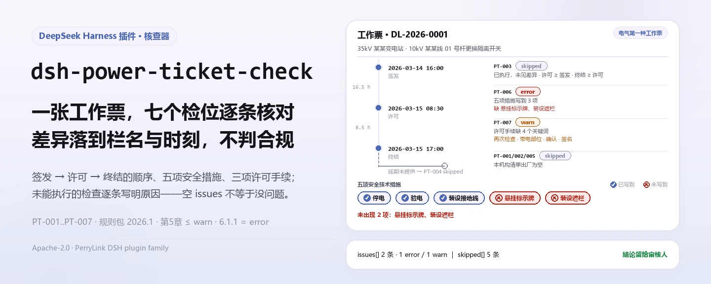
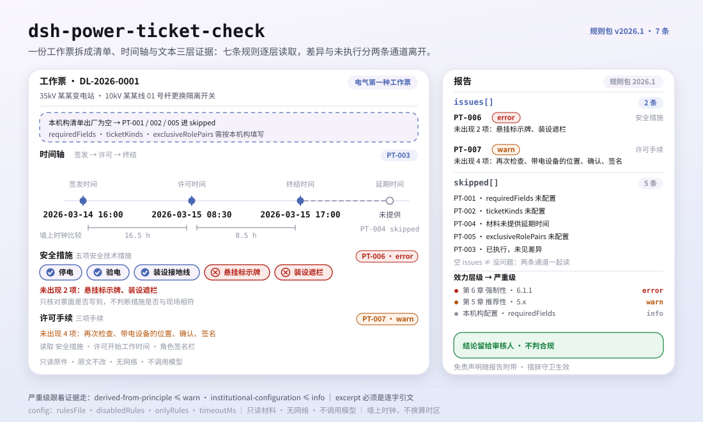

<div align="center">

<picture>
  <source media="(prefers-color-scheme: dark)" srcset="docs/assets/dsh-power-ticket-check-hero-zh-dark.webp">
  
</picture>

# dsh-power-ticket-check

**把一份电力工作票交进来，拿回一份「哪一栏、差什么、怎么补」的清单——合规结论始终留给审核人。**

面向 DeepSeek Harness 的数据型核查插件：读取一份电力工作票（以票面栏目名为键、栏目取值为值的平铺映射），按随包的版本化规则包（PT-001..PT-007）逐条核对要素齐备性与签发 → 许可 → 终结的时间顺序，只列票面内部能逐条指认的差异，不判合规、不认定责任。

[安装](#三步上手) · [配置](#配置) · [FAQ](#faq) · [简体中文](README.md) · [English](README.en.md) · [Español](README.es.md) · [Português](README.pt.md) · [हिन्दी](README.hi.md)

[](LICENSE)
[](#兼容性)
[](https://www.npmjs.com/package/dsh-power-ticket-check)
[](https://github.com/PerryLink/dsh-power-ticket-check/actions/workflows/ci.yml)
[](#兼容性)

[](https://github.com/PerryLink/dsh-power-ticket-check/stargazers)
[](https://www.npmjs.com/package/dsh-power-ticket-check)
[](https://dshfind.com/plugins/PerryLink/dsh-power-ticket-check?ref=badge)
[](https://securityscorecards.dev/viewer/?uri=github.com/PerryLink/dsh-power-ticket-check)
[](https://dsh.market/)
[](https://gitee.com/perrylink/dsh-power-ticket-check)

```sh
dsh plugin --profile <name> add dsh-power-ticket-check
```

</div>

<sub>社区插件，与 DeepSeek 官方无关。唯一仓库：<https://github.com/PerryLink/dsh-power-ticket-check>（Gitee 为镜像）。</sub>

## 它是什么

`dsh-power-ticket-check` 读取一份 **电力工作票**——以票面栏目名为键、栏目取值为值的平铺映射，外加票上列出的人员角色——按一张票面能被要求到的范围核对：本机构配置的 `requiredFields` 各栏是否填写、工作票种类是否在本机构列出的票种之内、签发时间 → 许可时间 → 终结时间 的顺序是否物理上成立、延期时间是否把结束时间向后推且不早于许可时间、本机构配置为须分设的角色是否由不同人员担任，以及安全措施与许可文本是否写到规则库要求核对的安全技术措施五项与许可手续三项关键词。

未能执行的检查逐条列在 `skipped` 并写明原因，而不是静默通过。它不判定作业是否合规、不认定责任、不替代审核人，只列材料内部能逐条指认的差异。

- **给谁用**：电力运维人员、工作票签发人与许可人；不用懂命令行，在对话里把材料交给它即可。
- **你交什么**：这项核对用到的原始材料（表格、清单或文书）；不改原件。Excel 可先转成 JSON/YAML，对话里也能代转。
- **它交什么**：一份「哪一栏、差什么、怎么补」的清单；没能执行的检查逐条列入 `skipped` 并写明原因。

<picture>
  <source media="(prefers-color-scheme: dark)" srcset="docs/assets/dsh-power-ticket-check-flow-v5-dark.svg">
  
</picture>

## 三步上手

1. **安装**（三选一）：

   ```sh
   # git 通道（最新 main；等价于 git+https://github.com/PerryLink/dsh-power-ticket-check.git）
   dsh plugin --profile <name> add github:PerryLink/dsh-power-ticket-check
   # npm 通道（已发布版本，当前 0.2.10）
   dsh plugin --profile <name> add dsh-power-ticket-check
   # tarball 通道：本仓库 pnpm pack 后
   dsh plugin --profile <name> add ./dsh-power-ticket-check-<version>.tgz
   ```

2. **最小配置**（默认即可用；bundle 行不带 `config` 时全部走默认值，规则包指向随包的 `rules/power-ticket-check.yaml`）：

   ```yaml
   - insert:
       - id: dsh-power-ticket-check
         name: dsh-power-ticket-check
   ```

3. **验证已生效**：

   ```sh
   dsh --profile <name> --dump-config | grep 'dsh-power-ticket-check'
   ```

   本地还可以直接跑仓内自带样例（首次需先 `pnpm install && pnpm run build` 产出 `lib/`）：

   ```sh
   node samples/quickstart/run.mjs --json
   # => {"tool":"power_ticket_check","issueCount":2,"summary":{"error":1,"warn":1,"info":0},"skippedCount":5}
   ```

   样例输入在 `samples/quickstart/input/`，期望输出在 `samples/quickstart/expected/result.json`。

**卸载**：`dsh plugin --profile <name> remove dsh-power-ticket-check`（或从 profile patch 删掉该行）。

<details>
<summary>在 WorkBuddy / 扣子中使用</summary>

在 WorkBuddy / 扣子搜「安全合规核对包」（总包，本检查是其中一项；上架以商城为准）即可在对话里调用同一套核对能力，无需命令行。

</details>

## 核心能力

`dsh-power-ticket-check` 注册 `power_ticket_check` 工具：读入一份工作票，套用版本化规则包，返回一份报告。

- **七条规则一包带走** —— 规则包是数据不是代码（`rules/power-ticket-check.yaml`，版本 `2026.1`），换掉规则包即换掉整套检查，不动一行 TypeScript。
- **只读材料** —— 接受 JSON 或 YAML，原件永不修改；纯 ESM，无网络请求、不调用模型。
- **引文不造假** —— 每条规则带 `document` / `number` / `clause` / `excerpt` / `kind` / `source`；`excerpt` 必须是逐字引文。DL/T 408—2023 的条款原文本次未取得，规则库如实写明不引用，而不是改写充作引文。
- **严重级跟着证据走** —— `derived-from-principle` 最高 `warn`，本机构配置（`institutional-configuration`）最高 `info`。GB 26860—2011 前言把工作票制度所在的第 5 章划为推荐性，因此仅依据第 5 章的规则不报 `error`；唯一 `error` 是落在强制性第 6 章的 `PT-006`。
- **空清单 ≠ 没问题** —— 每条没能执行的检查都进 `skipped` 并写明原因；`requiredFields`、`ticketKinds`、`exclusiveRolePairs` 出厂为空时，对应规则自我报告 `skipped`，绝不静默通过。
- **措辞不作裁决** —— 报告只列差异，不判定合规、责任或正确性；措辞守卫（wording guard）强制执行，报告永远附带免责声明。

| 规则 | 核对内容 | 严重级 | 依据类别 |
|---|---|---|---|
| `PT-001` | 本机构要求的栏目均已填写（默认关闭，版式属资料性） | info | local |
| `PT-002` | 工作票种类在本机构票种清单内，且与工作性质相符 | warn | direct |
| `PT-003` | 签发 → 许可 → 终结 的顺序成立；可选的间隔与时长上限 | warn | principle |
| `PT-004` | 延期时间把结束时间向后推，且不早于许可时间 | warn | direct |
| `PT-005` | 本机构要求分设的角色由不同人员担任（默认关闭） | warn | direct |
| `PT-006` | 五项安全技术措施写在票面上 | error | direct |
| `PT-007` | 三项许可手续（现场复查、指明带电部位、双方签名） | warn | direct |

### 示例

以下为插件真实入口；安装后调用一次即可。第一行是详细走查，其余是简短案例。

**详细示例** — 工具 `power_ticket_check`，输入：

```json
{"工作票编号":"DL-2026-0001","工作票种类":"电气第一种工作票","安全措施":"应停电、验电、装设接地线。"}
```

输出：

```json
{
  "id": "dsh-power-ticket-check.PT-006.104aebcf",
  "ruleId": "PT-006",
  "severity": "error",
  "locator": {
    "column": "安全措施"
  },
  "found": "安全措施文本中未出现 2 项：悬挂标示牌、装设遮栏",
  "expected": "在电气设备上工作，应有停电、验电、装设接地线、悬挂标示牌和装设遮栏（围栏）等保证安全的技术措施",
  "fix": "核对票面是否写全五项；本条只核对是否写到，不判断措施内容是否与现场相符"
}
```

*Observed from `dsh-power-ticket-check/tests/fixtures/PT-006/PT-006-unsafe.json (cases.json expects 1×PT-006); executed parseMaterial+runCheck, checkedAt=2026-10-06T00:00:00.000Z`*

| 你会问 | 它怎么答 |
|---|---|
| 出厂状态下，随便一份工作票都能通过，为什么？ | 因为 `PT-001` 是以 `skipped` 自报，不是判定通过。它的 `requiredFields` 清单出厂为空，本条无法执行；请按本机构票面把必填栏目填进去。即便配置好后，`PT-001` 也只核对栏目是否填写，不判断填写内容是否正确，且严重级为 `info`。 |
| 票种填的是电气第一种工作票，工作性质却写着带电作业，这种矛盾会报出吗？ | 不会。`PT-002` 只报两种情况：工作票种类没有填写，或所填种类不在本机构列出的票种之内。它的 `ticketKinds` 清单出厂为空，此时本条以 `skipped` 自报——`PT-005` 在 `exclusiveRolePairs` 清单为空时也是如此；本插件不判断该作业应当使用哪一种票。把清单填上以后，可把 `PT-005` 的角色对配成工作许可人与工作负责人，同一人同时出现在这两栏时即会报出。两条规则都不判断人员资格，也不判断兼职是否经批准。 |
| 许可时间写得比签发时间还早，另有一个时间栏的格式读不出来。 | `PT-003` 两种情况都会报：许可时间早于签发时间、终结时间早于许可时间，以及读不出来的栏目报为无法解析为日期时间，提示应按本机构统一写法填写，如 `2026-03-15 08:30`。它把两端都换算为绝对分钟数比较，跨天填写也算得准。若签发时间或许可时间完全读不出来，本条改为以 `skipped` 自报，因为顺序核对不成立。它不判断实际作业是否按票执行；可选的间隔与时长上限由使用方自行配置。 |
| 延期时间早于计划结束时间，等于把工期改短了。 | `PT-004` 会报出，延期时间早于许可时间也一并报出。标准未规定延期可以延长多久、可以办几次，因此本条不带任何量化上限，也不判断延期手续是否齐备。 |
| 安全措施栏写了内容，但只提到停电和验电。 | `PT-006` 会逐项报出缺少的三项。本条是本库唯一使用 `error` 级的规则，因为其依据 6.1.1 落在强制性章节；它只核对票面是否写到这五项，不判断措施内容是否与现场相符、是否执行到位。若找不到可读取的安全措施栏目，本条以 `skipped` 自报。 |
| 票面上看不出工作许可人曾会同工作负责人再到现场复查。 | `PT-007` 会报出它所读取的文本中缺少三项许可手续里的哪几项，读取范围是 `permitColumns` 这些栏目加上各角色栏的人名。它只做字面核对：现场是否真的复查过，它无从判断；若本机构要求这类问题阻断流程，可在规则库中直接提高本条严重级，不必改代码。 |

## 配置

全部可调参数都是 `src/config.ts` 里的 Schemastery `Config` 字段（可从 cordis.yml 覆盖），逐条阈值在 `rules/` 下的规则库文件里。按 id 覆盖会替换整行——请重述所有需要的键。

| 键 | 类型 | 默认值 | 说明 |
|---|---|---|---|
| `rulesFile` | string | `rules/power-ticket-check.yaml` | 规则库文件路径，相对插件包根目录 |
| `disabledRules` | string[] | `[]` | 要停用的规则 id 列表；每条都会出现在 `skipped` 中 |
| `onlyRules` | string[] | `[]` | 只执行这些规则 id；留空表示执行全部规则 |
| `skipNotes` | string | `""` | 附加到每条 `skipped` 说明后的备注 |
| `timeoutMs` | number | `120000` | 工具协作式超时预算（毫秒） |

值得了解的规则级参数：

- `PT-001` `requiredFields` —— 必须填写的栏目，用材料自己的栏目名；留空表示不核对。
- `PT-002` `ticketKinds` —— 你们的票种清单，例如 `[第一种工作票, 第二种工作票, 带电作业票]`；也可在单次调用里传入。
- `PT-003` `minMinutesBeforeWork` —— 签发与许可之间至少要求的间隔分钟数；`0` 关闭间隔比较。
- `PT-003` `maxDurationHours` —— 单张票允许的最长时长；`0` 关闭时长检查。
- `PT-005` `exclusiveRolePairs` —— 不得由同一人担任的角色对，写法如 `['工作票签发人|工作许可人']`。
- `PT-006` `measureTerms` / `measureColumns` —— 五项措施关键词与收集文本的栏目名。
- `PT-007` `permitTerms` / `permitColumns` —— 许可手续关键词与收集文本的栏目名。

profile patch 覆盖示例：

```yaml
- insert:
    - id: dsh-power-ticket-check
      name: dsh-power-ticket-check
      config:
        disabledRules: [PT-005]
        timeoutMs: 180000
```

## 材料格式

工具接受 JSON 或 YAML。一张工作票就是一个平铺映射：

```yaml
工作票编号: DL-2026-0001
工作票种类: 第一种工作票
工作地点: 35kV 某某变电站
工作任务: 10kV 某某线 01 号杆更换隔离开关
计划开始时间: 2026-03-15 08:00
计划结束时间: 2026-03-15 18:00
签发时间: 2026-03-14 16:00
许可时间: 2026-03-15 08:30
终结时间: 2026-03-15 17:00
工作票签发人: 张工
工作负责人: 李工
工作许可人: 王工
```

时间接受 `2026-03-15 08:30` 或纯日期；纯日期按当天零点处理，报告在需要时会说明。角色栏可以带后缀——`工作负责人签名` 会被识别为 `工作负责人` 角色——因此带签名栏导出的票面也能干净映射。

顺序核对把两端放在同一条连续时间轴上比较，跨天的许可会按更早的时刻报出，而不是算成一个小的负数同天间隔。字段在读取层是可选的，由检查引擎校验，因此部分导出的材料会产生「缺项」类差异，而不是让程序崩溃。

## 依据的标准

| 文件 | 文号 | 引用它的规则 |
|---|---|---|
| 《电力安全工作规程 发电厂和变电站电气部分》 | GB 26860—2011 | PT-001, PT-002, PT-003, PT-004, PT-005, PT-006, PT-007 |

**边界：** 本插件核对一份**电力工作票**中一张票面可以被要求到的部分——必填栏目是否填写，签发 / 许可 / 终结 的发生顺序是否物理上成立，延期是否把结束时间向后推，以及你要求分设的角色是否由不同人员担任。它**不**判断票面所写的安全措施是否充分，**不**指明某项作业需要哪一种工作票，也**不**核实任何人的资格是否真实。

规则数据与代码分离，存放在 `rules/power-ticket-check.yaml`。每条规则都带文件名、文号、按原文自身编号体系的条款号、逐字摘录与来源地址；加载期强制：摘录必须是真实引文且不少于八个字符，依据仅为一般原则或本机构配置的检查永远不能标为 `error`。

> ### ⚠️ 本插件拒绝做的三件事，以及决定其严重级的效力层级
>
> **1. 它尊重标准自身的效力层级。** GB 26860—2011 的前言逐字写着：「本标准的第5章和7.3.4为推荐性，其余为强制性」——**工作票制度位于*推荐性*的第 5 章。** 因此凡以第 5 章为依据的规则，出厂均为 `warn` 或 `info`，**其中没有任何一条能阻断流程**。`PT-006`（安全技术措施五项，6.1.1 条）是**唯一**的 `error`，因为第 6 章是强制性的。`PT-007`（许可手续，5.5.1 条）是 `warn`；其 note 说明，希望这些手续能阻断流程的机构，可以修改规则库将其提高，无需改代码。有一项测试对两个方向都做了断言：没有任何第 5 章的规则是 `error`，且 `PT-006` 是唯一一条。
>
> **2. 它不采纳三项在标准中没有依据的说法。** 完整读过 GB 26860—2011 与 GB 26859—2011 之后：任何地方都**没有**「第一种工作票应工作前一日送达」这样的时限；5.3.12 与 5.4.10 只说「延期应办理手续」，**对延期时长与次数均无上限**；法定名称是**紧急抢修单**（5.2.4），而不是「事故应急抢修单」。有一项测试断言规则库记录了三者。
>
> **3. 它不把票面版式当作强制要求。** 5.1.2 说工作票「**可**包含」这些项目，而附录 A–D 在标准目录中标为**资料性附录**（informative）。因此 `PT-001` 出厂时字段清单为**空**，由你按本单位票面填写，并以 `info` 报告。
>
> 还有两份清单属于你：`PT-002` 的票种与 `PT-005` 的互斥角色对。两者出厂均为空。本插件从不判断票面所写的安全措施是否充分、某项作业需要哪一种工作票，也不判断任何人的资格是否真实——标准规定的是各角色的**职责**（5.4.1–5.4.5），**没有规定任何资格条件**。

本规则库引用的条款来自 **GB 26860—2011《电力安全工作规程 发电厂和变电站电气部分》**——5.1.2、5.2.1–5.2.4、5.3.7、5.3.12、5.5.1、5.7.5 与 6.1.1——效力层级取自该标准前言，用于确定每条规则的严重级。条款文本取自一份全文扫描转录，并与另一个独立站点逐字比对。

本族当前涉及的标准（均已在标准平台核验元数据）：

| 标准 | 实施日期 | 说明 |
|---|---|---|
| GB 26860—2011 发电厂和变电站电气部分 | 2012-06-01 | 强制性，第 5 章与 7.3.4 除外；修订版「正在报批」 |
| GB 26859—2011 电力线路部分 | 2012-06-01 | 线路侧对应标准 |
| DL/T 408—2023 发电厂和变电站电气部分 | 2024-06-28 | 代替 **DL 408—1991**，与 GB 26860 **并行**，不是对它的替代 |
| DL/T 409—2023 电力线路部分 | 2024-06-28 | |
| DL/T 560—2022 高压试验室部分 | 2022-11-13 | 代替 DL 560—1995 |

**DL/T 408—2023 的条款原文本次未取得，因此本规则库不引用它的任何条文。** 其身份与章节结构已核验；DL/T 408—2023 把「紧急抢修单」改称「故障紧急抢修单」，并新增「带电作业票」与「双签发」——这也是 `PT-002` 同时接受两种名称、而不是二选一的原因。

完整的条款核验报告（含已核对与已排除的来源）见 `rules/evidence/clause-verification.md`。

## FAQ

<details>
<summary>材料会被上传吗？数据存在哪里？</summary>

不会上传。本插件是本地只读核查器：只读取你交给工具的材料，不发起网络请求、不调用模型、不带遥测；除工具结果与 DSH 宿主自身的会话/日志存储外，不向任何地方写数据。宿主控制那份存储及其保留期，本包不另存副本。删除本包只删除它的代码，不会删除宿主已有的会话日志或你创建的文档。

</details>

<details>
<summary>我的工作票是 Excel，能直接用吗？</summary>

可以，先转成 JSON 或 YAML；平台支持时在对话里就能代为转换。工具只读材料，永不修改原件。

</details>

<details>
<summary>`issues` 为空，能当作「这张票没问题」吗？</summary>

不能。每条没能执行的检查都列在 `skipped` 里并写明原因（例如 `requiredFields` 未配置、缺签发时间、找不到安全措施栏目）。判读报告时请把 `issues` 与 `skipped` 一起看完；`PT-001`、`PT-002`、`PT-005` 出厂清单为空，因此默认会以 `skipped` 自报。

</details>

<details>
<summary>为什么发现几乎都是 `warn` / `info`？它会阻断流程吗？</summary>

默认不阻断。GB 26860—2011 前言把工作票制度所在的第 5 章划为推荐性，因此第 5 章规则最高只到 `warn`；唯一 `error` 是依据强制性第 6 章的 `PT-006`。如果本机构要求某类问题必须阻断，在规则库里提高该条 `severity` 即可，不必改代码。

</details>

<details>
<summary>一次核对很多张票，性能吃得消吗？</summary>

工具在 `native` 与 `ptc` 两种模式都能跑；批量核对（例如一个月的票）建议 `ptc`，schema 成本只付一次。检查本身是纯本地的字段匹配与时间算术，无网络请求、不调用模型；`timeoutMs`（默认 120 秒）是协作式超时预算。

</details>

## 排障

- **`PT-001`、`PT-002` 或 `PT-005` 自我报告为 `skipped`。** 它们的清单为空；按本机构规程把对应清单填上。
- **`PT-003` 不报任何顺序问题。** 签发时间与许可时间没有同时出现，本条在 `skipped` 里写明了这一点。若时间栏有值但读不出来，本条报的是「无法解析」，而不是跳过——因此一个读不出的单元格永远不会让检查悄悄消失。
- **`PT-003` 对我们习惯的时长报了问题。** `maxDurationHours` 默认是 `0`；一旦设置，它对工具看到的每一张票都生效。票本来就干得久，就留在 `0`。
- **`PT-005` 漏掉了一个我知道的情况。** 把角色对加上。插件只比较你列出的角色对，因为哪些角色必须分设取决于票种与本机构实施细则。
- **插件装上了但工具不出现。** 确认 `main` 解析到 `lib/index.mjs`，且 `pnpm run build` 已产出该文件；`main` 写错会让加载器静默跳过该条目。
- **`dsh plugin add` 以不兼容为由拒绝安装。** peer 范围覆盖 `0.1.x` 与 `0.2.x`；若运行时在其之外，可显式豁免：`dsh plugin --profile <name> allow-version dsh-power-ticket-check@0.1.0 --dsh-version <runtime> --accept-risk`
- **`check` 把 `manifest-peers` 报为失败。** 静态检查器比对的是一份早于 0.2 世代的硬编码 peer 范围；安装期的 peer 校验以运行时为准，声明的范围才是正确的。这是 `dsh-plugin-dev` 的已知上游问题。
- **时间看起来偏移。** 全部计算都是对输入字符串做墙上时钟运算，不做时区换算。

## 安全边界与已知限制

- **只读、本地、无网络。** 工具只读取传入的材料，不修改原件；不发起网络请求、不调用模型、不带遥测，除工具结果与宿主自身会话存储外不写数据。
- **不判合规、不认定责任、不替代审核人。** 报告只列材料内部能逐条指认的差异，措辞守卫强制执行，每份报告都带免责声明。
- **不判断措施是否充分、该用哪种票、资格是否真实。** 标准只规定各角色的**职责**（5.4.1–5.4.5），**没有规定资格条件**；本插件据此把 `requiredFields`、`ticketKinds`、`exclusiveRolePairs` 三份清单留给使用方配置。
- **空清单不等于通过。** 未能执行的检查一律进 `skipped`；`requiredFields`、`ticketKinds`、`exclusiveRolePairs` 未配置时，对应规则自我报告 `skipped`。
- **单票模式的局限。** 5.3.7 原文是「一个工作负责人不应同时执行两张及以上工作票」，单张票的材料看不出「同时执行两张」；本插件在单票模式下只核对配置的角色分设（`exclusiveRolePairs`）。要核对 5.3.7 本身，应由使用方把同一时间窗内的多张票合并核对。
- **规则库的已知缺口。** DL/T 408—2023 的条款原文未取得，本规则库不引用其条文；其身份与章节结构已核验，`PT-002` 同时接受「紧急抢修单」与「故障紧急抢修单」两种写法。完整核验记录见 `rules/evidence/clause-verification.md`。
- **时间按墙上时钟。** 全部计算都是对输入字符串做墙上时钟运算，不做时区换算；读不出来的时间栏报为 `无法解析为日期时间`，签发时间与许可时间都读不出来时 `PT-003` 以 `skipped` 自报。
- **默认不阻断流程。** 第 5 章规则最高 `warn`；需要阻断的机构在规则库中提高对应条目的 `severity`，无需改代码。

## 兼容性

| 项目 | 状态 |
|---|---|
| Harness | 对等版本范围 `>=0.1.2-rc.1 <0.2.0 \|\| >=0.2.0-0 <0.3.0` —— 已实测同时接受 `0.2.0-rc.2` 与 `0.2.1-rc.2`。已声明 `engines.dsh`：0.2.1 起由宿主单独裁决，范围为 `>=0.2.1-0 <0.3.0` |
| Node | `^22.19.0 \|\| >=24.0.0` |
| 平台 | 全平台（纯 ESM；无原生代码、无联网、不调用模型） |
| 工具模式 | `native` / `ptc` 均可；批量核对（例如一个月的票）建议 `ptc`，schema 成本只付一次 |

## 生态与质量

- [Gitee 镜像](https://gitee.com/perrylink/dsh-power-ticket-check)（同步镜像，以 GitHub 为准）
- [dshfind 插件页](https://dshfind.com/plugins/PerryLink/dsh-power-ticket-check)（安装量与排名）
- [OpenSSF Scorecard 报告](https://securityscorecards.dev/viewer/?uri=github.com/PerryLink/dsh-power-ticket-check)（由 [.github/workflows/scorecard.yml](.github/workflows/scorecard.yml) 驱动）
- [DSH Market](https://dsh.market/)（已上架）
- [生态实测知识库](https://perrylink.github.io/dsh-plugin-guide/)：插件开发指南 · 选型实测数据 · 维护取舍判据

## 开发

```sh
pnpm install                                        # node ^22.19 || >=24
pnpm run typecheck                                  # tsc --noEmit
pnpm test                                           # vitest：共享表格插件套件 + 成对夹具
pnpm run build                                      # tsdown -> lib/index.mjs + lib/index.d.mts
pnpm run verify:self-contained                      # 依赖 spec 均来自 registry
pnpm run check:lockfile                             # lockfile 漂移检查
pnpm run check:readmes                              # 五语 README 一致性
pnpm run check:citations                            # 规则包引文基线
node ../scripts/sync-shared.mjs dsh-power-ticket-check   # 从 ../_shared 刷新 src/shared
pnpm pack                                           # 发布 tarball
```

| 路径 | 作用 |
|---|---|
| `src/index.ts` | function-plugin 契约；注册 `power_ticket_check`、解析随包规则库 |
| `src/config.ts` | Schemastery schema，所有可调项都在这里 |
| `src/check.ts` | 纯检查核，`(input, ruleset, options) => Report`；无插件上下文、无 I/O、无时钟、无模型 |
| `src/parse.ts` | JSON/YAML 读取器，把材料归一化为票面字段与角色 |
| `src/view.ts` | 报告到模型可见输出的投影 |
| `src/shared/` | 共享套件（规则库加载、报告形状、YAML 子集、日历算术、措辞守卫、表格助手）；随包复制，不外部引用 |
| `rules/power-ticket-check.yaml` | 规则包（7 条） |
| `rules/evidence/` | 每条引文的条款核验记录 |
| `tests/` | vitest；每条规则在 `tests/fixtures/<RULE>/` 有成对的合规/违规夹具 |

本插件是**数据型**的：规则包声明每一条检查，代码只负责读取、执行与渲染。本地样例试跑（需先 `pnpm run build` 产出 `lib/`）：

```sh
node samples/quickstart/run.mjs --json
# => {"tool":"power_ticket_check","issueCount":2,"summary":{"error":1,"warn":1,"info":0},"skippedCount":5}
```

README 配图由 [`scripts/gen-readme-assets.py`](scripts/gen-readme-assets.py) 程序化生成——hero 横幅用 Pillow 画、结构图用手写 SVG 画——可重复执行；旧的单版流程图与演示图保留在 `docs/assets/` 供外链使用，README 只引用新生成的 hero 与 flow-v5 结构图（各含深浅双版）。

Topics：`deepseek-harness`, `dsh`, `dsh-plugin`, `cordis`, `power`, `ticket`

## 家族与致谢

本项目是 [PerryLink](https://github.com/PerryLink) 维护的 DeepSeek Harness 插件家族成员（全部 Apache-2.0）。完整家族索引见[按材料选核查器](https://perrylink.github.io/zh/checkers/choose/)。如果这个插件帮到了你，**给个 star**——它不解锁任何功能，但会让下一个人更容易找到它。

- [@PerryLink](https://github.com/PerryLink) —— 创建者与维护者：数据型规则包（PT-001..PT-007）、`power_ticket_check` 工具、条款核验记录与五语文档。

<details>
<summary>展开全部插件</summary>

| 插件 | 状态 |
|---|---|
| **[dsh-aqua-input-check](https://github.com/PerryLink/dsh-aqua-input-check)** |  |
| **[dsh-archive-check](https://github.com/PerryLink/dsh-archive-check)** |  |
| **[dsh-auto-review](https://github.com/PerryLink/dsh-auto-review)** |  |
| **[dsh-autotier](https://github.com/PerryLink/dsh-autotier)** | 🧊 已冻结 — 见仓库 README |
| **[dsh-bid-ca-precheck](https://github.com/PerryLink/dsh-bid-ca-precheck)** |  |
| **[dsh-bid-qual-check](https://github.com/PerryLink/dsh-bid-qual-check)** |  |
| **[dsh-cert-mcp](https://github.com/PerryLink/dsh-cert-mcp)** | 🧊 已冻结 — 见仓库 README |
| **[dsh-checkpoint-rewind](https://github.com/PerryLink/dsh-checkpoint-rewind)** |  |
| **[dsh-click](https://github.com/PerryLink/dsh-click)** |  |
| **[dsh-composer-history](https://github.com/PerryLink/dsh-composer-history)** |  |
| **[dsh-contract-stance](https://github.com/PerryLink/dsh-contract-stance)** |  |
| **[dsh-customs-doc-check](https://github.com/PerryLink/dsh-customs-doc-check)** |  |
| **[dsh-data-quality](https://github.com/PerryLink/dsh-data-quality)** |  |
| **[dsh-demurrage-ledger](https://github.com/PerryLink/dsh-demurrage-ledger)** |  |
| **[dsh-doublecheck](https://github.com/PerryLink/dsh-doublecheck)** |  |
| **[dsh-drill-script-check](https://github.com/PerryLink/dsh-drill-script-check)** |  |
| **[dsh-eia-guide-check](https://github.com/PerryLink/dsh-eia-guide-check)** |  |
| **[dsh-emergency-plan](https://github.com/PerryLink/dsh-emergency-plan)** |  |
| **[dsh-essay-rubric-check](https://github.com/PerryLink/dsh-essay-rubric-check)** |  |
| **[dsh-evidence-check](https://github.com/PerryLink/dsh-evidence-check)** |  |
| **[dsh-export-ctl-check](https://github.com/PerryLink/dsh-export-ctl-check)** |  |
| **[dsh-fast](https://github.com/PerryLink/dsh-fast)** |  |
| **[dsh-fmea-table-check](https://github.com/PerryLink/dsh-fmea-table-check)** |  |
| **[dsh-forecast-penalty](https://github.com/PerryLink/dsh-forecast-penalty)** |  |
| **[dsh-fund-research](https://github.com/PerryLink/dsh-fund-research)** |  |
| **[dsh-github](https://github.com/PerryLink/dsh-github)** |  |
| **[dsh-gongwen-flow-check](https://github.com/PerryLink/dsh-gongwen-flow-check)** |  |
| **[dsh-gongwen-word-check](https://github.com/PerryLink/dsh-gongwen-word-check)** |  |
| **[dsh-guard-plan-qc](https://github.com/PerryLink/dsh-guard-plan-qc)** |  |
| **[dsh-hazchem-check](https://github.com/PerryLink/dsh-hazchem-check)** |  |
| **[dsh-hazplan-check](https://github.com/PerryLink/dsh-hazplan-check)** |  |
| **[dsh-hidden-risk-map](https://github.com/PerryLink/dsh-hidden-risk-map)** |  |
| **[dsh-hs-classify](https://github.com/PerryLink/dsh-hs-classify)** |  |
| **[dsh-icd-rule-check](https://github.com/PerryLink/dsh-icd-rule-check)** |  |
| **[dsh-industry-research](https://github.com/PerryLink/dsh-industry-research)** |  |
| **[dsh-lawcite-adapter](https://github.com/PerryLink/dsh-lawcite-adapter)** |  |
| **[dsh-laya](https://github.com/PerryLink/dsh-laya)** |  |
| **[dsh-lc-doc-check](https://github.com/PerryLink/dsh-lc-doc-check)** |  |
| **[dsh-learning-gap-check](https://github.com/PerryLink/dsh-learning-gap-check)** |  |
| **[dsh-library](https://github.com/PerryLink/dsh-library)** |  |
| **[dsh-local-ai](https://github.com/PerryLink/dsh-local-ai)** |  |
| **[dsh-lsp-actions](https://github.com/PerryLink/dsh-lsp-actions)** |  |
| **[dsh-mask](https://github.com/PerryLink/dsh-mask)** |  |
| **[dsh-mcp-panel](https://github.com/PerryLink/dsh-mcp-panel)** |  |
| **[dsh-medrec-qc](https://github.com/PerryLink/dsh-medrec-qc)** |  |
| **[dsh-memento](https://github.com/PerryLink/dsh-memento)** |  |
| **[dsh-nsfc-form-check](https://github.com/PerryLink/dsh-nsfc-form-check)** |  |
| **[dsh-nurse-record-check](https://github.com/PerryLink/dsh-nurse-record-check)** |  |
| **[dsh-observe](https://github.com/PerryLink/dsh-observe)** |  |
| **[dsh-origin-rvc-check](https://github.com/PerryLink/dsh-origin-rvc-check)** |  |
| **[dsh-ota-review-check](https://github.com/PerryLink/dsh-ota-review-check)** |  |
| **[dsh-output-styles](https://github.com/PerryLink/dsh-output-styles)** |  |
| **[dsh-paper-doc-adapter](https://github.com/PerryLink/dsh-paper-doc-adapter)** |  |
| **[dsh-permission-rules](https://github.com/PerryLink/dsh-permission-rules)** |  |
| **[dsh-permit-report-check](https://github.com/PerryLink/dsh-permit-report-check)** |  |
| **[dsh-pipeline-check](https://github.com/PerryLink/dsh-pipeline-check)** |  |
| **[dsh-pleading-draft](https://github.com/PerryLink/dsh-pleading-draft)** |  |
| **[dsh-plugin-doctor](https://github.com/PerryLink/dsh-plugin-doctor)** | 🚫 已退役（仓库已归档） |
| **[dsh-plugin-guide](https://github.com/PerryLink/dsh-plugin-guide)** |  |
| **[dsh-plugin-kit](https://github.com/PerryLink/dsh-plugin-kit)** | 🚫 已退役（仓库已归档） |
| **[dsh-plugin-upgrade](https://github.com/PerryLink/dsh-plugin-upgrade)** | 🚫 已退役（仓库已归档） |
| **[dsh-policy-brief-draft](https://github.com/PerryLink/dsh-policy-brief-draft)** |  |
| **[dsh-power-loss-split](https://github.com/PerryLink/dsh-power-loss-split)** |  |
| **[dsh-power-ticket-check](https://github.com/PerryLink/dsh-power-ticket-check)** |  |
| **[dsh-ppap-check](https://github.com/PerryLink/dsh-ppap-check)** |  |
| **[dsh-protest-deadline](https://github.com/PerryLink/dsh-protest-deadline)** |  |
| **[dsh-railway-window](https://github.com/PerryLink/dsh-railway-window)** |  |
| **[dsh-repair-order-qc](https://github.com/PerryLink/dsh-repair-order-qc)** |  |
| **[dsh-research-report](https://github.com/PerryLink/dsh-research-report)** |  |
| **[dsh-review-reply-check](https://github.com/PerryLink/dsh-review-reply-check)** |  |
| **[dsh-rulefile-check](https://github.com/PerryLink/dsh-rulefile-check)** |  |
| **[dsh-safety-brief-check](https://github.com/PerryLink/dsh-safety-brief-check)** |  |
| **[dsh-score](https://github.com/PerryLink/dsh-score)** |  |
| **[dsh-session-sync](https://github.com/PerryLink/dsh-session-sync)** |  |
| **[dsh-site-log-check](https://github.com/PerryLink/dsh-site-log-check)** |  |
| **[dsh-skill-pack-security](https://github.com/PerryLink/dsh-skill-pack-security)** |  |
| **[dsh-soe-decision-check](https://github.com/PerryLink/dsh-soe-decision-check)** |  |
| **[dsh-soilwater-check](https://github.com/PerryLink/dsh-soilwater-check)** |  |
| **[dsh-sop-sync-check](https://github.com/PerryLink/dsh-sop-sync-check)** |  |
| **[dsh-spc-gbt-adapter](https://github.com/PerryLink/dsh-spc-gbt-adapter)** |  |
| **[dsh-talk](https://github.com/PerryLink/dsh-talk)** |  |
| **[dsh-tender-extract](https://github.com/PerryLink/dsh-tender-extract)** |  |
| **[dsh-tender-matrix](https://github.com/PerryLink/dsh-tender-matrix)** |  |
| **[dsh-test-drive](https://github.com/PerryLink/dsh-test-drive)** |  |
| **[dsh-ticktick](https://github.com/PerryLink/dsh-ticktick)** | 🚫 已退役（仓库已归档） |
| **[dsh-translate](https://github.com/PerryLink/dsh-translate)** |  |
| **[dsh-warranty-calc](https://github.com/PerryLink/dsh-warranty-calc)** |  |
| **[dsh-budget](https://github.com/PerryLink/dsh-budget)** | 🧊 已冻结 — 见仓库 README |
| **[dsh-claude-move](https://github.com/PerryLink/dsh-claude-move)** | 🧊 已冻结 — 见仓库 README |
| **[dsh-defend](https://github.com/PerryLink/dsh-defend)** | 🧊 已冻结 — 见仓库 README |
| **[dsh-draw](https://github.com/PerryLink/dsh-draw)** | 🧊 已冻结 — 见仓库 README |
| **[dsh-reach](https://github.com/PerryLink/dsh-reach)** | 🧊 已冻结 — 见仓库 README |
| **[dsh-background-agents](https://github.com/PerryLink/dsh-background-agents)** | 🚫 已退役（仓库已归档） |
| **[dsh-session-pin](https://github.com/PerryLink/dsh-session-pin)** | 🚫 已退役（仓库已归档） |
| **[dsh-team-rooms](https://github.com/PerryLink/dsh-team-rooms)** | 🚫 已退役（仓库已归档） |

</details>

## License

[LICENSE](LICENSE)（Apache License 2.0）© 2026 dsh-power-ticket-check contributors

<p align="center"><sub>Apache-2.0 · 社区插件，与 DeepSeek 无关。</sub></p>
