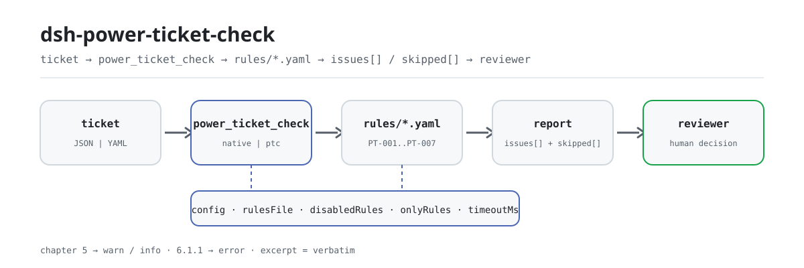

<div align="center">

<picture>
  <source media="(prefers-color-scheme: dark)" srcset="docs/assets/dsh-power-ticket-check-flow-dark.svg">
  
</picture>

# dsh-power-ticket-check

**Entregue uma permissão de trabalho elétrico e receba de volta uma lista de qual coluna está em falta, o que falta e como completar — o veredicto de conformidade continua com o revisor.**

Um plugin de verificação baseado em dados para o DeepSeek Harness: lê uma **permissão de trabalho elétrico** (um mapa plano dos nomes das colunas do formulário para os respetivos valores, mais os papéis de pessoal nele indicados), aplica o pacote de regras versionado que traz (PT-001..PT-007) e verifica a completude e a ordem temporal emissão → autorização → encerramento. Lista apenas as diferenças que consegue apontar dentro do material — nunca um veredicto de conformidade, nunca uma conclusão de responsabilidade.

[Instalação](#instalação-em-três-passos) · [Configuração](#configuração) · [FAQ](#faq) · [简体中文](README.md) · [English](README.en.md) · [Español](README.es.md) · [Português](README.pt.md) · [हिन्दी](README.hi.md)

[](LICENSE)
[](#compatibilidade)
[](https://www.npmjs.com/package/dsh-power-ticket-check)
[](https://github.com/PerryLink/dsh-power-ticket-check/actions/workflows/ci.yml)
[](#compatibilidade)

[](https://github.com/PerryLink/dsh-power-ticket-check/stargazers)
[](https://www.npmjs.com/package/dsh-power-ticket-check)
[](https://dshfind.com/plugins/PerryLink/dsh-power-ticket-check?ref=badge)
[](https://securityscorecards.dev/viewer/?uri=github.com/PerryLink/dsh-power-ticket-check)
[](https://dsh.market/)
[](https://gitee.com/perrylink/dsh-power-ticket-check)

```sh
dsh plugin --profile <name> add dsh-power-ticket-check
```

</div>

<sub>Plugin da comunidade, não afiliado à DeepSeek. Repositório canônico: <https://github.com/PerryLink/dsh-power-ticket-check> (o Gitee é um espelho).</sub>

## O que é

`dsh-power-ticket-check` lê uma **permissão de trabalho elétrico** — um mapa plano dos nomes das colunas do próprio formulário para os respetivos valores, mais os papéis do pessoal nela indicados — e verifica o que se pode exigir de um formulário: que todas as colunas do seu `requiredFields` configurado estejam preenchidas, que o tipo de permissão esteja na lista da sua implantação, que a hora de emissão → autorização → encerramento forme uma sequência fisicamente possível, que uma prorrogação desloque o fim para a frente e não seja anterior à autorização, que os papéis configurados como exclusivos sejam desempenhados por pessoas diferentes, e que o texto de medidas de segurança e de autorização contenha os cinco termos de medidas técnicas de segurança e os três de trâmites de autorização que o pacote procura.

As verificações que não puderam ser executadas são listadas em `skipped` com o respetivo motivo, em vez de passarem em silêncio. Não julga se o trabalho cumpriu as regras, não determina responsabilidade e não substitui o revisor; lista apenas as diferenças que consegue apontar dentro do material.

- **Para quem é**: pessoal de operação elétrica, emissores de permissões e titulares de autorização; não é necessária linha de comandos — entregue o material no chat.
- **O que entrega**: o material de origem sobre o qual a verificação trabalha (uma tabela, um registo ou um documento); o original nunca é modificado. O Excel pode ser convertido antes para JSON/YAML, no chat se a plataforma o permitir.
- **O que recebe**: uma lista de «qual coluna, o que falta, como completar»; cada verificação que não pôde ser executada aparece em `skipped` com o respetivo motivo.

## Instalação em três passos

1. **Instalar** (escolha um canal):

   ```sh
   # canal git (última main; equivale a git+https://github.com/PerryLink/dsh-power-ticket-check.git)
   dsh plugin --profile <name> add github:PerryLink/dsh-power-ticket-check
   # canal npm (versões publicadas; atualmente 0.2.10)
   dsh plugin --profile <name> add dsh-power-ticket-check
   # canal tarball: pnpm pack neste repositório e depois
   dsh plugin --profile <name> add ./dsh-power-ticket-check-<version>.tgz
   ```

2. **Configuração mínima** (valores predefinidos; sem um bloco `config` na linha do bundle tudo corre com os valores predefinidos e o pacote de regras aponta para o `rules/power-ticket-check.yaml` incluído):

   ```yaml
   - insert:
       - id: dsh-power-ticket-check
         name: dsh-power-ticket-check
   ```

3. **Verificar que monta**:

   ```sh
   dsh --profile <name> --dump-config | grep 'dsh-power-ticket-check'
   ```

   Também pode executar o exemplo incluído localmente (gere primeiro `lib/` com `pnpm install && pnpm run build`):

   ```sh
   node samples/quickstart/run.mjs --json
   # => {"tool":"power_ticket_check","issueCount":2,"summary":{"error":1,"warn":1,"info":0},"skippedCount":5}
   ```

   A entrada do exemplo está em `samples/quickstart/input/` e a saída esperada em `samples/quickstart/expected/result.json`.

**Desinstalar**: `dsh plugin --profile <name> remove dsh-power-ticket-check` (ou remova a linha do patch do perfil).

<details>
<summary>Usar no WorkBuddy / Coze</summary>

Procure o pacote «Safety Compliance Suite» no WorkBuddy / Coze (esta verificação é um dos seus itens; a disponibilidade depende da loja) para usar a mesma capacidade de verificação no chat, sem linha de comandos.

</details>

## Capacidades principais

`dsh-power-ticket-check` registra a ferramenta `power_ticket_check`: lê uma permissão, aplica um pacote de regras versionado e devolve um relatório.

- **Sete regras num pacote** — o pacote de regras é dados, não código (`rules/power-ticket-check.yaml`, versão `2026.1`); trocá-lo troca todo o conjunto de verificações sem tocar numa linha de TypeScript.
- **Apenas leitura sobre o material** — aceita JSON ou YAML e nunca modifica o original; ESM puro, sem pedidos de rede e sem chamadas ao modelo.
- **Sem citações inventadas** — cada regra leva `document` / `number` / `clause` / `excerpt` / `kind` / `source`, e `excerpt` tem de ser uma citação literal. O texto das cláusulas da DL/T 408—2023 não pôde ser obtido nesta ronda, e o pacote di-lo em vez de o parafrasear como citação.
- **A gravidade segue a evidência** — `derived-from-principle` está limitada a `warn`, e a configuração institucional (`institutional-configuration`) a `info`. O prólogo da GB 26860—2011 marca o capítulo 5 (onde vive o regime da permissão de trabalho) como recomendatório, pelo que nenhuma regra do capítulo 5 reporta `error`; o único `error` é a `PT-006`, que assenta no capítulo 6 obrigatório.
- **Uma lista vazia não é uma aprovação** — cada verificação que não pôde ser executada é reportada em `skipped` com o respetivo motivo; quando `requiredFields`, `ticketKinds` ou `exclusiveRolePairs` vêm vazias, a regra afetada reporta-se em `skipped` em vez de passar em silêncio.
- **Sem linguagem que adjudique** — o relatório lista apenas diferenças e nunca se pronuncia sobre conformidade, responsabilidade ou correção; um guarda de redação impõe-no e todos os relatórios levam o aviso legal.

| Regra | O que verifica | Gravidade | Tipo de base |
|---|---|---|---|
| `PT-001` | todas as colunas configuradas estão preenchidas (desativada por predefinição; o formato é informativo) | info | local |
| `PT-002` | o tipo de permissão está na sua lista e corresponde à natureza do trabalho | warn | direct |
| `PT-003` | emissão → autorização → encerramento é uma ordem possível; limites opcionais de intervalo e duração | warn | principle |
| `PT-004` | uma prorrogação move o fim para a frente e segue a autorização | warn | direct |
| `PT-005` | os papéis que exige separados são desempenhados por pessoas diferentes (desativada por predefinição) | warn | direct |
| `PT-006` | as cinco medidas técnicas de segurança estão escritas na permissão | error | direct |
| `PT-007` | os três trâmites de autorização (revisão do local, indicação de partes em tensão, ambas as assinaturas) | warn | direct |

### Exemplos

Estes são os pontos de entrada reais do plugin; instale uma vez e chame um deles. O primeiro bloco é o percurso detalhado e a tabela seguinte reúne os casos breves.

**Exemplo detalhado** — ferramenta `power_ticket_check`, entrada:

```json
{"工作票编号":"DL-2026-0001","工作票种类":"电气第一种工作票","安全措施":"应停电、验电、装设接地线。"}
```

Saída:

```json
{
  "id": "dsh-power-ticket-check.PT-006.104aebcf",
  "ruleId": "PT-006",
  "severity": "error",
  "locator": {
    "column": "安全措施"
  },
  "found": "安全措施文本中未出现 2 项：悬挂标示牌、装设遮栏",
  "expected": "在电气设备上工作，应有停电、验电、装设接地线、悬挂标示牌和装设遮栏（围栏）等保证安全的技术措施",
  "fix": "核对票面是否写全五项；本条只核对是否写到，不判断措施内容是否与现场相符"
}
```

*Observado em `dsh-power-ticket-check/tests/fixtures/PT-006/PT-006-unsafe.json (cases.json expects 1×PT-006); executed parseMaterial+runCheck, checkedAt=2026-10-06T00:00:00.000Z`*

| Você pergunta | O que responde |
|---|---|
| Tal como vem, aprova todas as permissões que lhe passo — por quê? | Porque a `PT-001` se reporta em `skipped`, não como aprovada. A sua lista `requiredFields` vem vazia, pelo que a regra não pode ser executada; preencha-a com as colunas que o seu próprio formulário exige. Mesmo configurada, a `PT-001` verifica que a coluna está preenchida, não que o valor esteja correto, e o seu nível é `info`. |
| A permissão é de primeira classe mas a natureza do trabalho menciona trabalho em tensão — essa contradição é reportada? | Não. A `PT-002` reporta apenas duas coisas: que o tipo de permissão falte, ou que não esteja entre os tipos que a sua implantação declara. A sua lista `ticketKinds` vem vazia e a regra reporta-se então em `skipped`, tal como a `PT-005` quando a lista `exclusiveRolePairs` está vazia; o plugin não decide que tipo de permissão um trabalho precisa. Depois de preencher essas listas, configure a `PT-005` com o par titular da autorização e responsável pelo trabalho para que a mesma pessoa nas duas colunas seja reportada. Nenhuma das regras julga a qualificação de ninguém nem se acumular funções foi aprovado. |
| A hora de autorização está escrita antes da hora de emissão, e ainda há uma coluna de tempo que não é analisável. | A `PT-003` reporta ambas: autorização anterior à emissão, encerramento anterior à autorização, e qualquer coluna ilegível como data-hora não analisável, esperando uma forma como `2026-03-15 08:30`. Ambas as pontas são convertidas num contagem absoluta de minutos, pelo que uma permissão que atravessa a meia-noite é comparada corretamente. Se a hora de emissão ou a de autorização não puderem ser lidas de todo, a regra reporta-se em `skipped`, porque a verificação da ordem não pode ser estabelecida. Nunca verifica se o trabalho seguiu realmente a permissão, e o limite opcional de intervalo ou de duração é configurado por si. |
| A hora de prorrogação é anterior ao fim planeado, pelo que a prorrogação encurta o trabalho em vez de o prolongar. | A `PT-004` reporta-o, e também reporta uma prorrogação anterior à hora de autorização. A norma não fixa qualquer teto para quanto ou quantas vezes uma permissão pode ser prorrogada, pelo que a regra não leva limite quantitativo nem verifica se os trâmites de prorrogação foram cumpridos. |
| A coluna de medidas de segurança está preenchida, mas menciona apenas corte de energia e verificação de ausência de tensão. | A `PT-006` reporta os termos em falta, um a um. É a única regra de nível `error` aqui, porque a sua cláusula 6.1.1 está no capítulo obrigatório, e verifica que as cinco medidas estão escritas na permissão, não que coincidam com o local ou tenham sido executadas. Se não encontrar nenhuma coluna de medidas legível, reporta-se em `skipped`. |
| Nada na permissão mostra que o titular da autorização voltou ao local com o responsável pelo trabalho. | A `PT-007` reporta quais dos três termos dos trâmites de autorização faltam no texto que lê, e esse texto são as `permitColumns` mais os nomes das colunas de papel. Lê apenas a redação: não consegue saber se a revisão do local aconteceu de facto, e uma instituição que queira que isto bloqueie pode subir o nível da regra no pacote sem alterar código. |

## Configuração

Todos os parâmetros ajustáveis são campos Schemastery `Config` em `src/config.ts` (alteráveis a partir de cordis.yml); os limites por regra vivem no pacote de regras em `rules/`. Uma sobreposição dirigida por id substitui a linha inteira — volte a declarar todas as chaves de que precisa.

| Chave | Tipo | Predefinição | Significado |
|---|---|---|---|
| `rulesFile` | string | `rules/power-ticket-check.yaml` | Caminho do pacote de regras, relativo à raiz do pacote |
| `disabledRules` | string[] | `[]` | Ids de regras a deixar de executar; cada uma aparece em `skipped` |
| `onlyRules` | string[] | `[]` | Executar apenas estas regras; vazio executa todas |
| `skipNotes` | string | `""` | Nota acrescentada a cada motivo de `skipped` |
| `timeoutMs` | number | `120000` | Orçamento de tempo de espera cooperativo da ferramenta |

Parâmetros de regra que vale a pena conhecer:

- `PT-001` `requiredFields` — as colunas que devem estar preenchidas, com os nomes de coluna do próprio material; vazio desativa a verificação.
- `PT-002` `ticketKinds` — os seus tipos de permissão, com os nomes do próprio material; também podem ser passados em cada chamada.
- `PT-003` `minMinutesBeforeWork` — o intervalo mínimo que exige entre emissão e autorização; `0` desativa a comparação de intervalo.
- `PT-003` `maxDurationHours` — a duração máxima de uma permissão; `0` desativa a verificação de duração.
- `PT-005` `exclusiveRolePairs` — pares que não podem ser a mesma pessoa, escritos como os dois nomes de coluna do material unidos por `|`.
- `PT-006` `measureTerms` / `measureColumns` — as cinco palavras-chave de medidas e as colunas cujo texto é recolhido.
- `PT-007` `permitTerms` / `permitColumns` — as palavras-chave dos trâmites de autorização e as colunas cujo texto é recolhido.

```yaml
PT-002.ticketKinds: [第一种工作票, 第二种工作票, 带电作业票]
PT-005.exclusiveRolePairs: ['工作票签发人|工作许可人']
```

Exemplo de sobreposição no patch do perfil:

```yaml
- insert:
    - id: dsh-power-ticket-check
      name: dsh-power-ticket-check
      config:
        disabledRules: [PT-005]
        timeoutMs: 180000
```

## Formato do material

A ferramenta aceita JSON ou YAML. Uma permissão é um mapa plano:

```yaml
工作票编号: DL-2026-0001
工作票种类: 第一种工作票
工作地点: 35kV 某某变电站
工作任务: 10kV 某某线 01 号杆更换隔离开关
计划开始时间: 2026-03-15 08:00
计划结束时间: 2026-03-15 18:00
签发时间: 2026-03-14 16:00
许可时间: 2026-03-15 08:30
终结时间: 2026-03-15 17:00
工作票签发人: 张工
工作负责人: 李工
工作许可人: 王工
```

As horas são aceites como `2026-03-15 08:30` ou como data simples, caso em que se assume a meia-noite e o relatório di-lo quando isso importa. As colunas de papel podem levar um sufixo — uma coluna de assinatura do responsável pelo trabalho é reconhecida como o papel de responsável — pelo que um formulário exportado com as suas caixas de assinatura também é mapeado corretamente.

A verificação cronológica compara ambas as pontas numa **única linha temporal contínua**, pelo que uma autorização que cai num dia anterior é reportada como um instante anterior, não como um pequeno intervalo negativo do mesmo dia. Os campos são opcionais na camada de leitura e validados pelo motor, pelo que uma exportação parcial produz diferenças de «item em falta» em vez de uma falha.

## Normas seguidas

| Documento | Número | Citado pelas regras |
|---|---|---|
| Regulamento de segurança elétrica: centrais e subestações | GB 26860—2011 | PT-001, PT-002, PT-003, PT-004, PT-005, PT-006, PT-007 |

**Limite:** este plugin verifica uma **permissão de trabalho elétrico** no que se pode exigir de um formulário — que as caixas exigidas estejam preenchidas, que emissão / autorização / encerramento tenham ocorrido numa ordem fisicamente possível, que uma prorrogação mova o fim para a frente e que os papéis que exige separados sejam desempenhados por pessoas diferentes. **Não** julga se as medidas de segurança escritas na permissão eram adequadas, **não** diz que tipo de permissão um trabalho precisa e **não** verifica se a qualificação de alguém é real.

Os dados das regras vivem em `rules/power-ticket-check.yaml`, separados do código. O carregador impõe que cada `excerpt` seja uma citação real de pelo menos oito caracteres e que uma verificação baseada num princípio geral ou numa política local nunca possa ser declarada `error`.

### ⚠️ Três coisas que este plugin se recusa a fazer, e o nível de efeito que fixa as suas gravidades

**1. Respeita o nível de efeito da própria norma.** O prólogo da GB 26860—2011 diz, literalmente:

```text
本标准的第5章和7.3.4为推荐性，其余为强制性
```

Ou seja, **o regime da permissão de trabalho está no capítulo 5, *recomendatório*.** Por isso todas as regras que assentam no capítulo 5 vêm como `warn` ou `info` e **nenhuma delas pode bloquear um fluxo de trabalho**. A `PT-006` (as cinco medidas técnicas de segurança, cláusula 6.1.1) é o **único** `error`, porque o capítulo 6 é obrigatório. A `PT-007` (os trâmites de autorização, cláusula 5.5.1) é `warn`; a sua nota explica que uma instituição que queira que esses trâmites bloqueiem o pode subir editando o pacote de regras, sem alterar código. Um teste afirma ambos os sentidos: nenhuma regra do capítulo 5 é `error`, e a `PT-006` é a única.

**2. Não adota três afirmações sem base nas normas.** Depois de ler a GB 26860—2011 e a GB 26859—2011 por completo: **não** existe em lado nenhum um prazo de «a permissão de primeira classe deve ser entregue um dia útil antes do trabalho»; as cláusulas 5.3.12 e 5.4.10 dizem apenas:

```text
延期应办理手续
```

sem **qualquer teto de duração ou de número**; e o nome legal registado no pacote é o termo curto da 5.2.4, não a variante longa:

```text
紧急抢修单 ≠ 事故应急抢修单
```

Um teste afirma que o pacote registra as três coisas.

**3. Não trata o formato da permissão como obrigatório.** A cláusula 5.1.2 diz que a permissão «pode incluir» esses itens, e os apêndices A–D estão marcados como informativos no índice da norma:

```text
5.1.2: 可包含
附录 A–D: 资料性附录
```

Por isso a `PT-001` vem com uma lista de campos **vazia** para preencher a partir do seu próprio formulário, e reporta em `info`.

Mais duas listas são suas: os tipos de permissão da `PT-002` e os pares de papéis exclusivos da `PT-005`. Ambas vêm vazias. O plugin nunca julga se as medidas de segurança escritas numa permissão eram adequadas, que tipo de permissão um trabalho precisa, nem se a qualificação de alguém é real — a norma fixa as **obrigações** dos papéis (5.4.1–5.4.5) e **nenhuma condição de qualificação**.

As cláusulas citadas vêm da **GB 26860—2011** — 5.1.2, 5.2.1–5.2.4, 5.3.7, 5.3.12, 5.5.1, 5.7.5 e 6.1.1 — e o prólogo da norma fornece o nível de efeito que fixa a gravidade de cada regra. O texto das cláusulas foi obtido de uma transcrição de uma digitalização integral e cotejado literalmente contra um segundo sítio independente.

Normas atuais desta família, todas verificadas na plataforma de normas:

| Norma | Em vigor | Nota |
|---|---|---|
| GB 26860—2011, centrais e subestações | 2012-06-01 | obrigatória, exceto os capítulos 5 e 7.3.4; há uma revisão «em aprovação» |
| GB 26859—2011, linhas elétricas | 2012-06-01 | a contraparte do lado da linha |
| DL/T 408—2023, centrais e subestações | 2024-06-28 | substitui a **DL 408—1991** e convive **ao lado** da GB 26860 — não a substitui |
| DL/T 409—2023, linhas elétricas | 2024-06-28 | |
| DL/T 560—2022, laboratórios de alta tensão | 2022-11-13 | substitui a DL 560—1995 |

**O texto das cláusulas da DL/T 408—2023 não pôde ser obtido, pelo que este pacote não cita nenhuma.** A sua identidade e estrutura de capítulos foram verificadas; a DL/T 408—2023 renomeia o formulário de reparação de emergência e acrescenta o tipo de permissão para trabalho em tensão e a dupla emissão — razão pela qual a `PT-002` aceita ambos os nomes em vez de escolher um:

```text
紧急抢修单 → 故障紧急抢修单 · + 带电作业票 · + 双签发
```

O relatório completo de verificação de cláusulas, incluindo as fontes verificadas e rejeitadas, está em `rules/evidence/clause-verification.md`.

## FAQ

<details>
<summary>O material é enviado? Onde ficam os dados?</summary>

Não há envio. É um verificador local de apenas leitura: lê apenas o material que entrega à ferramenta, não faz pedidos de rede, não chama o modelo e não inclui telemetria; não escreve dados além do resultado da ferramenta e do armazenamento de sessão/registo do próprio host DSH. O host controla esse armazenamento e a sua retenção; este pacote não guarda uma segunda cópia. Remover o pacote remove o seu código, não os registos de sessão nem os documentos que já criou.

</details>

<details>
<summary>As minhas permissões estão em Excel — posso usá-las diretamente?</summary>

Sim: converta-as primeiro para JSON ou YAML; no chat a plataforma pode fazer a conversão quando o suporta. A ferramenta apenas lê o material e nunca modifica o original.

</details>

<details>
<summary>Uma lista `issues` vazia significa que a permissão está bem, certo?</summary>

Não. Cada verificação que não pôde ser executada é listada em `skipped` com o respetivo motivo (por exemplo, `requiredFields` por configurar, falta a hora de emissão ou não foi encontrada uma coluna de medidas de segurança). Leia `issues` e `skipped` em conjunto. A `PT-001`, a `PT-002` e a `PT-005` vêm com listas vazias, pelo que por predefinição se reportam em `skipped`.

</details>

<details>
<summary>Porque é que quase todas as constatações são `warn` / `info`? Bloqueia um fluxo de trabalho?</summary>

Não por predefinição. O prólogo da GB 26860—2011 marca o capítulo 5 — onde vive o regime da permissão de trabalho — como recomendatório, pelo que as regras do capítulo 5 chegam no máximo a `warn`; o único `error` é a `PT-006`, que assenta no capítulo 6 obrigatório. Uma instituição que queira que uma classe de constatações bloqueie pode subir a `severity` dessa regra no pacote, sem alterar código.

</details>

<details>
<summary>Como lida com um mês de permissões de uma vez?</summary>

A ferramenta funciona tanto em `native` como em `ptc`; para verificação em lote (por exemplo, um mês de permissões) use `ptc`, assim o custo do esquema é pago uma vez. A verificação em si é correspondência local de campos e aritmética de tempos — sem pedidos de rede nem chamadas ao modelo; `timeoutMs` (120 segundos por predefinição) é o orçamento de tempo de espera cooperativo.

</details>

## Solução de problemas

- **A `PT-001`, a `PT-002` ou a `PT-005` reportam-se em `skipped`.** As suas listas estão vazias. Preencha as que as regras da sua empresa exigem.
- **A `PT-003` não reporta nada sobre a ordem.** A hora de emissão e a de autorização não estão ambas presentes; a regra di-lo em `skipped`. Se uma hora estiver presente mas for ilegível, a regra reporta *isso* em vez de se omitir, pelo que uma célula não analisável nunca esconde a verificação.
- **A `PT-003` dispara numa duração normal para nós.** `maxDurationHours` é `0` por predefinição; se o definir, aplica-se a todas as permissões que a ferramenta vir. Deixe-o em `0` se as suas permissões forem legitimamente longas.
- **A `PT-005` não vê um caso que conheço.** Acrescente o par de papéis. O plugin compara apenas os pares que lista, porque quais os papéis que devem ser separados depende do tipo de permissão e das suas regras de implementação.
- **O plugin instala-se mas a ferramenta nunca aparece.** Verifique se `main` resolve para `lib/index.mjs` e se `pnpm run build` o gerou; um `main` errado faz o carregador ignorar a entrada em silêncio.
- **`dsh plugin add` rejeita o pacote como incompatível.** O intervalo de peers cobre `0.1.x` e `0.2.x`; se o seu runtime ficar fora dele, conceda uma isenção explícita: `dsh plugin --profile <name> allow-version dsh-power-ticket-check@0.1.0 --dsh-version <runtime> --accept-risk`
- **`check` reporta `manifest-peers` como falha.** O verificador estático compara com um intervalo de peers codificado anterior à linha 0.2. O runtime aplica a compatibilidade de peers na instalação, pelo que o intervalo declarado é o correto; é um problema conhecido do `dsh-plugin-dev`.
- **As horas parecem deslocadas.** Toda a aritmética é de relógio de parede sobre as cadeias de entrada; não é feita conversão de fuso horário.

## Limites de segurança e limitações conhecidas

- **Apenas leitura, local, offline.** A ferramenta lê apenas o material que lhe é passado e nunca modifica o original; não faz pedidos de rede, não chama o modelo e não inclui telemetria; não escreve nada além do resultado da ferramenta e do armazenamento de sessão do host.
- **Sem veredicto de conformidade, sem determinação de responsabilidade, sem substituir o revisor.** O relatório lista apenas diferenças que consegue apontar dentro do material; um guarda de redação impõe-no e todos os relatórios levam o aviso legal.
- **Não julga se as medidas eram adequadas, que tipo de permissão um trabalho precisa, nem se uma qualificação é real.** A norma fixa as **obrigações** dos papéis (5.4.1–5.4.5) e **nenhuma condição de qualificação**; é por isso que `requiredFields`, `ticketKinds` e `exclusiveRolePairs` ficam para a implantação configurar.
- **Uma lista vazia não é uma aprovação.** Cada verificação que não pôde ser executada vai para `skipped`; quando `requiredFields`, `ticketKinds` ou `exclusiveRolePairs` não estão configuradas, a regra afetada reporta-se em `skipped`.
- **Limitação de uma só permissão.** A cláusula 5.3.7 diz que um responsável pelo trabalho não deve executar duas ou mais permissões ao mesmo tempo; o material de uma só permissão não consegue mostrar «ao mesmo tempo», pelo que no modo de uma só permissão o plugin apenas verifica a separação de papéis configurada (`exclusiveRolePairs`). Para verificar a própria 5.3.7, combine as permissões que partilham uma janela temporal e verifique-as em conjunto.
- **Lacuna conhecida do pacote de regras.** O texto das cláusulas da DL/T 408—2023 não pôde ser obtido, pelo que o pacote não cita nenhuma; a sua identidade e estrutura de capítulos foram verificadas, e a `PT-002` aceita ambos os nomes do formulário de reparação de emergência. O registo completo de verificação está em `rules/evidence/clause-verification.md`.
- **As horas são de relógio de parede.** Toda a aritmética é de relógio de parede sobre as cadeias de entrada, sem conversão de fuso horário; uma coluna de tempo ilegível é reportada como data-hora não analisável, e a `PT-003` reporta-se em `skipped` quando nem a hora de emissão nem a de autorização podem ser lidas.
- **Sem bloqueio por predefinição.** As regras do capítulo 5 chegam no máximo a `warn`; uma instituição que precise de bloqueio sobe a `severity` dessa entrada no pacote, sem alterar código.

## Compatibilidade

| Superfície | Estado |
|---|---|
| Harness | Intervalo de peers `>=0.1.2-rc.1 <0.2.0 \|\| >=0.2.0-0 <0.3.0` — verificado para aceitar tanto `0.2.0-rc.2` como `0.2.1-rc.2`. `engines.dsh` é declarado como `>=0.2.1-0 <0.3.0` e o host aplica-o desde 0.2.1 |
| Node | `^22.19.0 \|\| >=24.0.0` |
| Plataformas | Todas (ESM puro; sem código nativo, sem rede, sem chamada ao modelo) |
| Modo de ferramenta | Funciona em `native` e `ptc`; para um mês de permissões use `ptc` |

## Ecossistema e qualidade

- [Espelho no Gitee](https://gitee.com/perrylink/dsh-power-ticket-check) (espelho sincronizado; o GitHub é o canônico)
- [Página do plugin no dshfind](https://dshfind.com/plugins/PerryLink/dsh-power-ticket-check) (instalações e classificação)
- [Relatório OpenSSF Scorecard](https://securityscorecards.dev/viewer/?uri=github.com/PerryLink/dsh-power-ticket-check) (impulsionado por [.github/workflows/scorecard.yml](.github/workflows/scorecard.yml))
- [DSH Market](https://dsh.market/) (listado)
- [Base de conhecimento do ecossistema](https://perrylink.github.io/dsh-plugin-guide/) — guia de desenvolvimento de plugins · dados de seleção · critérios de manutenção

## Desenvolvimento

```sh
pnpm install                                        # node ^22.19 || >=24
pnpm run typecheck                                  # tsc --noEmit
pnpm test                                           # vitest: suíte partilhada de plugins de tabela + fixtures emparelhadas
pnpm run build                                      # tsdown -> lib/index.mjs + lib/index.d.mts
pnpm run verify:self-contained                      # as dependências resolvem a partir do registo
pnpm run check:lockfile                             # verificação de deriva do lockfile
pnpm run check:readmes                              # consistência dos README em cinco idiomas
pnpm run check:citations                            # linha de base de citações do pacote de regras
node ../scripts/sync-shared.mjs dsh-power-ticket-check   # refrescar src/shared a partir de ../_shared
pnpm pack                                           # o tarball publicado
```

| Caminho | Função |
|---|---|
| `src/index.ts` | contrato de plugin de função; registra `power_ticket_check` e resolve o pacote de regras incluído |
| `src/config.ts` | esquema Schemastery — tudo o que é ajustável vive aqui |
| `src/check.ts` | núcleo de verificação puro, `(input, ruleset, options) => Report`; sem contexto de plugin, sem E/S, sem relógio, sem modelo |
| `src/parse.ts` | leitor JSON/YAML que normaliza o material em campos e papéis da permissão |
| `src/view.ts` | projeção do relatório para o modelo |
| `src/shared/` | kit partilhado (carregador de regras, forma do relatório, subconjunto YAML, aritmética de calendário, guarda de redação, auxiliares de tabela); copiado, não importado |
| `rules/power-ticket-check.yaml` | o pacote de regras (7 regras) |
| `rules/evidence/` | registo de verificação de cláusulas de cada citação do pacote |
| `tests/` | vitest; cada regra tem uma fixture emparelhada conforme/violadora em `tests/fixtures/<RULE>/` |

O plugin é **de forma de dados**: o pacote de regras declara cada verificação e o código apenas lê, executa e renderiza. Execução local do exemplo (gere primeiro `lib/`):

```sh
node samples/quickstart/run.mjs --json
# => {"tool":"power_ticket_check","issueCount":2,"summary":{"error":1,"warn":1,"info":0},"skippedCount":5}
```

As imagens do README são geradas programaticamente por [`scripts/gen-readme-assets.py`](scripts/gen-readme-assets.py) (Python + Pillow) — um plugin sem interface recebe um par de SVG de fluxo claro/escuro como herói, e o script pode ser executado novamente. O fluxo de uma só pele e as imagens de demonstração antigas permanecem em `docs/assets/` para ligações externas; o README referencia apenas o par novo.

Tópicos: `deepseek-harness`, `dsh`, `dsh-plugin`, `cordis`, `power`, `ticket`

## Família e agradecimentos

Este projeto faz parte da família de plugins do DeepSeek Harness da [PerryLink](https://github.com/PerryLink) (todos Apache-2.0). Índice completo da família: [escolher um verificador por material](https://perrylink.github.io/zh/checkers/choose/). Se lhe for útil, **uma estrela ajuda a que a próxima pessoa o encontre** — não desbloqueia nada.

- [@PerryLink](https://github.com/PerryLink) — criador e mantenedor: o pacote de regras com forma de dados (PT-001..PT-007), a ferramenta `power_ticket_check`, o registo de verificação de cláusulas e a documentação em cinco idiomas.

<details>
<summary>Expandir todos os plugins</summary>

| Plugin | Status |
|---|---|
| **[dsh-aqua-input-check](https://github.com/PerryLink/dsh-aqua-input-check)** |  |
| **[dsh-archive-check](https://github.com/PerryLink/dsh-archive-check)** |  |
| **[dsh-auto-review](https://github.com/PerryLink/dsh-auto-review)** |  |
| **[dsh-autotier](https://github.com/PerryLink/dsh-autotier)** | 🧊 CONGELADO — ver o README do repo |
| **[dsh-bid-ca-precheck](https://github.com/PerryLink/dsh-bid-ca-precheck)** |  |
| **[dsh-bid-qual-check](https://github.com/PerryLink/dsh-bid-qual-check)** |  |
| **[dsh-cert-mcp](https://github.com/PerryLink/dsh-cert-mcp)** | 🧊 CONGELADO — ver o README do repo |
| **[dsh-checkpoint-rewind](https://github.com/PerryLink/dsh-checkpoint-rewind)** |  |
| **[dsh-click](https://github.com/PerryLink/dsh-click)** |  |
| **[dsh-composer-history](https://github.com/PerryLink/dsh-composer-history)** |  |
| **[dsh-contract-stance](https://github.com/PerryLink/dsh-contract-stance)** |  |
| **[dsh-customs-doc-check](https://github.com/PerryLink/dsh-customs-doc-check)** |  |
| **[dsh-data-quality](https://github.com/PerryLink/dsh-data-quality)** |  |
| **[dsh-demurrage-ledger](https://github.com/PerryLink/dsh-demurrage-ledger)** |  |
| **[dsh-doublecheck](https://github.com/PerryLink/dsh-doublecheck)** |  |
| **[dsh-drill-script-check](https://github.com/PerryLink/dsh-drill-script-check)** |  |
| **[dsh-eia-guide-check](https://github.com/PerryLink/dsh-eia-guide-check)** |  |
| **[dsh-emergency-plan](https://github.com/PerryLink/dsh-emergency-plan)** |  |
| **[dsh-essay-rubric-check](https://github.com/PerryLink/dsh-essay-rubric-check)** |  |
| **[dsh-evidence-check](https://github.com/PerryLink/dsh-evidence-check)** |  |
| **[dsh-export-ctl-check](https://github.com/PerryLink/dsh-export-ctl-check)** |  |
| **[dsh-fast](https://github.com/PerryLink/dsh-fast)** |  |
| **[dsh-fmea-table-check](https://github.com/PerryLink/dsh-fmea-table-check)** |  |
| **[dsh-forecast-penalty](https://github.com/PerryLink/dsh-forecast-penalty)** |  |
| **[dsh-fund-research](https://github.com/PerryLink/dsh-fund-research)** |  |
| **[dsh-github](https://github.com/PerryLink/dsh-github)** |  |
| **[dsh-gongwen-flow-check](https://github.com/PerryLink/dsh-gongwen-flow-check)** |  |
| **[dsh-gongwen-word-check](https://github.com/PerryLink/dsh-gongwen-word-check)** |  |
| **[dsh-guard-plan-qc](https://github.com/PerryLink/dsh-guard-plan-qc)** |  |
| **[dsh-hazchem-check](https://github.com/PerryLink/dsh-hazchem-check)** |  |
| **[dsh-hazplan-check](https://github.com/PerryLink/dsh-hazplan-check)** |  |
| **[dsh-hidden-risk-map](https://github.com/PerryLink/dsh-hidden-risk-map)** |  |
| **[dsh-hs-classify](https://github.com/PerryLink/dsh-hs-classify)** |  |
| **[dsh-icd-rule-check](https://github.com/PerryLink/dsh-icd-rule-check)** |  |
| **[dsh-industry-research](https://github.com/PerryLink/dsh-industry-research)** |  |
| **[dsh-lawcite-adapter](https://github.com/PerryLink/dsh-lawcite-adapter)** |  |
| **[dsh-laya](https://github.com/PerryLink/dsh-laya)** |  |
| **[dsh-lc-doc-check](https://github.com/PerryLink/dsh-lc-doc-check)** |  |
| **[dsh-learning-gap-check](https://github.com/PerryLink/dsh-learning-gap-check)** |  |
| **[dsh-library](https://github.com/PerryLink/dsh-library)** |  |
| **[dsh-local-ai](https://github.com/PerryLink/dsh-local-ai)** |  |
| **[dsh-lsp-actions](https://github.com/PerryLink/dsh-lsp-actions)** |  |
| **[dsh-mask](https://github.com/PerryLink/dsh-mask)** |  |
| **[dsh-mcp-panel](https://github.com/PerryLink/dsh-mcp-panel)** |  |
| **[dsh-medrec-qc](https://github.com/PerryLink/dsh-medrec-qc)** |  |
| **[dsh-memento](https://github.com/PerryLink/dsh-memento)** |  |
| **[dsh-nsfc-form-check](https://github.com/PerryLink/dsh-nsfc-form-check)** |  |
| **[dsh-nurse-record-check](https://github.com/PerryLink/dsh-nurse-record-check)** |  |
| **[dsh-observe](https://github.com/PerryLink/dsh-observe)** |  |
| **[dsh-origin-rvc-check](https://github.com/PerryLink/dsh-origin-rvc-check)** |  |
| **[dsh-ota-review-check](https://github.com/PerryLink/dsh-ota-review-check)** |  |
| **[dsh-output-styles](https://github.com/PerryLink/dsh-output-styles)** |  |
| **[dsh-paper-doc-adapter](https://github.com/PerryLink/dsh-paper-doc-adapter)** |  |
| **[dsh-permission-rules](https://github.com/PerryLink/dsh-permission-rules)** |  |
| **[dsh-permit-report-check](https://github.com/PerryLink/dsh-permit-report-check)** |  |
| **[dsh-pipeline-check](https://github.com/PerryLink/dsh-pipeline-check)** |  |
| **[dsh-pleading-draft](https://github.com/PerryLink/dsh-pleading-draft)** |  |
| **[dsh-plugin-doctor](https://github.com/PerryLink/dsh-plugin-doctor)** | 🚫 APOSENTADO (repo arquivado) |
| **[dsh-plugin-guide](https://github.com/PerryLink/dsh-plugin-guide)** |  |
| **[dsh-plugin-kit](https://github.com/PerryLink/dsh-plugin-kit)** | 🚫 APOSENTADO (repo arquivado) |
| **[dsh-plugin-upgrade](https://github.com/PerryLink/dsh-plugin-upgrade)** | 🚫 APOSENTADO (repo arquivado) |
| **[dsh-policy-brief-draft](https://github.com/PerryLink/dsh-policy-brief-draft)** |  |
| **[dsh-power-loss-split](https://github.com/PerryLink/dsh-power-loss-split)** |  |
| **[dsh-power-ticket-check](https://github.com/PerryLink/dsh-power-ticket-check)** |  |
| **[dsh-ppap-check](https://github.com/PerryLink/dsh-ppap-check)** |  |
| **[dsh-protest-deadline](https://github.com/PerryLink/dsh-protest-deadline)** |  |
| **[dsh-railway-window](https://github.com/PerryLink/dsh-railway-window)** |  |
| **[dsh-repair-order-qc](https://github.com/PerryLink/dsh-repair-order-qc)** |  |
| **[dsh-research-report](https://github.com/PerryLink/dsh-research-report)** |  |
| **[dsh-review-reply-check](https://github.com/PerryLink/dsh-review-reply-check)** |  |
| **[dsh-rulefile-check](https://github.com/PerryLink/dsh-rulefile-check)** |  |
| **[dsh-safety-brief-check](https://github.com/PerryLink/dsh-safety-brief-check)** |  |
| **[dsh-score](https://github.com/PerryLink/dsh-score)** |  |
| **[dsh-session-sync](https://github.com/PerryLink/dsh-session-sync)** |  |
| **[dsh-site-log-check](https://github.com/PerryLink/dsh-site-log-check)** |  |
| **[dsh-skill-pack-security](https://github.com/PerryLink/dsh-skill-pack-security)** |  |
| **[dsh-soe-decision-check](https://github.com/PerryLink/dsh-soe-decision-check)** |  |
| **[dsh-soilwater-check](https://github.com/PerryLink/dsh-soilwater-check)** |  |
| **[dsh-sop-sync-check](https://github.com/PerryLink/dsh-sop-sync-check)** |  |
| **[dsh-spc-gbt-adapter](https://github.com/PerryLink/dsh-spc-gbt-adapter)** |  |
| **[dsh-talk](https://github.com/PerryLink/dsh-talk)** |  |
| **[dsh-tender-extract](https://github.com/PerryLink/dsh-tender-extract)** |  |
| **[dsh-tender-matrix](https://github.com/PerryLink/dsh-tender-matrix)** |  |
| **[dsh-test-drive](https://github.com/PerryLink/dsh-test-drive)** |  |
| **[dsh-ticktick](https://github.com/PerryLink/dsh-ticktick)** | 🚫 APOSENTADO (repo arquivado) |
| **[dsh-translate](https://github.com/PerryLink/dsh-translate)** |  |
| **[dsh-warranty-calc](https://github.com/PerryLink/dsh-warranty-calc)** |  |
| **[dsh-budget](https://github.com/PerryLink/dsh-budget)** | 🧊 CONGELADO — ver o README do repo |
| **[dsh-claude-move](https://github.com/PerryLink/dsh-claude-move)** | 🧊 CONGELADO — ver o README do repo |
| **[dsh-defend](https://github.com/PerryLink/dsh-defend)** | 🧊 CONGELADO — ver o README do repo |
| **[dsh-draw](https://github.com/PerryLink/dsh-draw)** | 🧊 CONGELADO — ver o README do repo |
| **[dsh-reach](https://github.com/PerryLink/dsh-reach)** | 🧊 CONGELADO — ver o README do repo |
| **[dsh-background-agents](https://github.com/PerryLink/dsh-background-agents)** | 🚫 APOSENTADO (repo arquivado) |
| **[dsh-session-pin](https://github.com/PerryLink/dsh-session-pin)** | 🚫 APOSENTADO (repo arquivado) |
| **[dsh-team-rooms](https://github.com/PerryLink/dsh-team-rooms)** | 🚫 APOSENTADO (repo arquivado) |

</details>

## Licença

[LICENSE](LICENSE) (Apache License 2.0) © 2026 dsh-power-ticket-check contributors

<p align="center"><sub>Apache-2.0 · Plugin da comunidade, não afiliado à DeepSeek.</sub></p>
